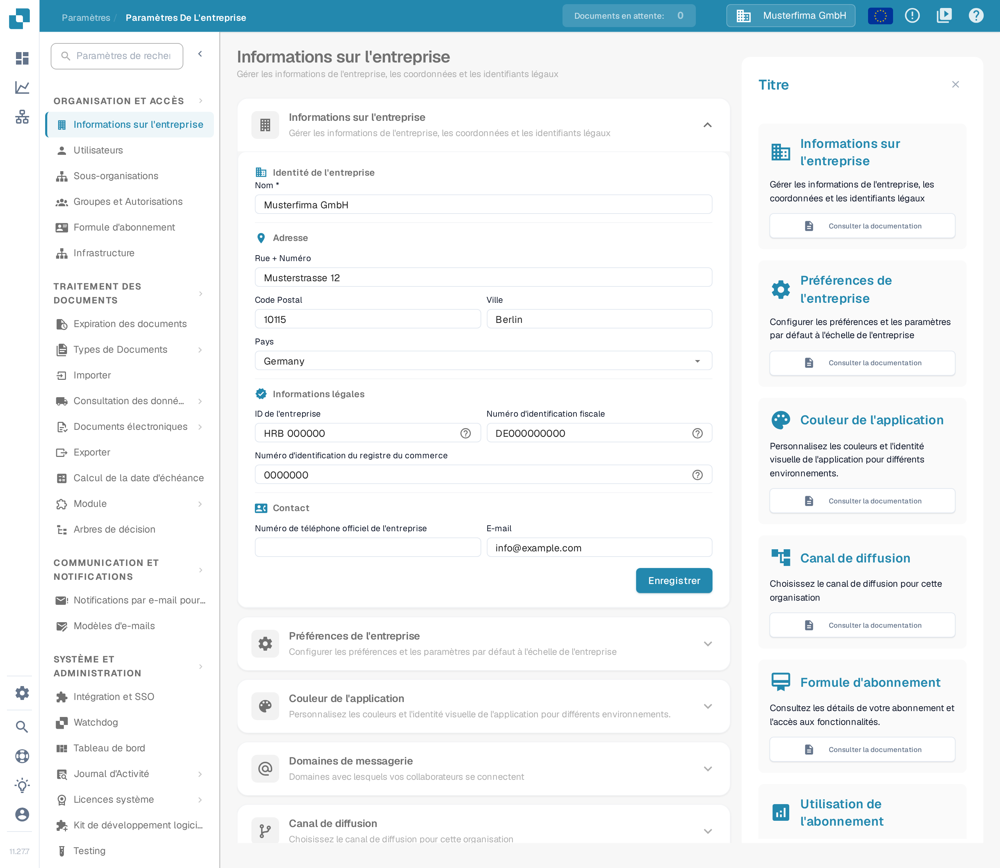
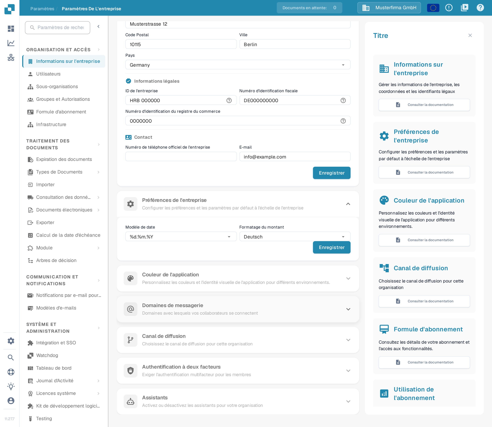
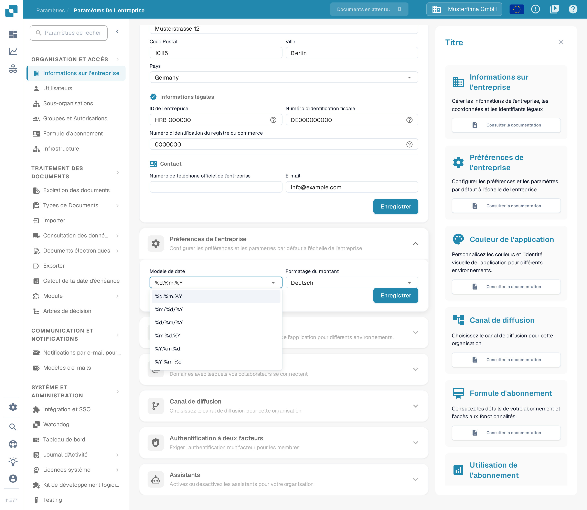
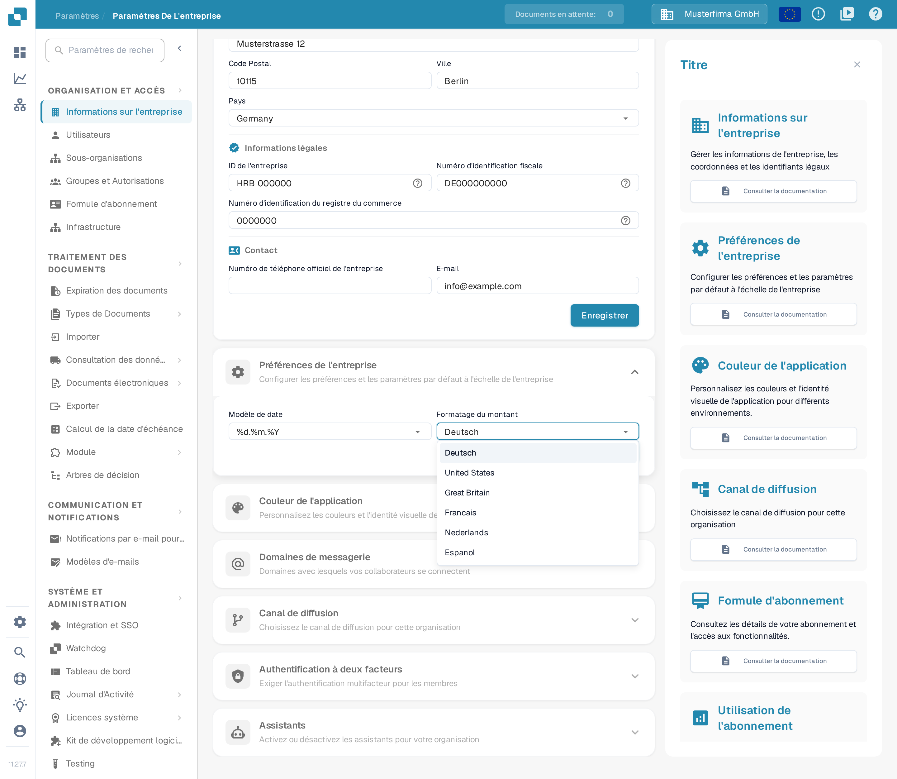
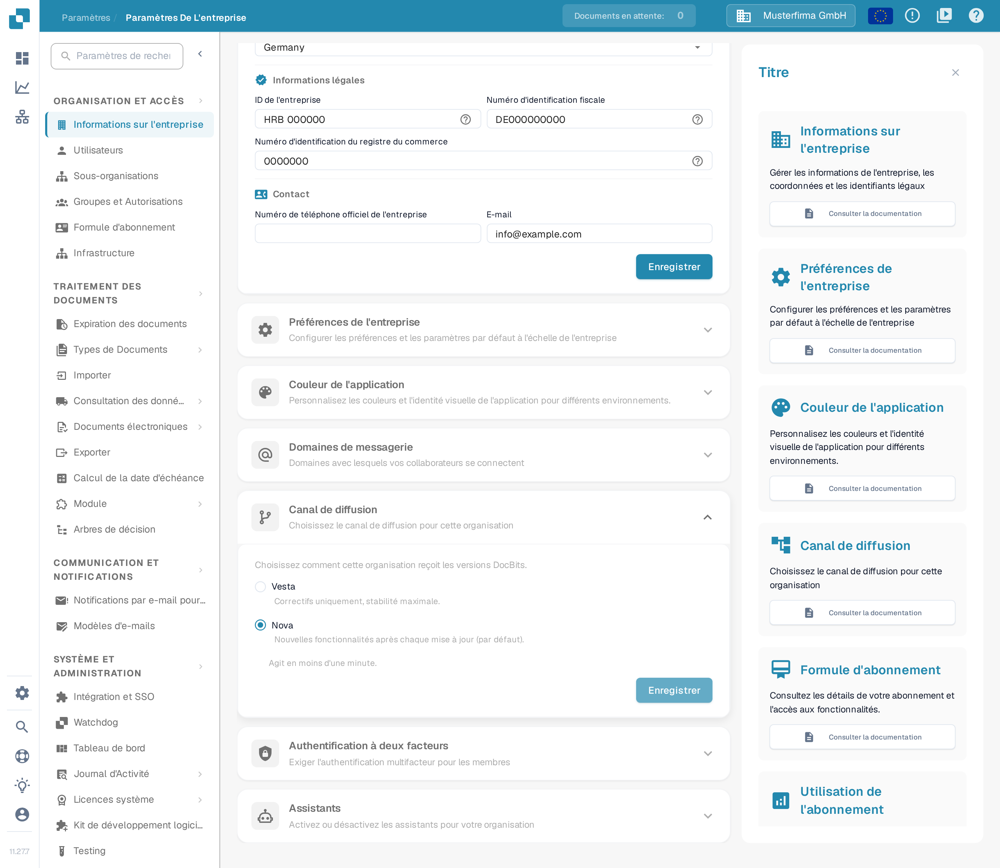

# Préférences de l’entreprise

## Tutoriel vidéo : entreprise, abonnement et audit


Informations sur l'entreprise, formule d'abonnement et journaux d'audit dans DocBits


La vidéo présente les informations et les préférences de l'entreprise, la formule d'abonnement, l'activité de connexion et les journaux d'audit.

Les préférences de l’entreprise déterminent la façon dont les dates et les montants sont affichés pour votre organisation. Vous les trouvez sous **Paramètres → Informations sur l'entreprise**. Dépliez **Préférences de l'entreprise** pour voir les deux réglages.

<figure><figcaption>
La page Informations sur l'entreprise. La section Préférences de l'entreprise se trouve plus bas.
</figcaption></figure>

<figure><figcaption>
Les deux préférences de l'entreprise et leur bouton Enregistrer. Les valeurs affichées (%d.%m.%Y et Deutsch) sont des données d'exemple inventées.
</figcaption></figure>

## Choisir un modèle de date

Ouvrez **Modèle de date** et choisissez l’ordre et le séparateur souhaités pour les dates affichées. Par exemple, `%d.%m.%Y` affiche le jour, le mois et l’année sur quatre chiffres, séparés par des points ; `%m/%d/%Y` place le mois en premier et utilise des barres obliques. La liste de DocBits affiche tous les modèles disponibles.

<figure><figcaption>
Choisissez un modèle de date adapté à votre organisation.
</figcaption></figure>

## Choisir le formatage du montant

Ouvrez **Formatage du montant** et choisissez le format régional utilisé par votre organisation. La liste contient notamment **Deutsch**, **United States**, **Great Britain**, **Francais**, ainsi que d’autres options.

<figure><figcaption>
Choisissez un format régional pour les montants.
</figcaption></figure>

Cliquez sur **Enregistrer** dans **Préférences de l'entreprise** après une modification. Ce bouton est distinct de celui de la section **Informations sur l'entreprise** située au-dessus.

## Canal de diffusion

L’ancien interrupteur **Nouvelle boîte de dialogue d'information sur la version** n’existe plus. DocBits détecte désormais automatiquement les nouvelles versions : aucune fenêtre ne vous est nécessaire pour rester à jour.

La livraison des versions est gérée par la section **Canal de diffusion**, sur la même page **Informations sur l'entreprise**. Choisissez comment votre organisation reçoit les versions DocBits : **Vesta** (correctifs uniquement, stabilité maximale) ou **Nova** (nouvelles fonctionnalités après chaque mise à jour, sélectionné par défaut). Lorsque l’API transmet cette information, la section indique aussi la version d’API que votre organisation exécute actuellement. Le changement agit en moins d’une minute.

<figure><figcaption>
La section Canal de diffusion avec les deux canaux de publication ; Nova est sélectionné dans cet exemple.
</figcaption></figure>
