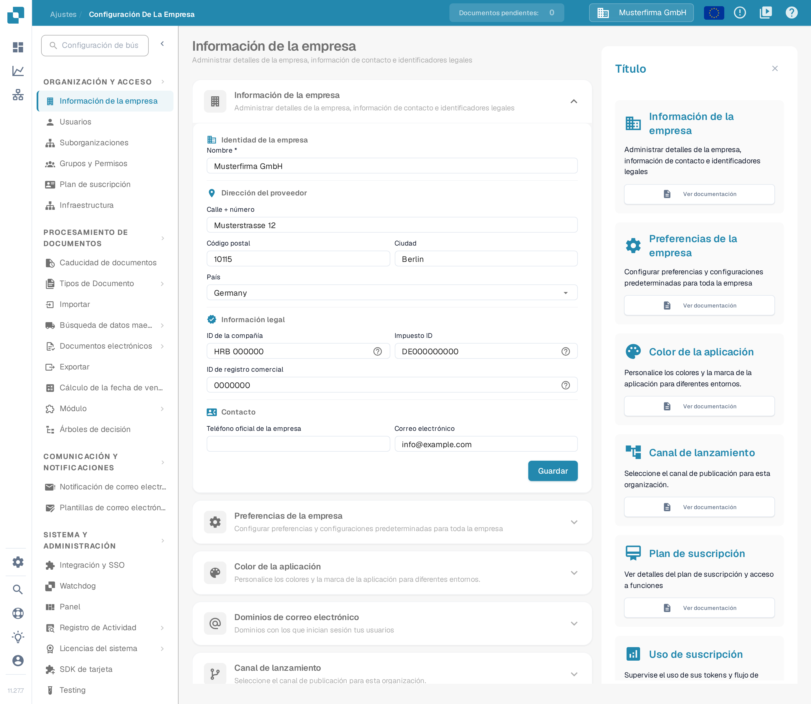
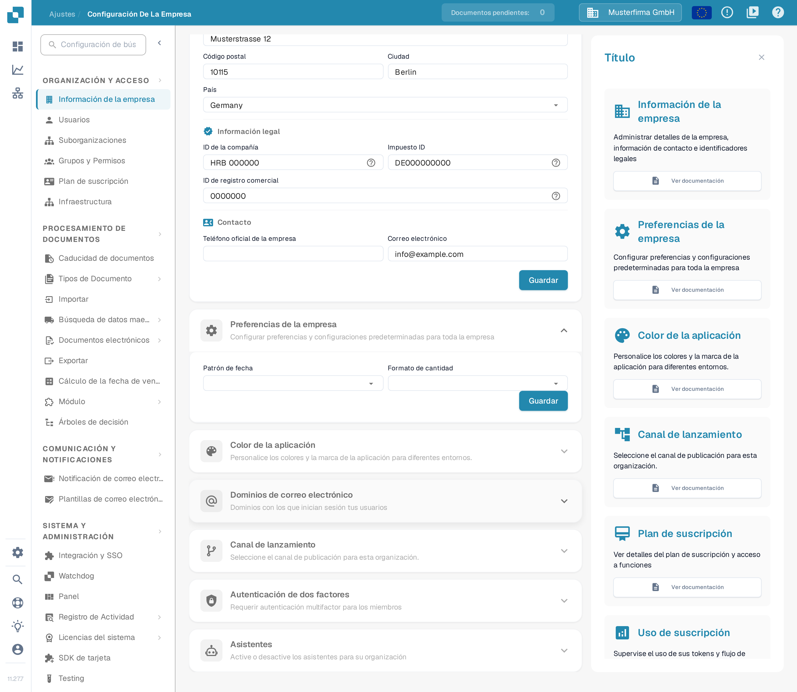
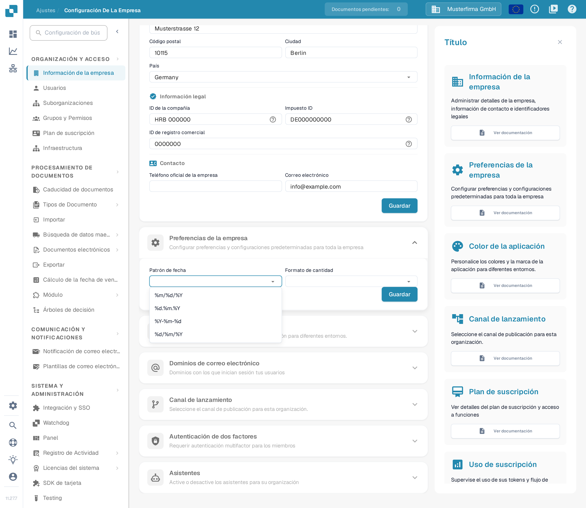
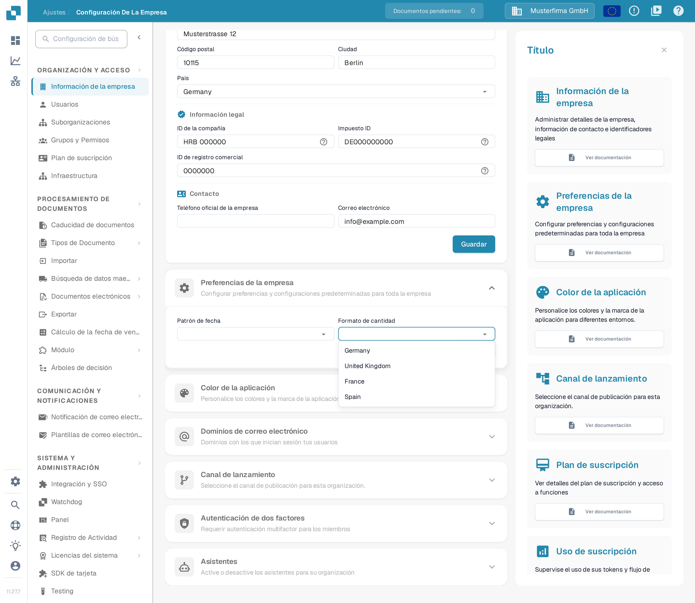
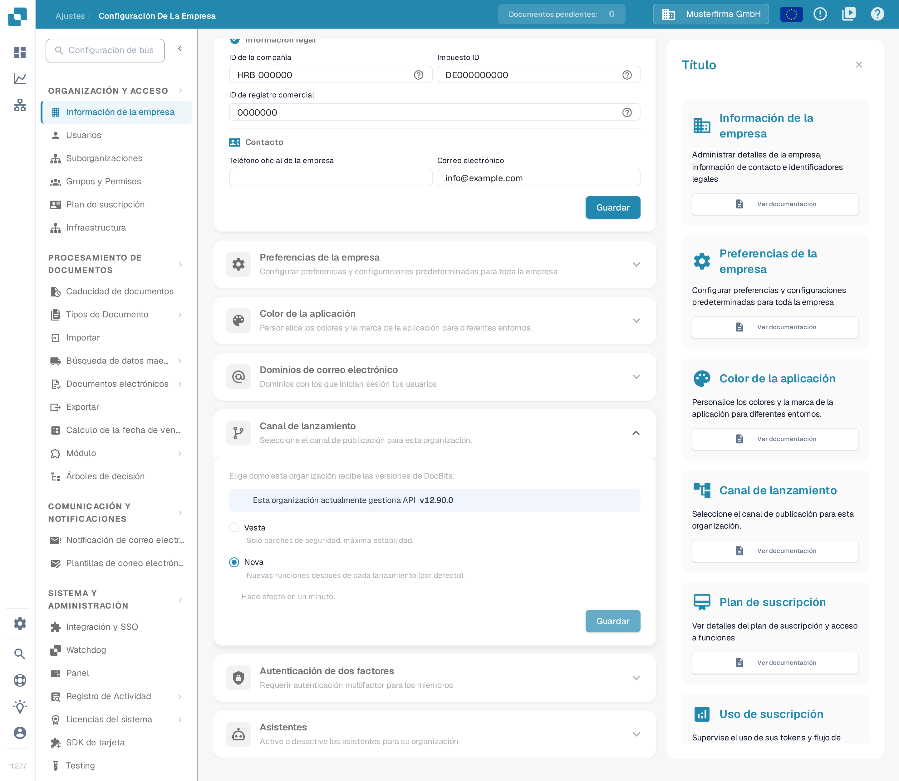

# Preferencias de la empresa

## Tutorial en vídeo: Empresa, suscripción y auditoría


Información de la empresa, plan de suscripción y registros de auditoría en DocBits


El vídeo muestra la información y las preferencias de la empresa, el plan de suscripción, la actividad de inicio de sesión y los registros de auditoría.

Las preferencias de la empresa determinan cómo se muestran las fechas y los importes en su organización. Las encontrará en **Ajustes → Información de la empresa**. Expanda **Preferencias de la empresa** para ver los dos ajustes.

<figure><figcaption>
La página Información de la empresa. Las Preferencias de la empresa son una sección más abajo.
</figcaption></figure>

Las capturas de esta página muestran datos de ejemplo inventados. Su organización muestra sus propios datos.

<figure><figcaption>
Los dos ajustes de las preferencias de la empresa y su propio botón Guardar.
</figcaption></figure>

## Elegir un patrón de fecha

Abra **Patrón de fecha** y elija el orden y el separador con los que desea ver las fechas. Por ejemplo, `%d.%m.%Y` muestra el día, el mes y el año con cuatro cifras, separados por puntos; `%m/%d/%Y` coloca primero el mes y usa barras. La lista del campo muestra todos los formatos disponibles.

<figure><figcaption>
Elija el patrón de fecha que utiliza su organización.
</figcaption></figure>

## Elegir el formato del importe

Abra **Formato de cantidad** y elija el formato regional que utiliza su organización. En la lista, los formatos aparecen con el nombre del país en inglés, por ejemplo **Germany**, **United Kingdom**, **France** y **Spain**.

<figure><figcaption>
Elija un formato regional para los importes.
</figcaption></figure>

Haga clic en **Guardar** dentro de **Preferencias de la empresa** después de cambiar un ajuste. Este botón es independiente del botón **Guardar** de **Información de la empresa**, que está más arriba.

## Canal de lanzamiento

El antiguo interruptor de aviso de nueva versión («New Version Info Dialog») ya no existe. DocBits detecta las nuevas versiones automáticamente, así que no necesita ninguna ventana emergente para estar al día.

La entrega de versiones se controla en la sección **Canal de lanzamiento** de la misma página **Información de la empresa**. Arriba, la tarjeta muestra la versión de API que su organización utiliza en ese momento, con el texto «Esta organización actualmente gestiona API». Debajo elige por qué vía recibe su organización las versiones de DocBits: **Vesta** (solo parches de seguridad, máxima estabilidad) o **Nova** (nuevas funciones después de cada lanzamiento, la opción por defecto). El cambio hace efecto en un minuto, según el aviso «Hace efecto en un minuto.» de la sección, y se guarda con el botón **Guardar** de la propia sección.

<figure><figcaption>
Elija Vesta o Nova y guarde el cambio en la propia sección. El número de versión de la captura es un dato de ejemplo inventado.
</figcaption></figure>
