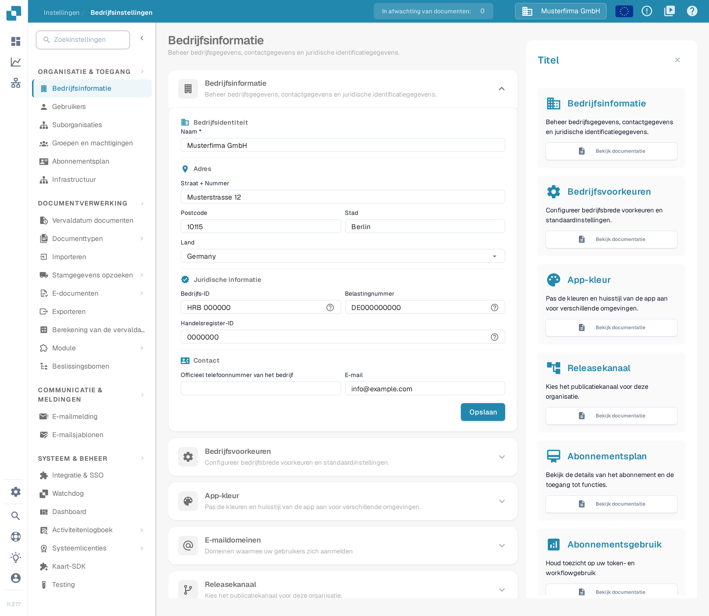
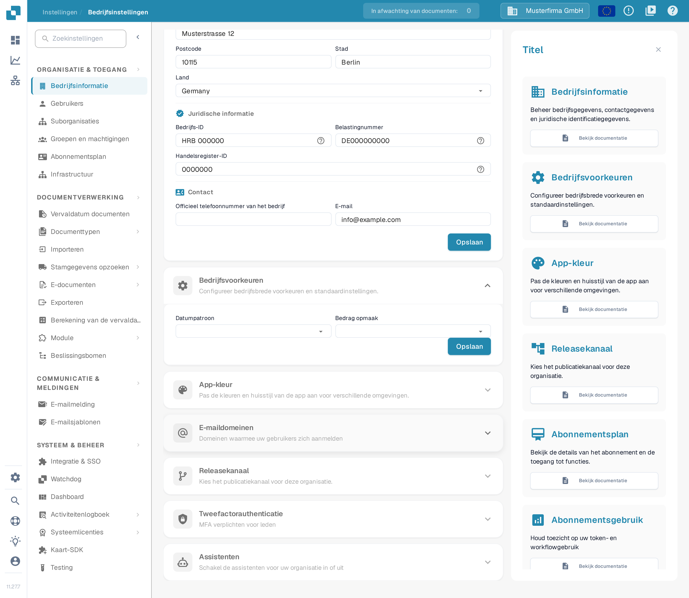
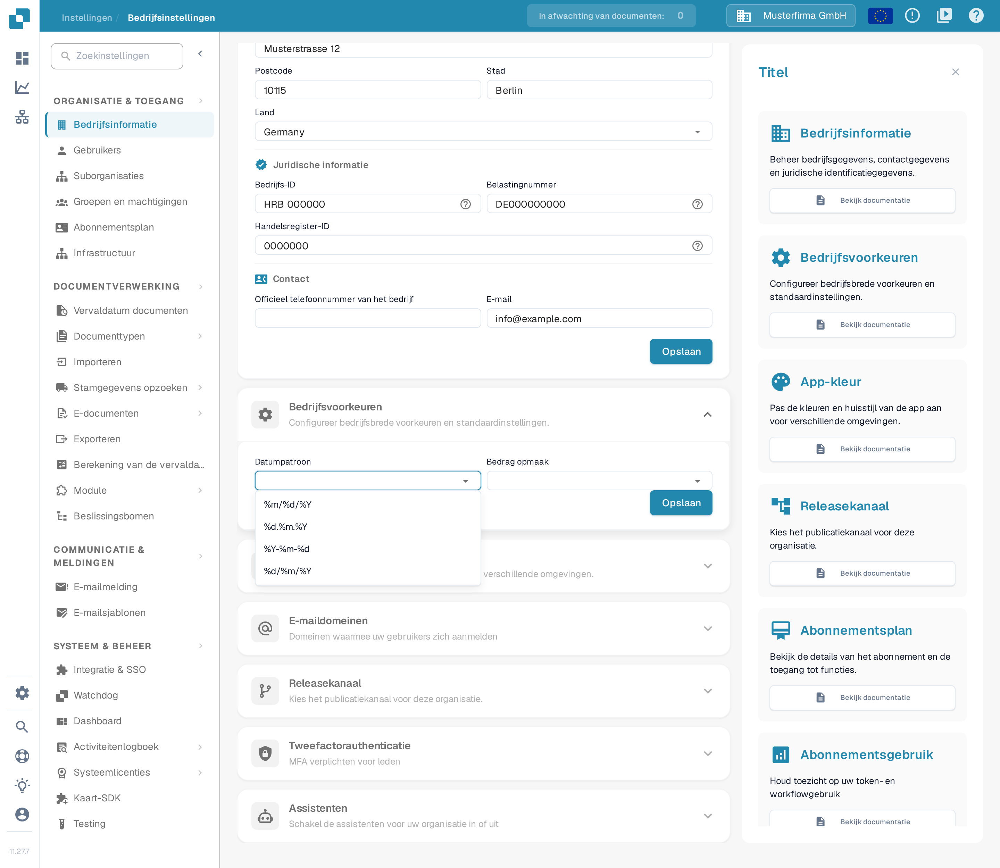
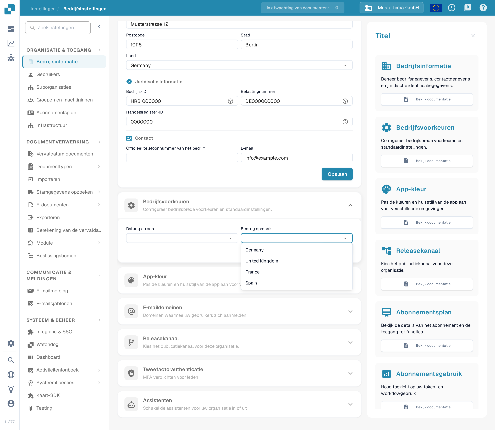
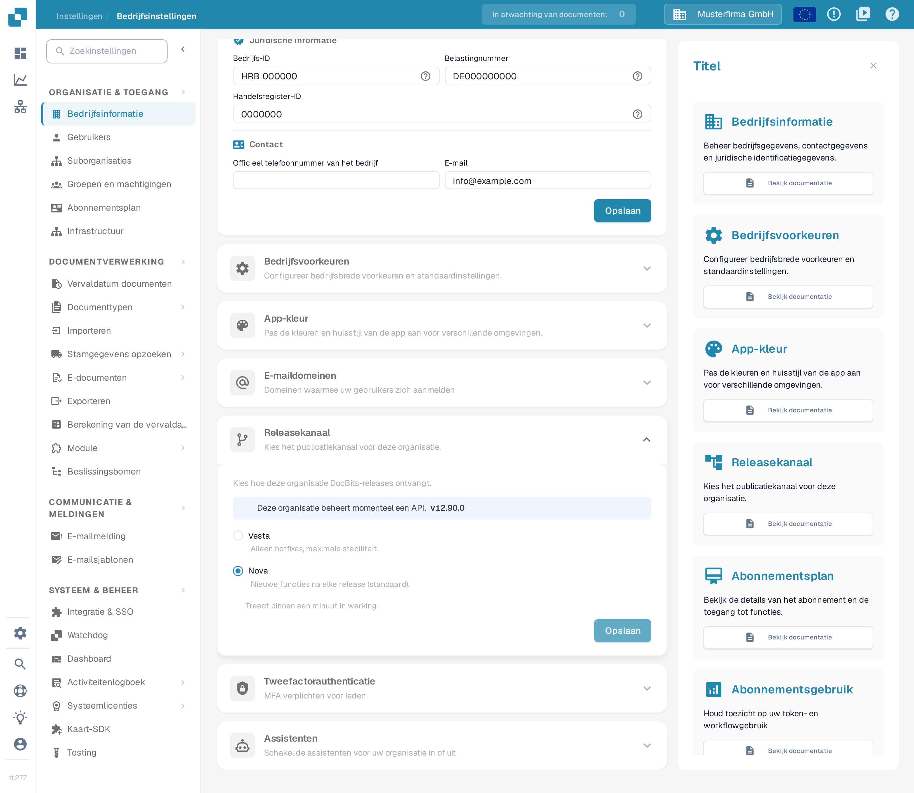

# Bedrijfsvoorkeuren

## Video-tutorial: bedrijf, abonnement en audit


Bedrijfsgegevens, abonnementsplan en auditlogboeken in DocBits


De video toont de bedrijfsgegevens en de bedrijfsvoorkeuren, het abonnementsplan, de inlogactiviteit en de auditlogboeken.

Met **Bedrijfsvoorkeuren** bepaalt u hoe datums en bedragen voor uw organisatie worden weergegeven. U vindt de sectie onder **Instellingen → Bedrijfsinformatie**. Vouw **Bedrijfsvoorkeuren** open om de twee instellingen te zien.

<figure><figcaption>
De pagina Bedrijfsinformatie. De sectie Bedrijfsvoorkeuren staat verder naar beneden.
</figcaption></figure>

<figure><figcaption>
De twee bedrijfsvoorkeuren en hun eigen knop Opslaan. In deze opname zijn beide keuzelijsten nog niet ingevuld.
</figcaption></figure>

## Een datumpatroon kiezen

Open **Datumpatroon** en kies de volgorde en het scheidingsteken die u voor weergegeven datums wilt. Zo toont `%d.%m.%Y` de dag, de maand en het jaar van vier cijfers, gescheiden door punten; `%m/%d/%Y` zet de maand vooraan en gebruikt schuine strepen. De lijst in DocBits toont alle beschikbare patronen.

<figure><figcaption>
Kies een datumpatroon dat bij uw organisatie past.
</figcaption></figure>

## De opmaak van bedragen kiezen

Open **Bedrag opmaak** en kies de regionale opmaak die uw organisatie gebruikt. In deze opname ziet u de voorbeeldvermeldingen **Germany**, **United Kingdom**, **France** en **Spain**; dat is verzonnen voorbeelddata. In een echte organisatie toont DocBits de volledige lijst met regionale indelingen.

<figure><figcaption>
Kies een regionale opmaak voor bedragen. De getoonde vermeldingen zijn voorbeeldgegevens.
</figcaption></figure>

Klik op **Opslaan** binnen **Bedrijfsvoorkeuren** nadat u iets hebt gewijzigd. Deze knop staat los van de knop Opslaan in de sectie **Bedrijfsinformatie** erboven.

## Releasekanaal

De oude schakelaar voor de melding over een nieuwe versie bestaat niet meer. DocBits herkent nieuwe versies nu automatisch, dus u hebt geen pop-up nodig om op de hoogte te blijven.

De versieverdeling verloopt via de sectie **Releasekanaal** op dezelfde pagina **Bedrijfsinformatie**. Daar ziet u hoe uw organisatie DocBits-releases ontvangt en welke keuze geldt: **Vesta** (alleen hotfixes, maximale stabiliteit) of **Nova** (nieuwe functies na elke release, standaard geselecteerd). Wanneer de API deze informatie doorgeeft, toont de sectie ook de API-versie die uw organisatie op dit moment gebruikt; het versienummer in de afbeelding hieronder is verzonnen voorbeelddata. Een wijziging treedt binnen een minuut in werking.

<figure><figcaption>
De sectie Releasekanaal met de twee releasekanalen; in dit voorbeeld is Nova geselecteerd en is het versienummer verzonnen data.
</figcaption></figure>
