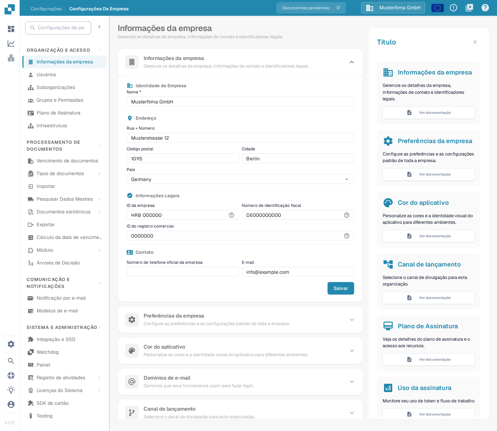
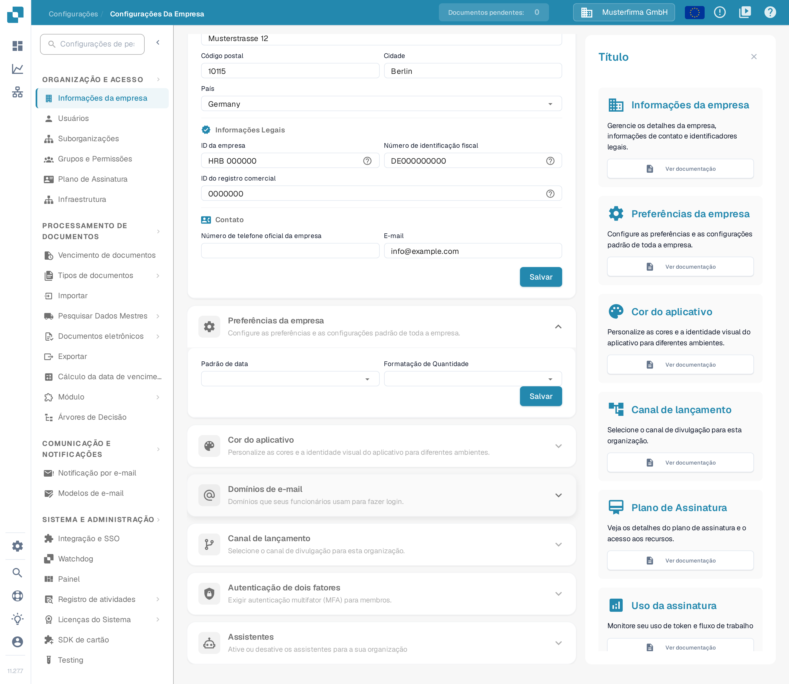
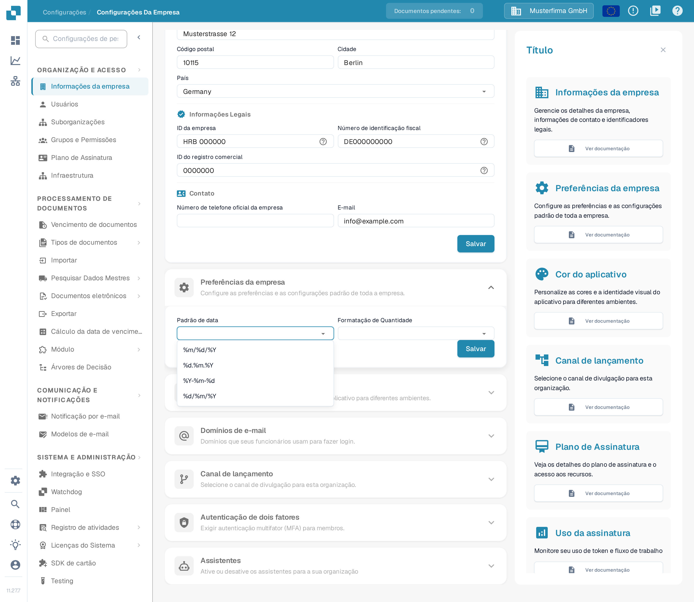
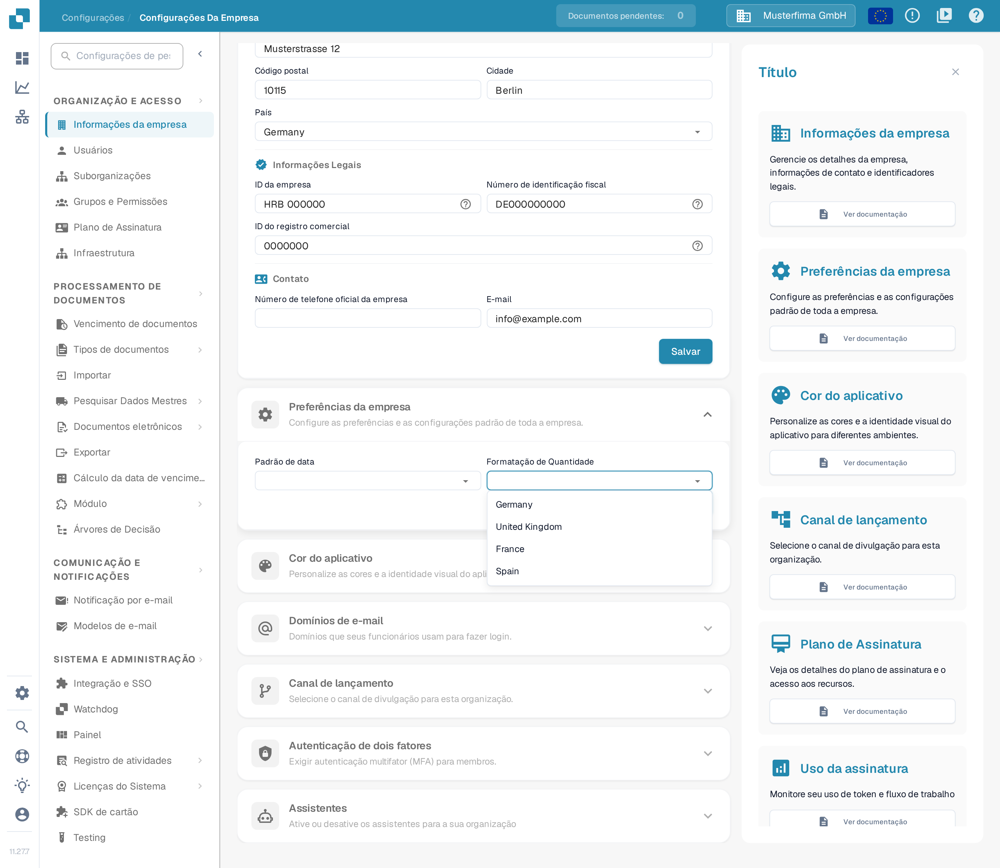
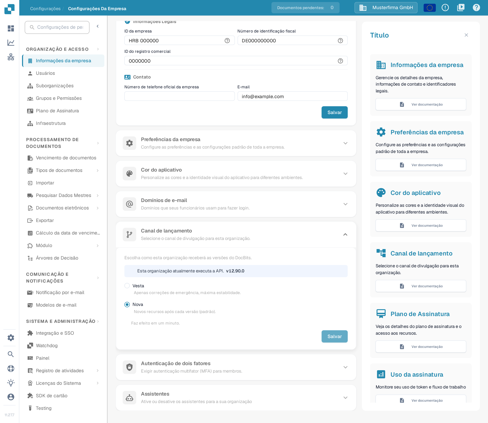

# Preferências da empresa

## Vídeo tutorial: Empresa, assinatura e auditoria


Informações da empresa, plano de assinatura e registos de auditoria no DocBits


O vídeo mostra as informações e as preferências da empresa, o plano de assinatura, a atividade de início de sessão e os registos de auditoria.

As **Preferências da empresa** definem como as datas e os montantes são apresentados na sua organização. Encontra a secção em **Configurações → Informações da empresa**: expanda **Preferências da empresa** para ver as duas definições.

<figure><figcaption>
A página Informações da empresa. A secção Preferências da empresa fica mais abaixo.
</figcaption></figure>

<figure><figcaption>
As duas preferências da empresa e o respetivo botão Salvar. Nesta captura, as duas listas de seleção ainda não têm valor escolhido.
</figcaption></figure>

## Escolher um padrão de data

Abra **Padrão de data** e escolha a ordem e o separador que pretende para as datas apresentadas. Por exemplo, `%d.%m.%Y` mostra o dia, o mês e o ano com quatro dígitos, separados por pontos; `%m/%d/%Y` coloca o mês à frente e usa barras. A lista no DocBits mostra todos os padrões disponíveis.

<figure><figcaption>
Escolha um padrão de data adequado à sua organização.
</figcaption></figure>

## Escolher a formatação de montantes

Abra **Formatação de Quantidade** e escolha o formato regional que a sua organização utiliza. Nesta captura vê as entradas de exemplo **Germany**, **United Kingdom**, **France** e **Spain**; trata-se de dados de exemplo inventados. Numa organização real, o DocBits apresenta a lista completa de formatos regionais.

<figure><figcaption>
Escolha um formato regional para os montantes. As entradas apresentadas são dados de exemplo.
</figcaption></figure>

Clique em **Salvar** dentro de **Preferências da empresa** depois de alterar um valor. Este botão é independente do botão Salvar da secção **Informações da empresa**, acima.

## Canal de lançamento

O antigo interruptor da janela de informação sobre novas versões já não existe. O DocBits deteta agora novas versões automaticamente, pelo que não precisa de uma janela pop-up para se manter atualizado.

A entrega de versões é feita na secção **Canal de lançamento**, na mesma página **Informações da empresa**. Aí vê como a sua organização recebe as versões do DocBits e qual das opções se aplica: **Vesta** (apenas correções de emergência, estabilidade máxima) ou **Nova** (novos recursos após cada versão, a opção predefinida). Quando a API comunica essa informação, a secção mostra também a versão da API que a sua organização utiliza atualmente; o número de versão que aparece na imagem abaixo é um dado de exemplo inventado. Uma alteração faz efeito num minuto.

<figure><figcaption>
A secção Canal de lançamento com os dois canais; neste exemplo está selecionado Nova e o número de versão é um dado inventado.
</figcaption></figure>
