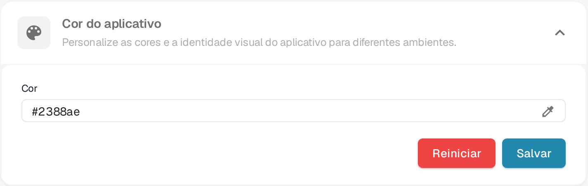

# Definindo a Cor do App nas Configurações da Empresa

## Visão Geral

A configuração de **App-Color** permite que os administradores definam o esquema de cores da interface do aplicativo. Este recurso é particularmente útil para distinguir entre diferentes ambientes, como teste, sandbox e produção. Ao atribuir cores distintas a cada ambiente, os usuários podem identificar facilmente em qual ambiente estão trabalhando, reduzindo o risco de realizar ações críticas no ambiente errado.

<figure><figcaption>
Cor do aplicativo em Configurações → Configurações da empresa
</figcaption></figure>

## Acessando a Configuração de App-Color

1. **Navegue até as Configurações da Empresa**:
   * Vá para **Configurações** → **Configurações da empresa**.
2. **Localize a Seção de App-Color**:
   * Expanda a seção **Cor do aplicativo** (*Personalize as cores e a identidade visual do aplicativo para diferentes ambientes*).

## Definindo a Cor do App

1. **Escolha uma Cor**:
   * Clique no ícone de conta-gotas à direita do campo **Cor**. O seletor de cores é aberto.
   * Escolha a cor desejada. O campo **Cor** mostra o valor hexadecimal da cor selecionada.
2. **Salve a Cor**:
   * Depois de selecionar a cor, clique no botão **Salvar** para aplicar a alteração.
   * A interface do aplicativo passa para a nova cor imediatamente.
3. **Redefinir para o Padrão**:
   * Clique em **Reiniciar** para voltar à cor padrão, **#2388AE**. A cor padrão é salva na hora, não é preciso mais nada.

## Melhores Práticas para Cores de Ambiente

Para evitar confusões, é recomendável estabelecer um esquema de cores padrão para cada ambiente:

* **Produção**: Use uma cor neutra ou padrão, como **#FFFFFF** (branco) ou **#f0f0f0** (cinza claro), para indicar o ambiente ao vivo.
* **Teste**: Use uma cor brilhante ou de alerta, como **#ffcc00** (amarelo) ou **#ffa500** (laranja), para indicar um ambiente de teste.
* **Sandbox**: Use uma cor distinta, como **#007bff** (azul) ou **#6c757d** (cinza), para indicar um ambiente de sandbox ou desenvolvimento.

## Assinatura

Os dados da assinatura ficam em uma página própria nas configurações; não fazem parte desta seção.

## Importância do App-Color

A configuração de App-Color é uma ferramenta simples, mas eficaz, para ajudar os usuários a reconhecer rapidamente o ambiente em que estão trabalhando. Ao selecionar e gerenciar cuidadosamente essas cores, as organizações podem minimizar erros e melhorar a eficiência do fluxo de trabalho.
