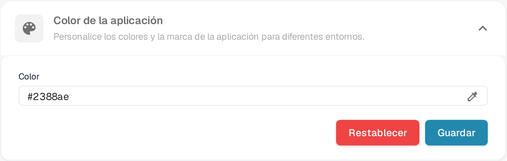

# Definir el Color de la Aplicación en la Configuración de la Empresa

## Descripción General

La configuración de **Color de la Aplicación** permite a los administradores definir el esquema de color de la interfaz de la aplicación. Esta función es particularmente útil para distinguir entre diferentes entornos como pruebas, sandbox y producción. Al asignar colores distintos a cada entorno, los usuarios pueden identificar fácilmente en qué entorno están trabajando, reduciendo el riesgo de realizar acciones críticas en el entorno equivocado.

<figure><figcaption>
Color de la aplicación en Ajustes → Configuración de la empresa
</figcaption></figure>

## Acceder a la Configuración de Color de la Aplicación

1. **Navegar a la Configuración de la Empresa**:
   * Ve a **Ajustes** → **Configuración de la empresa**.
2. **Localizar la Sección de Color de la Aplicación**:
   * Despliega la sección **Color de la aplicación** (*Personalice los colores y la marca de la aplicación para diferentes entornos*).

## Establecer el Color de la Aplicación

1. **Elegir un Color**:
   * Haz clic en el icono del cuentagotas a la derecha del campo **Color**. Se abre el selector de color.
   * Elige el color que quieras. El campo **Color** muestra el valor hexadecimal del color seleccionado.
2. **Guardar el Color**:
   * Una vez que haya seleccionado el color, haga clic en el botón **Guardar** para aplicar el cambio.
   * La interfaz de la aplicación se actualiza al nuevo color de inmediato.
3. **Restablecer a Predeterminado**:
   * Haz clic en **Restablecer** para volver al color predeterminado, **#2388AE**. El valor predeterminado se guarda de inmediato, no hace falta nada más.

## Mejores Prácticas para Colores de Entorno

Para evitar confusiones, se recomienda establecer un esquema de color estándar para cada entorno:

* **Producción**: Use un color neutral o predeterminado, como **#FFFFFF** (blanco) o **#f0f0f0** (gris claro), para indicar el entorno en vivo.
* **Pruebas**: Use un color brillante o de alerta, como **#ffcc00** (amarillo) o **#ffa500** (naranja), para indicar un entorno de pruebas.
* **Sandbox**: Use un color distinto, como **#007bff** (azul) o **#6c757d** (gris), para indicar un entorno de sandbox o desarrollo.

## Suscripción

Los datos de la suscripción están en una página propia dentro de los ajustes; no forman parte de esta sección.

## Importancia del Color de la Aplicación

La configuración de Color de la Aplicación es una herramienta simple pero efectiva para ayudar a los usuarios a reconocer rápidamente el entorno en el que están trabajando. Al seleccionar y gestionar cuidadosamente estos colores, las organizaciones pueden minimizar errores y mejorar la eficiencia del flujo de trabajo.
