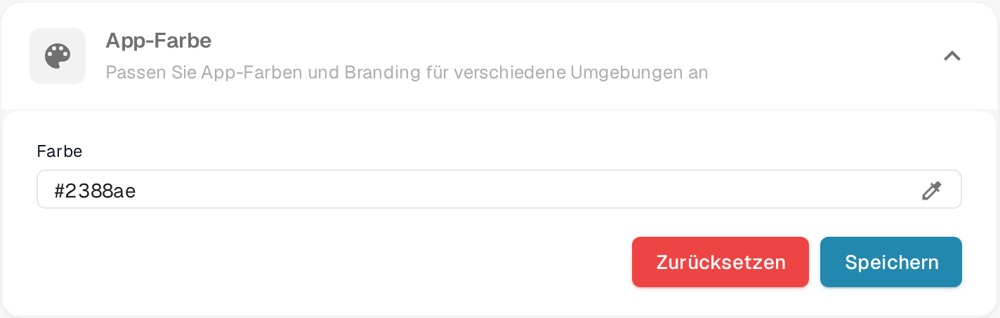

# Definieren der App-Farbe in den Unternehmens-Einstellungen

## Übersicht

Die **App-Farbe**-Einstellung ermöglicht es Administratoren, das Farbschema der Benutzeroberfläche der Anwendung festzulegen. Diese Funktion ist besonders nützlich, um zwischen verschiedenen Umgebungen wie Test, Sandbox und Produktion zu unterscheiden. Durch die Zuweisung unterschiedlicher Farben zu jeder Umgebung können Benutzer leicht erkennen, in welcher Umgebung sie arbeiten, wodurch das Risiko verringert wird, kritische Aktionen in der falschen Umgebung auszuführen.

<figure><figcaption>
App-Farbe unter Einstellungen → Unternehmenseinstellungen
</figcaption></figure>

## Zugriff auf die App-Farbe-Einstellung

1. **Navigieren zu den Unternehmens-Einstellungen**:
   * Gehen Sie zu **Einstellungen** → **Unternehmenseinstellungen**.
2. **Finden Sie den App-Farbe-Bereich**:
   * Klappen Sie den Abschnitt **App-Farbe** auf (*Passen Sie App-Farben und Branding für verschiedene Umgebungen an*).

## Festlegen der App-Farbe

1. **Wählen Sie eine Farbe**:
   * Klicken Sie auf das Pipettensymbol rechts neben dem Feld **Farbe**. Die Farbauswahl öffnet sich.
   * Wählen Sie die gewünschte Farbe aus. Das Feld **Farbe** zeigt den Hex-Wert der aktuell gewählten Farbe.
2. **Farbe speichern**:
   * Nachdem Sie die Farbe ausgewählt haben, klicken Sie auf die Schaltfläche **Speichern**, um die Änderung anzuwenden.
   * Die Benutzeroberfläche der Anwendung wird sofort auf die neue Farbe umgestellt.
3. **Auf Standard zurücksetzen**:
   * Klicken Sie auf **Zurücksetzen**, um die Standardfarbe **#2388AE** wiederherzustellen. Die Standardfarbe wird sofort gespeichert, weitere Schritte sind nicht nötig.

## Best Practices für Umgebungsfarben

Um Verwirrung zu vermeiden, wird empfohlen, ein standardisiertes Farbschema für jede Umgebung festzulegen:

* **Produktion**: Verwenden Sie eine neutrale oder Standardfarbe, wie **#FFFFFF** (weiß) oder **#f0f0f0** (hellgrau), um die Live-Umgebung anzuzeigen.
* **Test**: Verwenden Sie eine helle oder alarmierende Farbe, wie **#ffcc00** (gelb) oder **#ffa500** (orange), um eine Testumgebung anzuzeigen.
* **Sandbox**: Verwenden Sie eine auffällige Farbe, wie **#007bff** (blau) oder **#6c757d** (grau), um eine Sandbox- oder Entwicklungsumgebung anzuzeigen.

## Abonnement

Die Angaben zum Abonnement stehen auf einer eigenen Seite in den Einstellungen; sie sind nicht Teil dieses Abschnitts.

## Bedeutung der App-Farbe

Die App-Farbe-Einstellung ist ein einfaches, aber effektives Werkzeug, um Benutzern zu helfen, die Umgebung, in der sie arbeiten, schnell zu erkennen. Durch sorgfältige Auswahl und Verwaltung dieser Farben können Organisationen Fehler minimieren und die Effizienz des Workflows verbessern.
