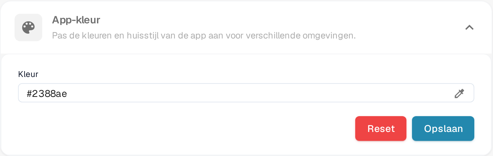

# Het definiëren van App-kleur in Bedrijfsinstellingen

## Overzicht

De **App-kleur** instelling stelt beheerders in staat om het kleurenschema van de applicatie-interface te definiëren. Deze functie is bijzonder nuttig om onderscheid te maken tussen verschillende omgevingen zoals testen, sandbox en productie. Door verschillende kleuren aan elke omgeving toe te wijzen, kunnen gebruikers gemakkelijk identificeren in welke omgeving ze werken, waardoor het risico op het uitvoeren van kritieke acties in de verkeerde omgeving wordt verminderd.

<figure><figcaption>
App-kleur onder Instellingen → Bedrijfsinstellingen
</figcaption></figure>

## Toegang tot de App-kleur Instelling

1. **Navigeer naar Bedrijfsinstellingen**:
   * Ga naar **Instellingen** → **Bedrijfsinstellingen**.
2. **Zoek de App-kleur Sectie**:
   * Klap de sectie **App-kleur** open (*Pas de kleuren en huisstijl van de app aan voor verschillende omgevingen*).

## De App-kleur Instellen

1. **Kies een Kleur**:
   * Klik op het pipet-pictogram rechts van het veld **Kleur**. De kleurenkiezer opent.
   * Kies de gewenste kleur. Het veld **Kleur** toont de hex-waarde van de gekozen kleur.
2. **Sla de Kleur op**:
   * Zodra je de kleur hebt geselecteerd, klik je op de **Opslaan** knop om de wijziging toe te passen.
   * De applicatie-interface schakelt direct over op de nieuwe kleur.
3. **Reset naar Standaard**:
   * Klik op **Reset** om terug te gaan naar de standaardkleur **#2388AE**. De standaardkleur wordt direct opgeslagen, er is niets anders nodig.

## Beste Praktijken voor Omgevingskleuren

Om verwarring te voorkomen, wordt aanbevolen om een standaard kleurenschema voor elke omgeving vast te stellen:

* **Productie**: Gebruik een neutrale of standaardkleur, zoals **#FFFFFF** (wit) of **#f0f0f0** (lichtgrijs), om de live omgeving aan te geven.
* **Testen**: Gebruik een heldere of waarschuwingskleur, zoals **#ffcc00** (geel) of **#ffa500** (oranje), om een testomgeving aan te geven.
* **Sandbox**: Gebruik een onderscheidende kleur, zoals **#007bff** (blauw) of **#6c757d** (grijs), om een sandbox of ontwikkelomgeving aan te geven.

## Abonnement

De abonnementsgegevens staan op een aparte pagina in de instellingen; ze horen niet bij deze sectie.

## Belang van App-kleur

De App-kleur instelling is een eenvoudige maar effectieve tool om gebruikers te helpen snel de omgeving te herkennen waarin ze werken. Door deze kleuren zorgvuldig te selecteren en te beheren, kunnen organisaties fouten minimaliseren en de workflow-efficiëntie verbeteren.
