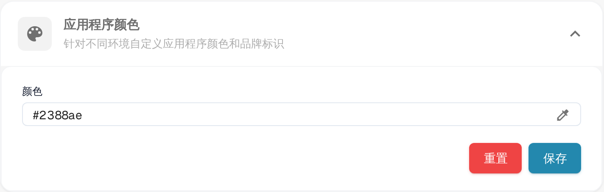

# 在公司设置中定义应用颜色

## 概述

**App Color** 设置允许管理员定义应用程序界面的配色方案。此功能尤其适用于区分测试、沙盒和生产等不同环境。为每个环境分配不同的颜色后，用户可以轻松识别当前所处的环境，从而降低在错误环境中执行关键操作的风险。

<figure><figcaption>
设置 → 公司设置中的应用程序颜色
</figcaption></figure>

## 访问 App Color 设置

1. **导航至公司设置**：
   * 前往**设置** → **公司设置**。
2. **找到 App Color 部分**：
   * 展开**应用程序颜色**部分（*针对不同环境自定义应用程序颜色和品牌标识*）。

## 设置 App Color

1. **选择颜色**：
   * 点击**颜色**字段右侧的吸管图标，打开颜色选择器。
   * 选择所需颜色。**颜色**字段显示当前所选颜色的十六进制值。
2. **保存颜色**：
   * 选择颜色后，点击**保存**按钮以应用更改。
   * 应用程序界面会立即切换为新颜色。
3. **重置为默认值**：
   * 点击**重置**可恢复默认颜色 **#2388AE**。默认颜色会立即保存，无需其他操作。

## 环境颜色最佳实践

为避免混淆，建议为每种环境制定标准配色方案：

* **生产环境**：使用中性或默认颜色，例如 **#FFFFFF**（白色）或 **#f0f0f0**（浅灰色），表示线上环境。
* **测试环境**：使用鲜艳或醒目的颜色，例如 **#ffcc00**（黄色）或 **#ffa500**（橙色），表示测试环境。
* **沙盒环境**：使用具有辨识度的颜色，例如 **#007bff**（蓝色）或 **#6c757d**（灰色），表示沙盒或开发环境。

## 订阅

订阅信息位于设置中的单独页面，不属于本部分。

## App Color 的重要性

App Color 设置是一种简单而有效的工具，可帮助用户快速识别当前所处的环境。通过谨慎选择和管理这些颜色，组织可以减少错误并提高工作流效率。
