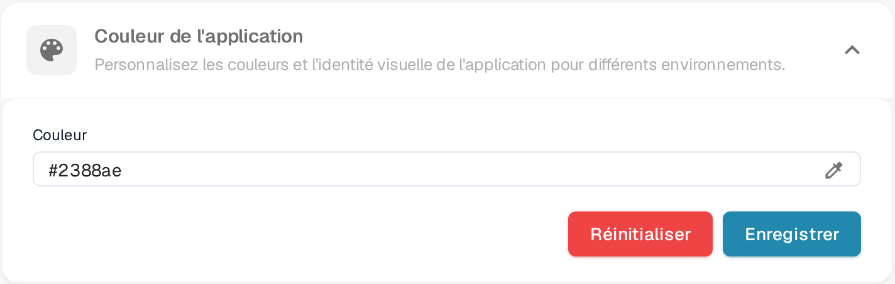

# Définir la couleur de l'application dans les paramètres de l'entreprise

## Aperçu

Le paramètre **App-couleur** permet aux administrateurs de définir le schéma de couleurs de l'interface de l'application. Cette fonctionnalité est particulièrement utile pour distinguer les différents environnements tels que le test, le bac à sable et la production. En attribuant des couleurs distinctes à chaque environnement, les utilisateurs peuvent facilement identifier dans quel environnement ils travaillent, réduisant ainsi le risque d'effectuer des actions critiques dans le mauvais environnement.

<figure><figcaption>
Couleur de l'application dans Paramètres → Paramètres de l'entreprise
</figcaption></figure>

## Accéder au paramètre de couleur de l'application

1. **Naviguer vers les paramètres de l'entreprise** :
   * Allez dans **Paramètres** → **Paramètres de l'entreprise**.
2. **Localiser la section App-couleur** :
   * Dépliez la section **Couleur de l'application** (*Personnalisez les couleurs et l'identité visuelle de l'application pour différents environnements*).

## Définir la couleur de l'application

1. **Choisir une couleur** :
   * Cliquez sur l'icône pipette à droite du champ **Couleur**. Le sélecteur de couleur s'ouvre.
   * Choisissez la couleur souhaitée. Le champ **Couleur** affiche la valeur hexadécimale de la couleur actuellement sélectionnée.
2. **Enregistrer la couleur** :
   * Une fois que vous avez sélectionné la couleur, cliquez sur le bouton **Enregistrer** pour appliquer le changement.
   * L'interface de l'application passe immédiatement à la nouvelle couleur.
3. **Réinitialiser par défaut** :
   * Cliquez sur **Réinitialiser** pour revenir à la couleur par défaut, **#2388AE**. La couleur par défaut est enregistrée immédiatement, aucune autre action n'est nécessaire.

## Meilleures pratiques pour les couleurs des environnements

Pour éviter toute confusion, il est recommandé d'établir un schéma de couleurs standard pour chaque environnement :

* **Production** : Utilisez une couleur neutre ou par défaut, telle que **#FFFFFF** (blanc) ou **#f0f0f0** (gris clair), pour indiquer l'environnement en direct.
* **Test** : Utilisez une couleur vive ou d'alerte, telle que **#ffcc00** (jaune) ou **#ffa500** (orange), pour indiquer un environnement de test.
* **Bac à sable** : Utilisez une couleur distincte, telle que **#007bff** (bleu) ou **#6c757d** (gris), pour indiquer un environnement de bac à sable ou de développement.

## Abonnement

Les informations d'abonnement se trouvent sur une page distincte dans les paramètres ; elles ne font pas partie de cette section.

## Importance de la couleur de l'application

Le paramètre de couleur de l'application est un outil simple mais efficace pour aider les utilisateurs à reconnaître rapidement l'environnement dans lequel ils travaillent. En sélectionnant et en gérant soigneusement ces couleurs, les organisations peuvent minimiser les erreurs et améliorer l'efficacité du flux de travail.
