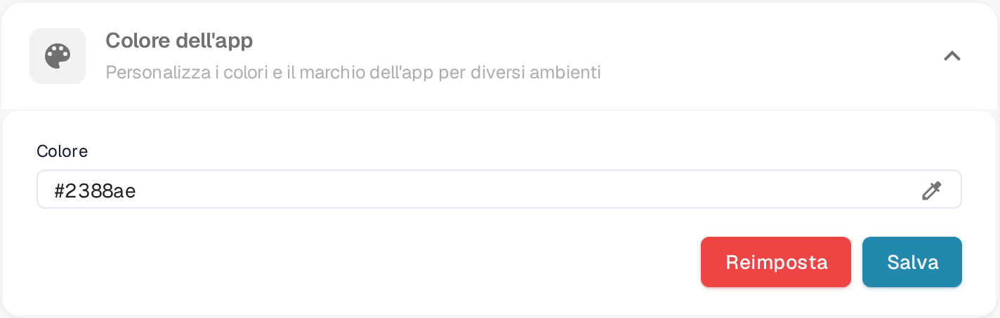

# Definire il Colore dell'App nelle Impostazioni della Società

## Panoramica

L'impostazione **App Color** consente agli amministratori di definire la combinazione di colori dell'interfaccia dell'applicazione. Questa funzionalità è particolarmente utile per distinguere tra diversi ambienti come testing, sandbox e produzione. Assegnando colori distinti a ciascun ambiente, gli utenti possono facilmente identificare in quale ambiente stanno lavorando, riducendo il rischio di eseguire azioni critiche nell'ambiente sbagliato.

<figure><figcaption>
Colore dell'app in Impostazioni → Impostazioni aziendali
</figcaption></figure>

## Accesso all'Impostazione del Colore dell'App

1. **Navigare nelle Impostazioni della Società**:
   * Vai su **Impostazioni** → **Impostazioni aziendali**.
2. **Individuare la Sezione Colore dell'App**:
   * Espandi la sezione **Colore dell'app** (*Personalizza i colori e il marchio dell'app per diversi ambienti*).

## Impostare il Colore dell'App

1. **Scegliere un Colore**:
   * Fai clic sull'icona del contagocce a destra del campo **Colore**. Si apre il selettore dei colori.
   * Scegli il colore desiderato. Il campo **Colore** mostra il valore esadecimale del colore selezionato.
2. **Salvare il Colore**:
   * Una volta selezionato il colore, fai clic sul pulsante **Salva** per applicare la modifica.
   * L'interfaccia dell'applicazione passa subito al nuovo colore.
3. **Ripristina il Predefinito**:
   * Fai clic su **Reimposta** per tornare al colore predefinito, **#2388AE**. Il valore predefinito viene salvato subito, non serve altro.

## Migliori Pratiche per i Colori degli Ambienti

Per evitare confusione, si raccomanda di stabilire uno schema di colori standard per ciascun ambiente:

* **Produzione**: Usa un colore neutro o predefinito, come **#FFFFFF** (bianco) o **#f0f0f0** (grigio chiaro), per indicare l'ambiente live.
* **Testing**: Usa un colore brillante o di avviso, come **#ffcc00** (giallo) o **#ffa500** (arancione), per indicare un ambiente di testing.
* **Sandbox**: Usa un colore distintivo, come **#007bff** (blu) o **#6c757d** (grigio), per indicare un ambiente sandbox o di sviluppo.

## Abbonamento

I dati dell'abbonamento si trovano in una pagina dedicata nelle impostazioni; non fanno parte di questa sezione.

## Importanza del Colore dell'App

L'impostazione del Colore dell'App è uno strumento semplice ma efficace per aiutare gli utenti a riconoscere rapidamente l'ambiente in cui stanno lavorando. Selezionando e gestendo attentamente questi colori, le organizzazioni possono ridurre al minimo gli errori e migliorare l'efficienza del flusso di lavoro.
