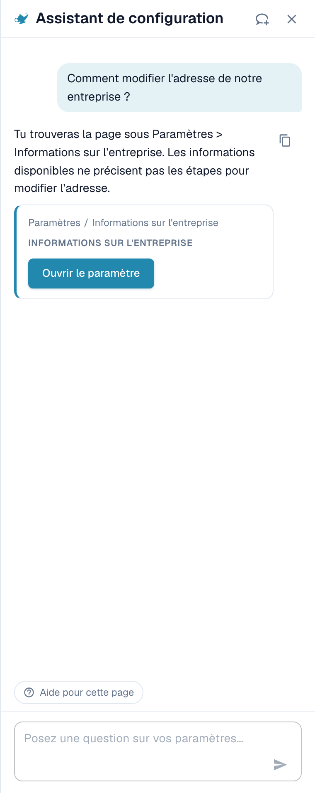
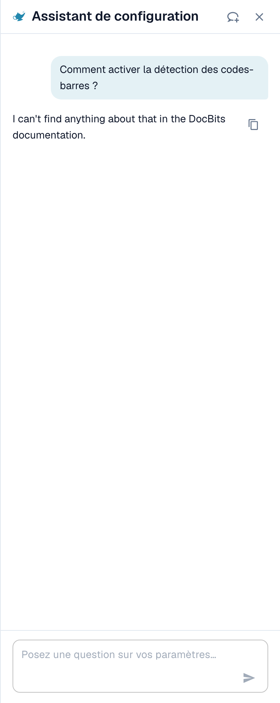
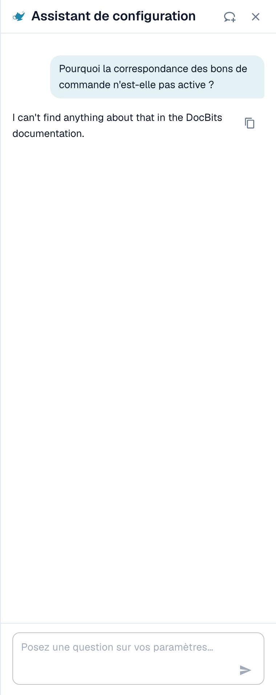
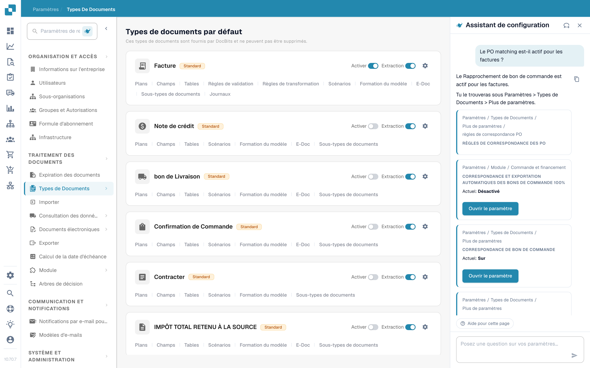
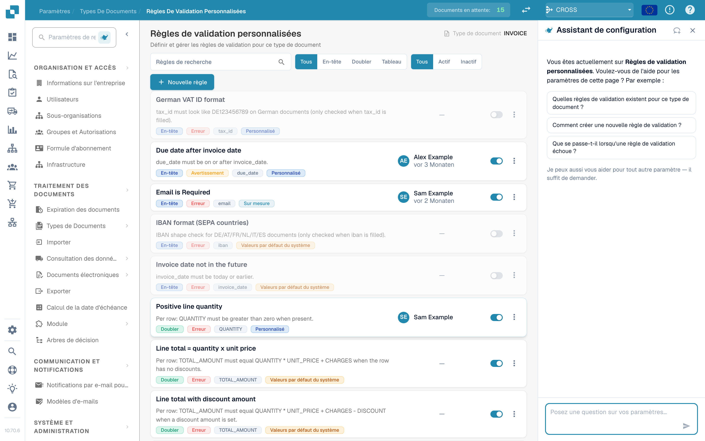
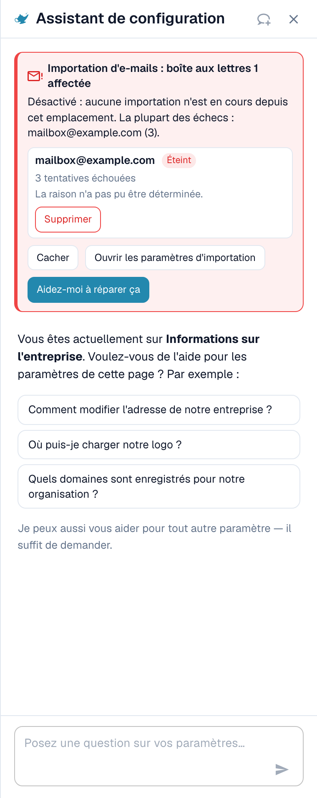

# Assistant de paramètres : ce que peut faire le chat

## Vue d'ensemble

Le chat de l'**Settings Assistant** répond aux questions sur vos paramètres, vous avertit lorsqu'une importation cesse de fonctionner et, avec votre confirmation, modifie un paramètre à votre place. Avant de l'utiliser, un administrateur doit [activer l'assistant](settings-assistant.md).

### Ce qu'il peut faire

| Vous voulez… | Exemple | Ce que vous obtenez |
| --- | --- | --- |
| Trouver un paramètre | « Où trouver les paramètres d'importation par e-mail ? » | Le chemin (par exemple Settings / Import), un bouton **Open setting** qui vous amène au paramètre et le met en évidence |
| Comprendre un paramètre | « Comment activer la détection des codes-barres ? » | Une courte explication de chaque paramètre correspondant : quand l'activer, quand le laisser désactivé |
| Vérifier votre configuration | « Pourquoi le rapprochement avec le BC n'est-il pas actif ? » | La valeur actuelle de chaque paramètre associé dans votre organisation (**Current: On** ou **Current: Off**) et lequel vous bloque |
| Repérer une importation défaillante | Une carte rouge en haut du panneau | Quelle boîte mail ou connexion FTP échoue, à quelle fréquence, et une raison probable |
| Modifier un paramètre en toute sécurité | **Switch off** sur une boîte mail défaillante dans une carte de constat | Un aperçu de la modification. Rien n'est enregistré avant votre confirmation. Chaque modification peut être annulée. |
| Découvrir une page | **Watch video explanation** | Une courte vidéo pour la page où vous vous trouvez (disponible pour certaines pages) |


L'assistant fonctionne avec le niveau d'IA **Fast**. Il n'existe aucun paramètre d'organisation pour choisir un autre modèle.


## Poser des questions

Saisissez une question dans le champ en bas (« Posez une question sur vos paramètres… ») et appuyez sur **Enter**. L'assistant montre ce qu'il fait (« Lecture de la configuration… », « Recherche dans la documentation… », « Rédaction de la réponse… ») et vous pouvez l'arrêter à tout moment avec **Stop**.

### Le panneau sait sur quelle page vous êtes

Lorsque vous ouvrez le panneau sur une page de paramètres, il vous accueille pour **cette page** et propose trois questions adaptées. Ce sont de vrais exemples :

| Page | Exemples de questions |
| --- | --- |
| Informations sur l'entreprise | « Comment modifier l'adresse de notre entreprise ? », « Où téléverser notre logo ? », « Quels domaines sont enregistrés pour notre organisation ? » |
| Importation | « L'importation par e-mail est-elle active pour nous ? », « À quelle adresse e-mail envoyons-nous les documents ? », « Comment configurer une importation FTP ou SFTP ? » |
| Classifier et extraire | « Quel modèle d'IA est utilisé pour l'extraction ? », « La scission des documents sur les codes-barres est-elle active pour nous ? », « Puis-je utiliser un autre modèle d'IA pour un fournisseur ? » |
| Utilisateurs | « Comment inviter un nouvel utilisateur ? », « Comment faire d'un utilisateur un administrateur ? », « Comment désactiver un utilisateur ? » |
| Vue d'ensemble des paramètres | « Comment activer la détection des codes-barres ? », « Pourquoi le rapprochement avec le BC n'est-il pas actif ? », « Où trouver les paramètres d'importation par e-mail ? » |

Cliquez sur une question et elle est envoyée immédiatement. Sous les trois questions, le panneau indique *Je peux aussi vous aider pour tout autre paramètre — il suffit de demander.* Pendant une conversation, la pastille **Help with this page** reste en bas et demande « Que puis-je configurer sur cette page ? ».

### Exemple 1 : Trouver un paramètre

Vous demandez **« Comment modifier l'adresse de notre entreprise ? »**

<figure><figcaption>
La réponse nomme l'endroit, et la carte vous donne le chemin exact et un bouton <strong>Open setting</strong>.
</figcaption></figure>

La réponse indique où se trouve l'adresse. La carte en dessous montre le chemin (**Settings / Company Settings**) et le bouton **Open setting**. Cliquez dessus : DocBits ouvre la page, fait défiler jusqu'au paramètre et le met en évidence pendant quelques secondes.

### Exemple 2 : Comprendre un paramètre qui a plusieurs noms

Vous demandez **« Comment activer la détection des codes-barres ? »**

<figure><figcaption>
Lorsqu'un mot correspond à plusieurs paramètres, l'assistant les liste chacun avec <strong>Enable when</strong> et <strong>Leave off when</strong>.
</figcaption></figure>

« Détection des codes-barres » peut désigner trois paramètres différents, l'assistant demande donc *Vouliez-vous dire : QR Code Extraction, Barcode Assignment ou Split Document on Barcode ?* et explique chacun :

* **QR Code Extraction** : lit automatiquement les codes-barres et codes QR pris en charge pendant le traitement. Activez-la lorsque vos documents portent des codes utiles.
* **Barcode Assignment** : permet à un réviseur d'attribuer à la main des valeurs de codes-barres décodées à des champs pendant la validation. Elle exige que l'extraction détecte d'abord le code et ne rend pas le traitement touchless.
* **Split Document on Barcode** : scinde un fichier téléversé en documents séparés aux pages de séparation. N'utilisez-la que lorsque les codes de séparation sont fiables.

### Exemple 3 : Découvrir pourquoi quelque chose ne se produit pas

Vous demandez **« Pourquoi le rapprochement avec le BC n'est-il pas actif ? »**

<figure><figcaption>
Pour une question « pourquoi », l'assistant lit votre configuration et montre chaque paramètre avec sa valeur <strong>Current</strong>.
</figcaption></figure>

L'assistant lit les paramètres de votre organisation et rapporte ce qu'il a trouvé. Dans cet exemple, le rapprochement avec le BC est **On** pour les quatre types de documents, et le paramètre **Auto export if PO matched 100%** est **Off**, donc le rapprochement et l'exportation automatiques ne s'exécutent pas. Chaque carte affiche **Current: On / Off** et un bouton **Open setting**, pour que vous puissiez corriger tout de suite.

### Exemple 4 : Rapprochement avec le BC

Vous ouvrez **Settings → Document Types** et demandez **« Le rapprochement avec le BC est-il actif pour les factures ? »** (cette question fait aussi partie des trois suggestions de cette page).

<figure><figcaption>
La page <strong>Document Types</strong> avec l'assistant à droite. La réponse indique que <strong>PO Matching is active for invoices in your organisation</strong> et montre trois paramètres associés : <strong>PO Matching</strong> (Current: On), les <strong>PO match rules</strong> et <strong>Auto export if PO matched 100%</strong> (Current: Off).
</figcaption></figure>

L'assistant lit le paramètre du type de document et ajoute les paramètres qui s'y rattachent. Dans cet exemple, le rapprochement est activé, mais l'exportation automatique après une correspondance à 100 % est désactivée, de sorte que les factures rapprochées attendent encore une personne. Chaque carte a un bouton **Open setting**.

* Pour les **règles de rapprochement et les tolérances**, utilisez la page [Règles de correspondance des bons de commande](../document-types/more-settings/purchase-order/purchase-order-matching-rules.md).
* Pour voir **pourquoi les documents d'un fournisseur ne sont pas rapprochés**, ouvrez [Touchless Intelligence : Diagnostic du rapprochement avec le BC](../../../touchless-po-matching-diagnosis.md). Elle montre le motif, les documents concernés et le flux de décision.

### Exemple 5 : Validation des champs (règles de validation personnalisées)

Sur la page **Settings → Document Types → Custom Validation Rules**, le panneau vous accueille pour cette page et suggère trois questions.

<figure><figcaption>
La page <strong>Custom Validation Rules</strong> avec l'assistant à droite. La liste des règles est au milieu, les trois suggestions du panneau sont : <strong>Quelles règles de validation existent pour ce type de document ?</strong>, <strong>Comment créer une nouvelle règle de validation ?</strong> et <strong>Que se passe-t-il lorsqu'une règle de validation échoue ?</strong>
</figcaption></figure>

Utilisez ici l'assistant pour **trouver** le bon paramètre et pour apprendre ce que fait une règle. Pour **créer ou modifier** une règle, travaillez sur la page elle-même : voir [Règles de validation personnalisées](../document-types/custom-validation-rules.md) et [Dupliquer une règle de validation personnalisée](../document-types/duplicate-a-custom-validation-rule.md). Si l'assistant crée une règle pour vous, la règle est toujours créée **inactive**, et c'est vous qui l'activez.


Ne confondez pas les **Custom Validation Rules** (règles pour les champs d'un type de document) avec la **E-Invoice Validation** (le contrôle des fichiers XRechnung, ZUGFeRD et Factur-X). Ce sont deux pages différentes.


### Exemple 6 : D'autres questions à essayer

* « Quel modèle d'IA est utilisé pour l'extraction ? »
* « La scission des documents sur les codes-barres est-elle active pour nous ? »
* « Comment désactiver un utilisateur ? »
* « Où définir la durée de conservation des documents ? »
* « Quels paramètres influencent le taux touchless ? »
* « Montrez-moi une capture d'écran des paramètres du portail fournisseur. »


Si une question sort de la zone des paramètres, ou si l'assistant ne trouve rien à ce sujet dans les informations DocBits dont il dispose, il le dit. Par exemple, une question sur un sujet qui n'est pas un paramètre renvoie *Je ne trouve rien sur … dans les informations DocBits disponibles ici* avec un lien vers la page la plus proche. Il ne devine pas.


### Liens et captures d'écran dans les réponses

* Les réponses peuvent contenir des liens **View documentation**. Ils pointent uniquement vers docs.docbits.com et s'ouvrent dans un nouvel onglet. Les liens vers la documentation apparaissent lorsque la recherche dans la documentation est disponible pour votre environnement.
* Les réponses peuvent afficher des **captures d'écran** issues de la documentation. Cliquez sur une miniature pour l'agrandir.
* **Copy answer** (la petite icône de copie à côté d'une réponse) copie le texte.

## Constats : l'assistant vous avertit

Lorsque quelque chose dans votre configuration a cessé de fonctionner, une **carte rouge** apparaît en haut du panneau. Vous n'avez pas besoin de demander. L'assistant vérifie à nouveau chaque fois que vous ouvrez le panneau et chaque fois que vous revenez à l'onglet du navigateur.

<figure><figcaption>
Un constat développé : la boîte mail, son état (<strong>Switched off</strong>), le nombre de tentatives échouées et la raison.
</figcaption></figure>

Il existe actuellement deux contrôles :

| Contrôle | Titre de la carte | Ce qu'il compte |
| --- | --- | --- |
| Importation par e-mail | « Importation par e-mail : 1 boîte mail concernée » / « Importation par e-mail : 3 boîtes mail concernées » | Boîtes mail avec des connexions échouées |
| Importation FTP | « Importation FTP : 1 connexion concernée » / « Importation FTP : 2 connexions concernées » | Connexions avec des tentatives de connexion ou d'authentification échouées |

Chaque carte a trois boutons :

* **Show errors** (puis **Hide**) : liste les boîtes mail ou connexions concernées, jusqu'à dix, avec l'état (**Switched off** ou **Retrying**), le nombre de tentatives échouées et la raison.
* **Open import settings** : ouvre **Settings → Import**.
* **Help me fix this** : démarre une discussion. L'assistant se pose la question « Mon importation par e-mail a cessé de fonctionner. Pouvez-vous m'aider à la corriger ? » et vous guide à travers la raison.

La ligne de synthèse indique la gravité :

| Ligne de synthèse | Signification |
| --- | --- |
| *Désactivée : rien n'est importé d'ici.* | Toutes les boîtes mail concernées sont désactivées. Rien n'arrive. |
| *De nouvelles tentatives ont lieu, mais les importations échouent probablement.* | DocBits continue d'essayer, mais la connexion ne fonctionne pas. |
| *1 désactivée, 2 avec nouvelle tentative en cours.* | Un mélange des deux. |

### Raisons que vous pouvez voir

L'assistant traduit l'erreur technique en l'une de ces raisons :

| Raison affichée | Que faire |
| --- | --- |
| Connexion bloquée par une stratégie (p. ex. authentification de base désactivée, ou mot de passe d'application/MFA requis) | Demandez à votre administrateur de messagerie un mot de passe d'application ou faites passer la boîte mail à l'authentification moderne |
| Connexion refusée (vérifiez le nom d'utilisateur et le mot de passe) | Le mot de passe a changé. Saisissez le nouveau dans les paramètres d'importation |
| Boîte mail ou chemin introuvable | La boîte mail a été renommée ou supprimée. Vérifiez l'adresse ou le dossier |
| Serveur injoignable | Vérifiez le nom du serveur et votre pare-feu |
| Délai dépassé lors de la connexion | Le serveur est lent ou bloqué. Réessayez plus tard |
| Échec de la connexion par certificat ou TLS | Vérifiez le paramètre de chiffrement et le certificat du serveur |
| Raison indéterminée | Ouvrez les paramètres d'importation et testez la connexion |

### Désactiver ou supprimer une connexion défaillante

Sur une ligne développée, vous pouvez utiliser **Switch off** (affiché uniquement si elle est encore active) ou **Delete**. Les deux suivent le même processus sécurisé :

1. Vous cliquez sur le bouton. L'assistant demande *Désactiver (nom) ? Rien ne sera importé depuis cette boîte mail tant qu'elle ne sera pas réactivée.* ou *Supprimer (nom) ? Elle est supprimée définitivement et ne peut pas être récupérée.*
2. Vous confirmez avec **Yes, switch off** ou **Yes, delete**, ou vous cliquez sur **Cancel**.
3. La ligne de résultat apparaît : *(nom) a été désactivée.* avec un bouton **Undo**. Une connexion supprimée n'a pas de **Undo**, car la suppression est définitive.

Si quelqu'un d'autre a modifié la boîte mail entre-temps, vous voyez *Cette boîte mail a été modifiée entre-temps. Veuillez la vérifier et réessayer.* Rien n'est modifié.

## Modifier les paramètres en toute sécurité

L'assistant ne modifie jamais rien de lui-même. Chaque modification suit les mêmes quatre étapes :

1. **Preview** : vous voyez le paramètre, sa portée (**Organization**) et la valeur **current → proposed**. Rien n'est encore enregistré.
2. **Votre confirmation** : vous cliquez sur **Confirm** (ou **Yes**). Seul un administrateur de l'organisation peut le faire.
3. **Ligne de résultat** : le chat affiche **Changed: (setting) → (value)**.
4. **Undo** : un bouton avec un compte à rebours (« 14 min restantes ») vous permet de reprendre la modification. La modification est aussi consignée dans le journal.

**Exemple (illustratif).** Une carte de recommandation pour un paramètre que l'assistant a le droit de modifier affiche un bouton **Apply** à côté de **Open setting**. Supposons que la carte concerne **Auto export if PO matched 100%**. Vous cliquez sur **Apply**. La boîte de dialogue **Apply this change?** affiche *Current: Off → Proposed: On*. Vous cliquez sur **Confirm**. Un message **Setting updated.** apparaît avec un bouton **Undo**. Si vous remarquez une erreur dans les 15 minutes environ, vous cliquez sur **Undo** et l'ancienne valeur est rétablie. Les cartes sans bouton **Apply** servent uniquement à la navigation : utilisez **Open setting** et modifiez vous-même la valeur.

Si la valeur a changé depuis l'ouverture de la boîte de dialogue, vous voyez *Ce paramètre a changé depuis l'ouverture de cette boîte de dialogue. Prévisualisez-le à nouveau.* et rien n'est appliqué.

### Ce que l'assistant peut modifier

| Modification | Exemple de demande (illustratif) |
| --- | --- |
| Un paramètre unique de l'organisation (**Apply** sur une recommandation) | « Activer le rapprochement automatique avec le BC et l'exportation » |
| Activer ou désactiver des types de documents | « Désactiver le type de document Bon de livraison » |
| Renommer un groupe d'accès | « Renommer le groupe Acheteurs en Achats » |
| Mode de recherche d'un champ de consultation (Auto ou Manuel) | « Rechercher les fournisseurs manuellement au lieu d'automatiquement » |
| Supprimer un champ | « Supprimer le champ Centre de coûts » |
| Créer une règle de validation inactive à partir d'un catalogue | Ouvrez la page **Custom Validation Rules** et décrivez le contrôle |
| Créer une règle de transformation inactive | « Créer une règle qui supprime les tirets du numéro de TVA du fournisseur » |
| Désactiver ou supprimer une connexion d'importation | Utilisez les boutons de la carte de constat |

### Brouillons de règles

Si vous demandez une **règle de transformation**, l'assistant affiche d'abord un **Rule preview** :

* le nom de la règle et une phrase simple (« Supprimer les tirets du numéro de TVA du fournisseur »),
* la cible (champ d'en-tête, colonne d'un tableau, lignes d'un tableau, attribut de document),
* un test sur des documents d'exemple : **Applies to 4 of 5 samples**, chaque document étant marqué **Applies**, **Does not apply** ou **Applies, no change**.

Avec **Create rule**, vous l'enregistrez. La règle est créée **inactive** : vous l'activez vous-même après l'avoir vérifiée. Vous pouvez annuler la création pendant **15 minutes**. Passé ce délai, supprimez la règle dans la liste des règles. Au maximum **10 règles par heure** peuvent être créées via l'assistant.

## Explications en vidéo

Sur certaines pages (actuellement **Layouts**, **Users** et **Sub-Organizations**), l'assistant propose **Watch video explanation**. La vidéo se lit dans le panneau, dispose de sous-titres et d'une transcription (**Show transcript**), et utilise votre langue lorsqu'une version existe.

## Limites et messages

| Message | Signification |
| --- | --- |
| Trop de requêtes. Veuillez patienter un instant. | Vous avez envoyé beaucoup de questions rapidement. **Retry** devient actif après une courte attente. |
| Réservé aux administrateurs. | Votre compte n'est pas administrateur de l'organisation. |
| L'assistant est temporairement indisponible. | Réessayez dans quelques minutes. |
| L'assistant met trop de temps à répondre. | La réponse n'a pas démarré à temps. Cliquez sur **Retry**. |
| Une erreur s'est produite. Veuillez réessayer. | Une erreur générale. L'**Error ID** peut être copié pour le support. |
| L'assistant est en cours de configuration | La fonction n'est pas encore disponible dans votre environnement. |
| Vous avez changé d'organisation — cette réponse ne s'applique plus ici. | Vous avez changé d'organisation alors qu'une réponse ou une modification était ouverte. |

Une conversation conserve les 50 derniers échanges dans votre navigateur. Une question peut comporter jusqu'à 4000 caractères.

## Conseils

* Demandez **une seule chose à la fois**. « Où est l'importation par e-mail et est-elle activée ? » fonctionne mieux en deux questions.
* Utilisez le **message d'accueil de la page**. Les trois questions sont écrites pour la page où vous vous trouvez, et c'est le départ le plus rapide.
* Dites **ce que vous voulez obtenir**, pas le nom d'un paramètre. « Je veux que les factures soient exportées sans que personne ne les regarde » trouve les bons paramètres.
* Vérifiez l'**aperçu** avant de confirmer, surtout les valeurs **current → proposed**.
* Vous n'êtes pas sûr ? Utilisez **Open setting** et regardez la page. L'assistant ne cache jamais où se trouve un paramètre.

## Pages connexes

* [Assistant de paramètres : l'activer](settings-assistant.md)
* [Tableau de bord analytique](../../../analytics-dashboard.md)
* [DocBits MCP](../../../../advanced-functions-and-tools/docbits-mcp/README.md)

<!-- Source notes (not shown): the assistant answers for custom validation rules and for PO tolerance / "why not matched" questions are weak on dev (tracked in the CORE project, CORE-6433), so this page shows only the greeting for validation and the PO matching status answer. Re-test and add answer screenshots after the fix. facts read from the doc2app code on dev (SettingsAssistant, AssistantChat components) and checked in the dev UI on 14 Oct 2026. "Fast tier, no organisation switch" and "documentation search not configured on Sandbox yet" come from the feature team (CORE-6379). Strings for the apply/action cards not verified in the UI are described, not quoted. -->
