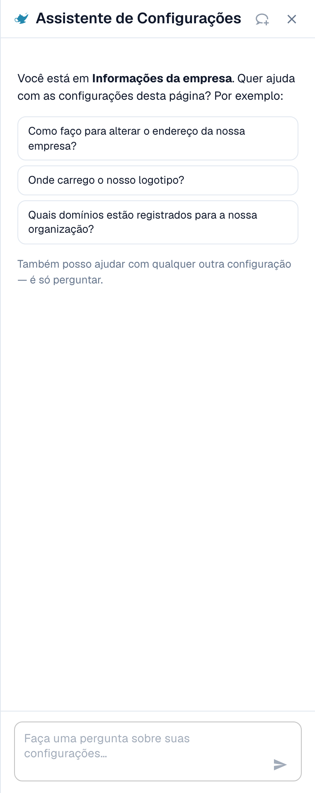
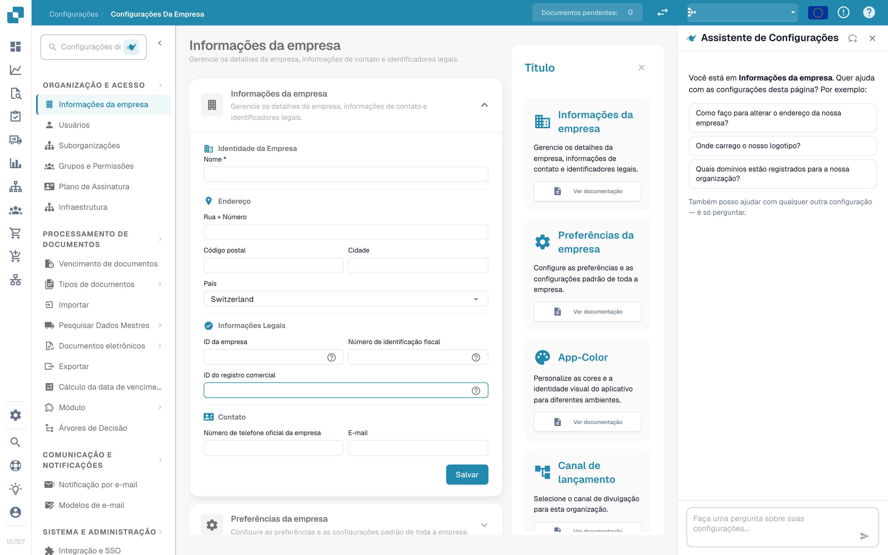

# Assistente de Configurações: como ativar

O **Settings Assistant** é um painel de chat dentro da área de Settings. Você faz uma pergunta em linguagem natural, e ele lê a configuração da sua organização, responde e leva você direto à configuração certa. Ele também pode avisar quando algo na sua configuração parou de funcionar e, com a sua confirmação, alterar uma configuração para você.

Ele ajuda mais quando você sabe **o que** quer ("parar de dividir documentos por códigos de barras"), mas não sabe **onde** fica a configuração, ou quando você se pergunta **por que** algo não acontece ("Por que o PO matching não está ativo?").

<figure><figcaption>
O Settings Assistant na página Company Information: uma saudação para a página atual, três perguntas de exemplo e o campo de pergunta. Um cartão de aviso aparece acima da saudação quando uma importação parou de funcionar (veja <a href="settings-assistant-chat.md#findings-the-assistant-warns-you">Alertas</a>).
</figcaption></figure>

O assistente vem **desativado por padrão**. Esta página mostra onde ativá-lo e como abri-lo. O que você pode perguntar a ele, e o que ele pode alterar, está descrito na página [Settings Assistant: o que o chat pode fazer](settings-assistant-chat.md).

## Quem pode usá-lo

* O **administrador da organização** ativa ou desativa o assistente para toda a organização.
* Depois de ativado, todo administrador que pode abrir **Settings** pode mostrar ou ocultar o painel para si mesmo.
* As alterações (aplicar uma recomendação, desativar ou excluir uma conexão de importação, criar uma regra) estão limitadas aos **administradores da organização**. Os demais utilizadores recebem a mensagem _Available to administrators only._

## Ativar

1. Acesse **Settings → Organization & Access → Company Information**. O cabeçalho da página mostra **Company Settings**.
2. Abra a secção **Assistants**.
3. Ative **Enable the settings assistant**.

<figure><figcaption>
A secção Assistants. O settings assistant tem o seu próprio interruptor. O validation assistant e a narração explicativa são funcionalidades separadas.
</figcaption></figure>

Uma mensagem curta confirma **Settings assistant enabled**. A configuração vem desativada por padrão. Enquanto estiver desativada, o painel e o seu botão não aparecem em nenhum lugar.


O **Validation assistant** na mesma secção é uma funcionalidade diferente. Ele explica campos bloqueantes dentro de um documento e não pode alterar nenhuma configuração. Ativar ou desativar um dos dois não afeta o outro.


## Abrir e fechar o painel

Em todas as páginas da área de Settings você encontra um pequeno **botão com ícone de lâmpada** ao lado do campo de busca de configurações. Clique nele para **mostrar** ou **ocultar** o assistente.

<figure><figcaption>
O assistente fica no <strong>lado direito</strong> de cada página de Settings: navegação à esquerda, a página no meio e o assistente ao lado dela. Aqui em <strong>Company Settings → Company Information</strong>. O botão para mostrar ou ocultar o assistente é o ícone de lâmpada ao lado de <strong>Search Settings</strong>, no topo da navegação.
</figcaption></figure>

* O painel guarda a sua escolha por utilizador, por isso continua aberto na próxima vez que você voltar.
* Em um ecrã largo (1280 pixels ou mais), ele fica ao lado da página. Você pode arrastar a borda para alterar a largura.
* Em um ecrã estreito, ele abre como uma sobreposição. **Esc** ou um clique fora fecha-o.
* **New chat** (o ícone de balão de fala no cabeçalho) limpa a conversa. A conversa também sobrevive a um recarregamento da página, mas não ao fecho do separador do navegador.

## O que fazer em seguida

* Faça a sua primeira pergunta: veja [Settings Assistant: o que o chat pode fazer](settings-assistant-chat.md).
* O assistente funciona no nível de IA **Fast**. Não existe uma configuração da organização para escolher outro modelo.

## Solução de problemas

| Problema                                                              | Causa e solução                                                                                                     |
| --------------------------------------------------------------------- | ------------------------------------------------------------------------------------------------------------------- |
| Não há botão com ícone de lâmpada na área de Settings                 | O interruptor da organização está desativado. Um administrador da organização ativa-o em **Company Information → Assistants** |
| A secção **Assistants** não aparece em Company Information             | Somente administradores da organização a veem                                                                       |
| O painel mostra **The assistant is being set up**                     | A funcionalidade ainda não está disponível no seu ambiente                                                          |
| O painel está lá, mas as respostas dizem _Available to administrators only._ | A sua conta não é de administrador da organização                                                             |

## Páginas relacionadas

* [Settings Assistant: o que o chat pode fazer](settings-assistant-chat.md)
* [Preferências da empresa](../company-preferences.md)
