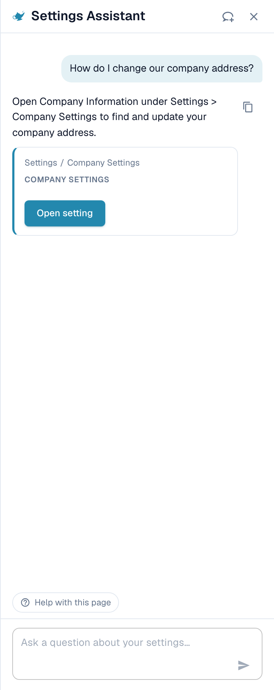
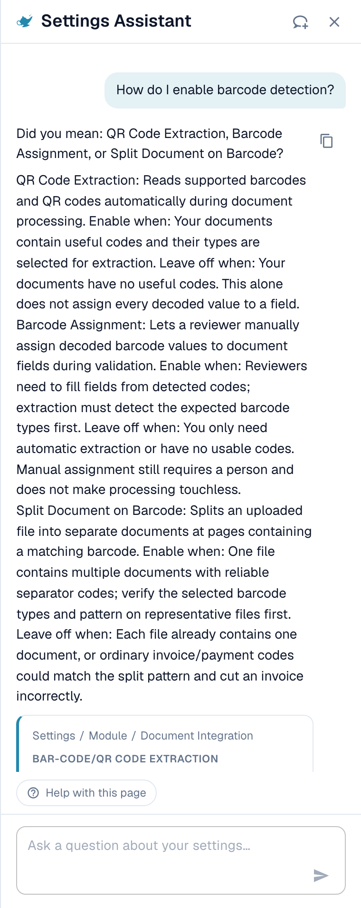
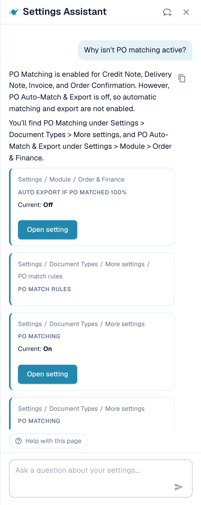
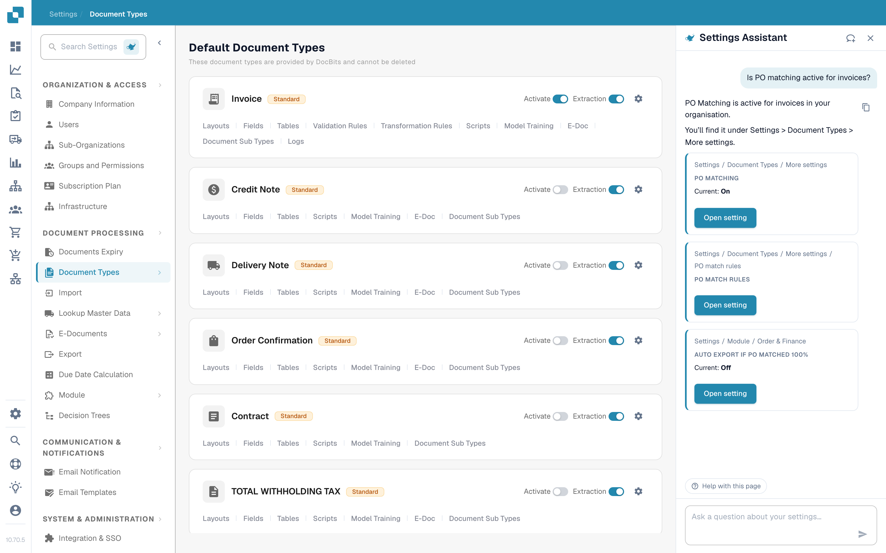
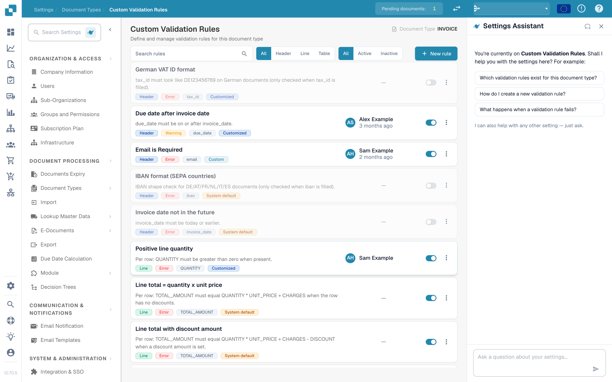
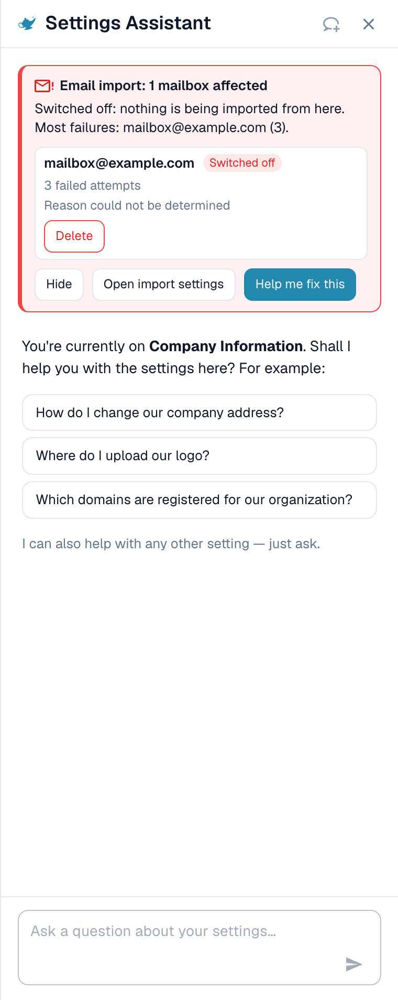

# Settings Assistant：聊天可以做什么

## 概览

**Settings Assistant** 的聊天功能会回答有关你的设置的问题，在导入停止工作时向你发出警告，并在你确认后为你更改设置。使用之前，管理员必须先[启用助手](./)。

### 它可以做什么

| 你想要…… | 示例 | 你会得到什么 |
| ------------------------ | ----------------------------------------------------- | ----------------------------------------------------------------------------------------------------------------------------- |
| 查找某项设置 | “在哪里可以找到电子邮件导入设置？” | 路径（例如 Settings / Import）、一个 **Open setting** 按钮，点击后会跳转到该设置并将其高亮显示 |
| 了解某项设置 | “如何启用条码检测？” | 对每项匹配设置的简短说明：何时开启，何时保持关闭 |
| 检查你的配置 | “为什么 PO Matching 没有启用？” | 你组织中每项相关设置的当前值（**Current: On** 或 **Current: Off**），以及是哪一项阻止了你 |
| 发现损坏的导入 | 面板顶部的一张红色卡片 | 哪个邮箱或 FTP 连接失败、多久失败一次，以及可能的原因 |
| 安全地更改设置 | 在发现卡片中，对故障邮箱点击 **Switch off** | 更改的预览。在你确认之前不会保存任何内容。每项更改都可以撤销。 |
| 了解某个页面 | **Watch video explanation** | 当前页面的简短视频（适用于部分页面） |


助手运行在 **Fast** AI 层级上。没有用于选择其他模型的设置。


## 提问

在底部的输入框中输入问题（“Ask a question about your settings…”），然后按 **Enter**。助手会显示它正在做什么（“Reading configuration…”、“Searching documentation…”、“Writing answer…”），你可以随时用 **Stop** 停止它。

### 面板知道你所在的页面

当你在某个设置页面上打开面板时，它会针对**该页面**向你问候，并提供三个适合该页面的问题。以下是真实的示例：

| 页面 | 示例问题 |
| ------------------- | ------------------------------------------------------------------------------------------------------------------------------------------------- |
| Company Information | “如何更改我们的公司地址？”、“在哪里上传我们的徽标？”、“我们的组织注册了哪些域名？” |
| Import | “我们的电子邮件导入是否已启用？”、“我们将文档发送到哪个电子邮件地址？”、“如何设置 FTP 或 SFTP 导入？” |
| Classify & Extract | “提取使用的是哪种 AI 模型？”、“我们是否启用了按条码拆分文档？”、“能否为某个供应商使用其他 AI 模型？” |
| Users | “如何邀请新用户？”、“如何将某个用户设为管理员？”、“如何停用某个用户？” |
| Settings overview | “如何启用条码检测？”、“为什么 PO Matching 没有启用？”、“在哪里可以找到电子邮件导入设置？” |

点击某个问题后会立即发送。在三个问题下方，面板会显示 _我也可以帮助你了解任何其他设置——直接提问即可。_ 在对话期间，**Help with this page** 选项会一直显示在底部，并询问“此页面可以配置什么？”。

### 示例 1：查找某项设置

你提问 **“如何更改我们的公司地址？”**

<!-- settings-assistant-answer-company-address.png -->

<figure><figcaption>
回答会指明位置所在，卡片则给出确切路径和一个 <strong>Open setting</strong> 按钮。
</figcaption></figure>

回答会说明该地址在哪里。下方的卡片会显示路径（**Settings / Company Settings**）和 **Open setting** 按钮。点击它：DocBits 会打开该页面，滚动到该设置并将其高亮显示几秒钟。

### 示例 2：了解有多名称的设置

你提问 **“如何启用条码检测？”**

<!-- settings-assistant-answer-barcode.png -->

<figure><figcaption>
当一个词可能对应多项设置时，助手会逐一列出，并给出 <strong>Enable when</strong> 和 <strong>Leave off when</strong>。
</figcaption></figure>

“条码检测”可能指三项不同的设置，因此助手会询问 _你指的是：QR Code Extraction、Barcode Assignment，还是 Split Document on Barcode？_ 并逐一说明：

* **QR Code Extraction**：在处理过程中自动读取受支持的条码和 QR 码。当你的文档带有有用的代码时启用它。
* **Barcode Assignment**：允许审核人员在验证期间手动将解码后的条码值分配给字段。它需要先由提取功能检测到代码，并且不会让处理过程实现免人工操作。
* **Split Document on Barcode**：在分隔页处将一个上传文件拆分为多个文档。仅当分隔代码可靠时才使用它。

### 示例 3：查明某件事为什么没有发生

你提问 **“为什么 PO Matching 没有启用？”**

<!-- settings-assistant-answer-po-matching.png -->

<figure><figcaption>
对于“为什么”类问题，助手会读取你的配置，并显示每项设置及其 <strong>Current</strong> 值。
</figcaption></figure>

助手会读取你组织的设置并报告它发现的内容。在此示例中，PO Matching 对全部四种文档类型都为 **On**，而设置 **Auto export if PO matched 100%** 为 **Off**，因此自动匹配和导出不会运行。每张卡片都会显示 **Current: On / Off** 和一个 **Open setting** 按钮，你可以立即修正。

### 示例 4：PO 匹配

你打开 **Settings → Document Types** 并提问 **“发票的 PO 匹配是否已启用？”**（此问题也是该页面上三个建议问题之一）。

<!-- settings-assistant-in-document-types-po-matching.png -->

<figure><figcaption>
<strong>Document Types</strong> 页面，右侧是助手。回答指出 <strong>PO Matching is active for invoices in your organisation</strong>，并显示三项相关设置：<strong>PO Matching</strong>（Current: On）、<strong>PO match rules</strong> 以及 <strong>Auto export if PO matched 100%</strong>（Current: Off）。
</figcaption></figure>

助手会读取该文档类型的设置，并补充属于它的相关设置。在此示例中匹配已开启，但 100% 匹配后的自动导出已关闭，因此匹配成功的发票仍在等待人工处理。每张卡片都有一个 **Open setting** 按钮。

* 关于**匹配规则和容差**，请使用页面 [Purchase Order Matching Rules](../../document-types/more-settings/purchase-order/purchase-order-matching-rules.md)。
* 若要查看**某个供应商的文档为什么无法匹配**，请打开 [Touchless Intelligence: PO Matching Diagnosis](../../../../analytics-dashboard/touchless-intelligence/touchless-po-matching-diagnosis.md)。它会显示原因、受影响的文档以及决策流程。

### 示例 5：字段验证（自定义验证规则）

在 **Settings → Document Types → Custom Validation Rules** 页面上，面板会针对该页面问候你，并建议三个问题。

<!-- settings-assistant-in-custom-validation-rules.png -->

<figure><figcaption>
<strong>Custom Validation Rules</strong> 页面，右侧是助手。规则列表位于中间，面板的三个建议问题是：<strong>该文档类型有哪些验证规则？</strong>、<strong>如何创建一条新的验证规则？</strong> 和 <strong>验证规则失败时会发生什么？</strong>
</figcaption></figure>

在这里使用助手可以**查找**正确的设置，并了解一条规则的作用。若要**创建或更改**规则，请在该页面上操作：请参阅 [Custom Validation Rules](../../document-types/custom-validation-rules.md) 和 [Duplicate a Custom Validation Rule](../../document-types/duplicate-a-custom-validation-rule.md)。如果助手为你创建规则，该规则始终以**非活动**状态创建，你需要自行启用它。


不要混淆 **Custom Validation Rules**（针对文档类型字段的规则）与 **E-Invoice Validation**（对 XRechnung、ZUGFeRD 和 Factur-X 文件的检查）。它们是两个不同的页面。


### 示例 6：可以尝试的更多问题

* “提取使用的是哪种 AI 模型？”
* “我们是否启用了按条码拆分文档？”
* “如何停用某个用户？”
* “在哪里设置文档的保留时长？”
* “哪些设置会影响免人工处理率？”
* “给我看一下供应商门户设置的屏幕截图。”


如果某个问题超出了设置范围，或者助手在其掌握的 DocBits 信息中找不到相关内容，它会明确说明。例如，询问某个不属于设置的项目时，它会返回 _我在此处可用的 DocBits 信息中找不到有关……的任何内容_，并附上最接近页面的链接。它不会猜测。


### 回答中的链接和屏幕截图

* 回答可以包含 **View documentation** 链接。它们只指向 docs.docbits.com，并在新标签页中打开。只有当你的环境提供文档搜索时，回答中才会出现文档链接。
* 回答可以显示来自文档的**屏幕截图**。点击缩略图可将其放大。
* **Copy answer**（回答旁边的小型复制图标）会复制文本。

## 发现项：助手会向你发出警告

当你的设置中有某项内容停止工作时，面板顶部会出现一张**红色卡片**。你无需提问。每次打开面板以及每次返回浏览器标签页时，助手都会重新检查。

<!-- settings-assistant-finding-expanded.png -->

<figure><figcaption>
展开的发现项：邮箱、其状态（<strong>Switched off</strong>）、失败尝试次数以及原因。
</figcaption></figure>

目前有两项检查：

| 检查 | 卡片标题 | 统计内容 |
| ------------ | -------------------------------------------------------------------------- | ------------------------------------------------------ |
| 电子邮件导入 | “Email import: 1 mailbox affected” / “Email import: 3 mailboxes affected” | 登录失败的邮箱 |
| FTP 导入 | “FTP import: 1 connection affected” / “FTP import: 2 connections affected” | 连接或登录尝试失败的连接 |

每张卡片都有三个按钮：

* **Show errors**（随后变为 **Hide**）：列出受影响的邮箱或连接，最多十个，并显示其状态（**Switched off** 或 **Retrying**）、失败尝试次数以及原因。
* **Open import settings**：打开 **Settings → Import**。
* **Help me fix this**：开始一段聊天。助手会自己提问“我的电子邮件导入停止工作了。你能帮我修复吗？”，并带你逐步查明原因。

摘要行会告诉你问题有多严重：

| 摘要行 | 含义 |
| -------------------------------------------------------- | --------------------------------------------------------- |
| _已关闭：此处不再导入任何内容。_ | 所有受影响的邮箱都已关闭，不会有任何内容到达。 |
| _仍在重试，但导入很可能正在失败。_ | DocBits 会继续尝试，但登录无法成功。 |
| _1 个已关闭，2 个仍在重试。_ | 两种情况混合出现。 |

### 你可能会看到的原因

助手会把技术错误转换成以下某个原因：

| 显示的原因 | 该做什么 |
| -------------------------------------------------------------------------------------------------- | ---------------------------------------------------------------------------------------------- |
| 登录被策略阻止（例如基本身份验证已禁用，或需要应用密码/MFA） | 向你的邮件管理员索取应用密码，或将该邮箱切换为现代身份验证 |
| 登录被拒绝（请检查用户名和密码） | 密码已更改。请在导入设置中输入新密码 |
| 未找到邮箱或路径 | 邮箱已被重命名或删除。请检查地址或文件夹 |
| 无法访问服务器 | 请检查服务器名称和防火墙 |
| 连接时超时 | 服务器响应缓慢或连接被阻止。请稍后重试 |
| 证书或 TLS 连接失败 | 请检查加密设置和服务器证书 |
| 无法确定原因 | 请打开导入设置并测试连接 |

### 关闭或删除故障连接

在展开的行中，你可以使用 **Switch off**（仅在仍处于开启状态时显示）或 **Delete**。两者都遵循相同的安全流程：

1. 你点击该按钮。助手会询问 _Switch off（名称）？在重新开启此邮箱之前，不会从它导入任何内容。_ 或 _Delete（名称）？它会被永久移除，且无法撤销。_
2. 你用 **Yes, switch off** 或 **Yes, delete** 确认，或者点击 **Cancel**。
3. 结果行会出现：_（名称）已关闭。_，并带有一个 **Undo** 按钮。已删除的连接没有 **Undo**，因为删除是永久性的。

如果其他人在这期间更改了该邮箱，你会看到 _此邮箱在此期间已被更改。请检查后重试。_ 不会发生任何更改。

## 安全地更改设置

助手绝不会自行更改任何内容。每项更改都遵循相同的四个步骤：

1. **Preview**：你会看到该设置、其范围（**Organization**）以及 **current → proposed** 值。此时尚未保存任何内容。
2. **你的确认**：你点击 **Confirm**（或 **Yes**）。只有组织管理员可以这样做。
3. **结果行**：聊天中会显示 **Changed: (setting) → (value)**。
4. **Undo**：一个带有倒计时（例如“还剩 14 分钟”）的按钮让你可以在 15 分钟内撤销该更改。该更改也会记录在日志中。

**示例（仅供说明）。** 对于助手获准写入的设置，建议卡片会在 **Open setting** 旁边显示一个 **Apply** 按钮。假设该卡片涉及 **Auto export if PO matched 100%**。你点击 **Apply**。对话框 **Apply this change?** 会显示 _Current: Off → Proposed: On_。你点击 **Confirm**。随后出现消息 **Setting updated.**，并带有一个 **Undo** 按钮。如果你在大约 15 分钟内发现错误，点击 **Undo**，原来的值就会恢复。没有 **Apply** 按钮的卡片仅用于导航：使用 **Open setting** 自行更改该值。

如果自你打开对话框以来该值已发生变化，你会看到 _此设置自你打开该对话框以来已更改。请重新预览。_ 并且不会应用任何内容。

### 助手可以更改什么

| 更改 | 示例请求（仅供说明） |
| ------------------------------------------------------------- | ---------------------------------------------------------------- |
| 单项组织设置（在建议上使用 **Apply**） | “启用自动 PO 匹配和导出” |
| 开启或关闭文档类型 | “停用文档类型 Delivery Note” |
| 重命名访问组 | “将 Buyers 组重命名为 Purchasing” |
| 查找字段的搜索模式（Auto 或 Manual） | “改为手动搜索供应商，而不是自动搜索” |
| 删除字段 | “删除字段 Cost Center” |
| 从目录创建一条非活动的验证规则 | 打开 **Custom Validation Rules** 页面并描述该检查 |
| 创建一条非活动的转换规则 | “创建一条从供应商 VAT 编号中移除连字符的规则” |
| 关闭或删除某个导入连接 | 使用发现卡片中的按钮 |

### 规则草稿

如果你要求创建**转换规则**，助手会先显示一个 **Rule preview**：

* 规则名称和一句简单说明（“从供应商 VAT 编号中移除连字符”），
* 目标（抬头字段、表格的列、表格的行、文档属性），
* 在示例文档上进行测试：**Applies to 4 of 5 samples**，并将每份文档标记为 **Applies**、**Does not apply** 或 **Applies, no change**。

用 **Create rule** 即可保存。该规则以**非活动**状态创建：你在检查后自行启用它。你可以在 **15 分钟**内撤销这次创建。之后，请在规则列表中删除该规则。通过助手每小时最多可以创建 **10 条规则**。

## 视频说明

在部分页面（目前包括 **Layouts**、**Users** 和 **Sub-Organizations**）上，助手会提供 **Watch video explanation**。视频在面板中播放，带有字幕和文字稿（**Show transcript**），并且如果存在相应语言的版本，就会使用你的语言。

## 限制和消息

| 消息 | 含义 |
| --------------------------------------------------------------------- | ----------------------------------------------------------------------------- |
| 请求过多。请稍等片刻。 | 你很快地发送了许多问题。稍等片刻后，**Retry** 会变为可用。 |
| 仅管理员可用。 | 你的账户不是组织管理员。 |
| 助手暂时不可用。 | 请几分钟后重试。 |
| 助手响应时间过长。 | 回答没有及时开始。请点击 **Retry**。 |
| 出错了。请重试。 | 一般性错误。可以复制 **Error ID** 以便联系支持人员。 |
| 助手正在设置中 | 该功能在你的环境中尚不可用。 |
| 你已切换组织——此回答不再适用于此处。 | 在回答或更改处于打开状态时，你切换了组织。 |

一段对话会在你的浏览器中保留最近 50 轮。一个问题最多可以有 4000 个字符。

## 提示

* **一次只问一件事**。“电子邮件导入在哪里，它是否已开启？”拆成两个问题效果更好。
* 使用**页面问候语**。这三个问题是针对你所在的页面编写的，是最快的开始方式。
* 说明**你想达成什么**，而不是某个设置的名称。“我希望发票在无人查看的情况下也能导出”会帮你找到正确的设置。
* 在确认之前检查**预览**，尤其是 **current → proposed** 值。
* 不确定？使用 **Open setting** 查看该页面。助手从不会隐瞒某项设置的位置。

## 相关页面

* [Settings Assistant：启用助手](./)
* [Analytics Dashboard](../../../../analytics-dashboard/)
* [DocBits MCP](../../../../../advanced-functions-and-tools/docbits-mcp/)
