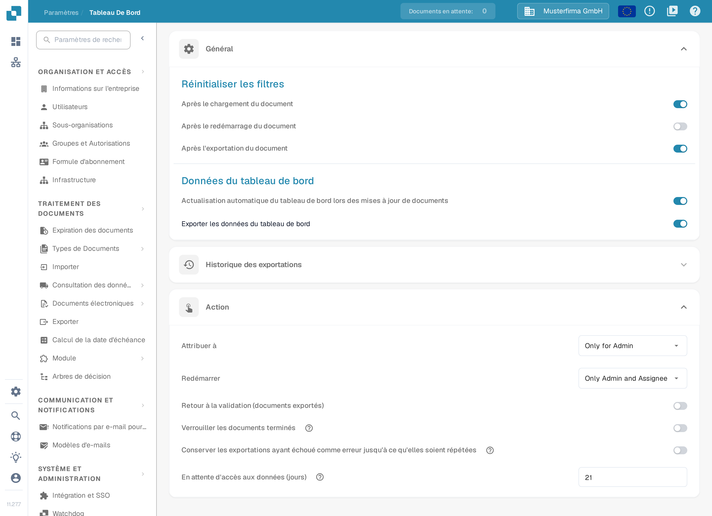
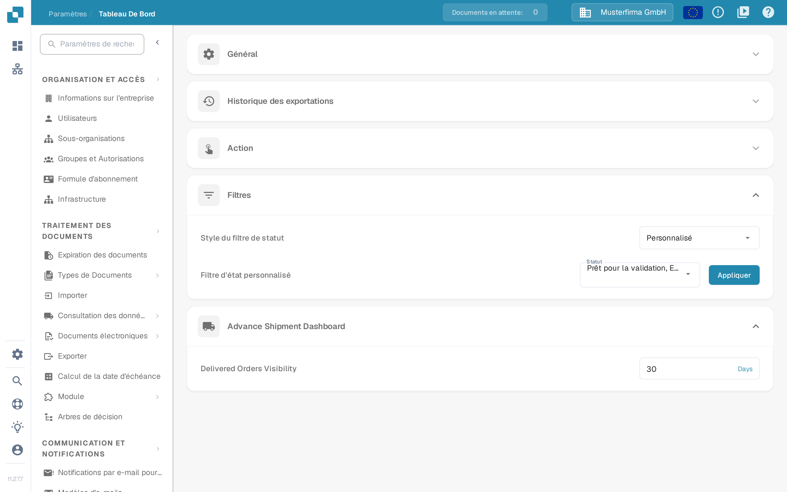

# Tableau de bord

## Aperçu

Les paramètres du tableau de bord aident les administrateurs à contrôler la présentation des données et les interactions dans le tableau de bord DocBits. Ils déterminent quelles informations sont immédiatement disponibles après la connexion, afin que chaque utilisateur retrouve rapidement les données les plus utiles à ses tâches.

<figure><figcaption>
Les sections Général et Action dans l'interface française. La section Historique des exportations est repliée ; les interrupteurs et la valeur 21 jours sont des données d'exemple d'une organisation de démonstration.
</figcaption></figure>

## Accéder aux paramètres du tableau de bord

Pour accéder aux paramètres du tableau de bord, naviguez vers :\
**Paramètres → Tableau de bord**

Dépliez une section pour consulter ses réglages. Les réglages sont enregistrés dès que vous modifiez un interrupteur, une sélection ou une valeur numérique ; **Appliquer** enregistre la sélection personnalisée des statuts.

## **Général**

* **Réinitialiser les filtres** : permet de définir le moment où les filtres du tableau de bord sont réinitialisés, par exemple après le chargement du document, le redémarrage du document ou l'exportation du document. Cela garantit une vue claire des données à chaque étape du flux de travail.
* **Données du tableau de bord** :
  * **Actualisation automatique du tableau de bord lors des mises à jour de documents** : un interrupteur qui détermine si le tableau de bord recharge automatiquement ses données lorsque des documents sont mis à jour. Lorsqu'il est activé, les modifications apportées aux documents — par exemple un changement de statut effectué par une autre personne — sont reprises automatiquement, de sorte que la liste affiche toujours l'état actuel sans actualisation manuelle.
  * **Exporter les données du tableau de bord** : cette fonction ajoute un bouton d'exportation à la barre d'outils du tableau de bord, qui permet d'exporter la vue actuelle du tableau de bord dans un fichier **.csv** ou **.xlsx**. Pour la procédure pas à pas, voir [Exporter les données du tableau de bord](../../document-processing/module/export-dashboard-data.md).

## **Historique des exportations**

Dans l'**Historique des exportations**, une table répertorie toutes les exportations passées avec les informations clés de chaque demande.

<figure><figcaption>
Lignes compactes de l'historique des exportations avec les pastilles de filtre et les compteurs +N pour les filtres supplémentaires. Dans cette capture de développement, les adresses e-mail et les identifiants d'organisation sont masqués.
</figcaption></figure>

Les informations suivantes sont affichées :

* **Email** : l'adresse e-mail du destinataire enregistrée pour l'exportation.
* **Status** : le statut actuel de l'exportation (Pending, Completed ou Failed).
* **Requested At** : la date et l'heure auxquelles l'exportation a été lancée.
* **Completed At** : la date et l'heure auxquelles l'exportation a été terminée.
* **Format** : le format de fichier utilisé pour l'exportation (CSV, XLSX).
* **Filters Used** : jusqu'à trois filtres actifs apparaissent sous forme de pastilles sur une seule ligne. Si davantage de filtres ont été appliqués, une pastille **+N** indique combien il y en a en plus. Pointez la cellule des filtres pour afficher la liste complète dans une infobulle. Les filtres dont la valeur est **None** ne sont pas affichés.

Les en-têtes de colonnes et les valeurs de statut de cette table apparaissent actuellement en anglais dans l'interface française.

<mark style="color:red;">**Remarque**</mark> : pour exporter des tables, l'option Exporter les données du tableau de bord de la section [Général](./#general) doit être active.

## **Action**

* **Attribuer à** : cette fonction définit qui peut attribuer des documents.
  * **Only for Admin** : seuls les utilisateurs administrateurs peuvent attribuer des documents, indépendamment des autorisations accordées aux utilisateurs non administrateurs.
  * **All Users** : tous les utilisateurs disposant des [autorisations](../groups-users-and-permissions/groups-and-permissions/activating-permissions.md) nécessaires peuvent attribuer des documents.
* **Redémarrer** : cette fonction définit qui peut redémarrer des documents.
  * **Only for Admin** : seuls les utilisateurs dotés de droits d'administration peuvent redémarrer des documents, indépendamment des autorisations accordées aux utilisateurs non administrateurs.
  * **Only Admin and Assignee** : seuls les utilisateurs dotés de droits d'administration et la personne attribuée peuvent redémarrer le document.
  * **All Users** : tous les utilisateurs disposant des [autorisations](../groups-users-and-permissions/groups-and-permissions/activating-permissions.md) nécessaires peuvent redémarrer des documents.

Les valeurs proposées par les champs **Attribuer à** et **Redémarrer** apparaissent actuellement en anglais dans l'interface française.

* **En attente d'accès aux données (jours)** : définit pendant combien de jours une personne sollicitée dans le flux d'activité peut ouvrir le document en lecture seule ; ensuite, le lien ne fonctionne plus. La valeur par défaut est de 14 jours, et l'accès se termine aussi dès que le document avance. Voir [Pending Input](../../../../end-user-and-partner-section/end-user-section/pending-input.md).
* **Retour à la validation (documents exportés)** : contrôle l'action « Retour à la validation » pour les documents exportés.
* **Verrouiller les documents terminés** : le texte d'aide explique que les documents finalisés peuvent alors uniquement être archivés ou marqués comme erronés, ou comme ayant subi une erreur d'exportation. Ils ne peuvent plus être modifiés, redémarrés, exportés ni attribués. Les flux de travail qui se poursuivent après l'exportation (par exemple l'approbation) doivent être exportés avec le statut **Exporté**.
* **Conserver les exportations ayant échoué comme erreur jusqu'à ce qu'elles soient répétées** : pour une configuration d'exportation inactive déclenchée par un flux de travail, conserve l'**erreur d'exportation** jusqu'à ce que cette configuration exporte à nouveau avec succès. Un simple redémarrage de l'exportation ne supprime pas l'erreur, comme l'explique le texte d'aide du réglage.

## **Filtres**

* **Style du filtre de statut** : choisissez **Tous**, **Statique** ou **Personnalisé** pour déterminer les filtres de statut proposés. **Personnalisé** affiche la sélection des statuts et le bouton **Appliquer**.
* **Filtre d'état personnalisé** : permet de créer et d'appliquer des filtres personnalisés sur des statuts de document précis, par exemple **Prêt pour la validation** ou **Exporté**. Les utilisateurs accèdent ainsi rapidement aux documents qui se trouvent à une étape donnée du traitement.

<figure><figcaption>
Les sections Filtres et Advance Shipment Dashboard dans l'interface française. La sélection de statuts et la valeur 30 jours sont des données d'exemple ; les sections Général, Historique des exportations et Action sont repliées.
</figcaption></figure>

Pour savoir comment choisir **Personnalisé**, sélectionner des statuts, appliquer la sélection ou revenir à **Tous**, voir [Filtres personnalisés](page-1.md).

## Advance Shipment Dashboard

* **Delivered Orders Visibility** : cette fonction permet de définir la durée pendant laquelle les commandes livrées restent visibles.

Le titre de cette section, le libellé du champ et son unité apparaissent actuellement en anglais dans l'interface française (**Days**).

Ces paramètres du tableau de bord sont essentiels pour que la plateforme DocBits soit aussi réactive et utile que possible : ils offrent un outil puissant pour suivre et gérer le traitement des documents directement depuis le tableau de bord.
