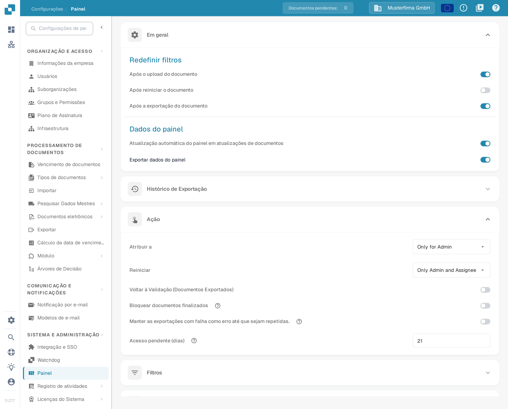
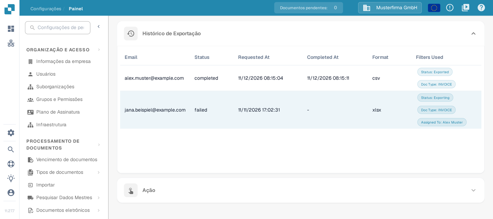
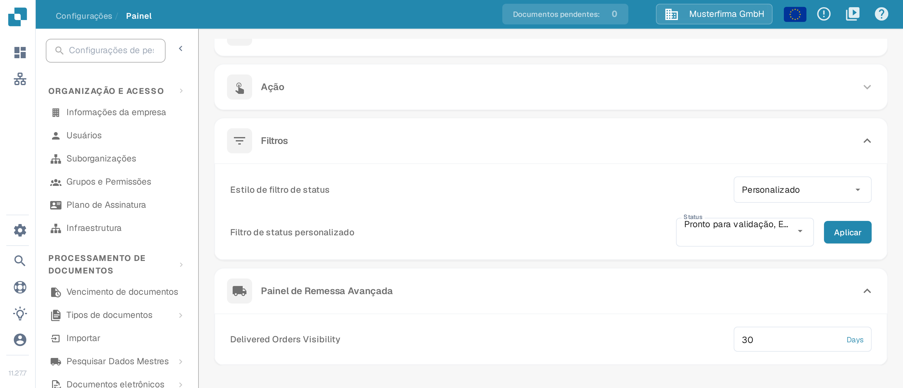

# Painel

## Visão Geral

As configurações do Painel ajudam os administradores a controlar o que o painel do DocBits mostra e como os utilizadores trabalham com esses dados. Definem que informação está disponível imediatamente após o início de sessão, para que cada pessoa encontre rapidamente os dados relevantes para as suas tarefas.

<figure><figcaption>
Vista atual de Em geral e Ação na interface em português. O Histórico de Exportação está recolhido; os valores apresentados são dados de exemplo.
</figcaption></figure>

## Aceder às Configurações do Painel

Para aceder às configurações do painel, navegue até:\
**Configurações → Painel**

Abra uma secção para ver os respetivos controlos. As definições são guardadas assim que altera um interruptor, uma seleção ou um valor numérico; o botão **Aplicar** guarda a seleção de estados personalizada.

## **Em geral**

* **Redefinir filtros**: define quando os filtros do painel devem ser repostos. A interface oferece as opções **Após o upload do documento**, **Após reiniciar o documento** e **Após a exportação do documento**. Assim, a vista começa de novo em cada etapa do fluxo de trabalho.
* **Dados do painel**:
  * **Atualização automática do painel em atualizações de documentos**: interruptor que define se o painel recarrega os dados automaticamente quando os documentos mudam. Quando está ativo, as alterações — por exemplo, uma mudança de estado feita por outro utilizador — são assumidas sem atualização manual, para que a lista mostre sempre o estado atual.
  * **Exportar dados do painel**: acrescenta um botão **Exportar** à barra de ferramentas do painel, com o qual exporta a vista atual do painel como ficheiro **.csv** ou **.xlsx**. Para os passos, consulte [Exportar dados do painel](../../document-processing/module/export-dashboard-data.md).

## **Histórico de Exportação**

No **Histórico de Exportação** encontra uma tabela com todas as exportações anteriores e a informação principal de cada pedido.

<figure><figcaption>
Duas linhas de exemplo no Histórico de Exportação. Os endereços terminam em example.com; datas, estados e filtros são dados de exemplo. Os títulos Email, Status, Requested At, Completed At, Format e Filters Used continuam em inglês na interface em português.
</figcaption></figure>

A tabela inclui os seguintes dados:

* **Email**: o endereço de e-mail registado para a exportação.
* **Status**: o estado atual da exportação, por exemplo **completed**, **failed** ou uma exportação ainda em curso (na captura, **Exporting**).
* **Requested At**: a data e a hora a que a exportação foi iniciada.
* **Completed At**: a data e a hora a que a exportação terminou; numa exportação falhada aparece um traço.
* **Format**: o formato do ficheiro exportado (**csv** ou **xlsx**).
* **Filters Used**: os filtros ativos aparecem como chips, cada um com nome e valor, por exemplo **Status: Exported** ou **Doc Type: INVOICE**. Com mais filtros, um chip **+N** indica quantos existem além desses. Aponte para a célula dos filtros para ver a lista completa numa dica. Os filtros com o valor **None** são omitidos.

Na interface em português, os títulos das colunas e os nomes dos chips continuam em inglês.

<mark style="color:red;">**Nota**</mark>: para exportar tabelas, a opção Exportar dados do painel na secção [Em geral](./#em-geral) tem de estar ativa.

## **Ação**

* **Atribuir a**: define quem pode atribuir documentos. As opções aparecem em inglês na interface em português.
  * **Only for Admin**: apenas os administradores podem atribuir documentos, independentemente das permissões concedidas aos restantes utilizadores.
  * **All Users**: todos os utilizadores com as [permissões](../groups-users-and-permissions/groups-and-permissions/activating-permissions.md) necessárias podem atribuir documentos.
* **Reiniciar**: define quem pode reiniciar documentos. As opções aparecem em inglês na interface em português.
  * **Only for Admin**: apenas os utilizadores com privilégios de administrador podem reiniciar documentos, independentemente das permissões concedidas aos restantes utilizadores.
  * **Only Admin and Assignee**: apenas os administradores e o utilizador a quem o documento está atribuído podem reiniciar o documento.
  * **All Users**: todos os utilizadores com as [permissões](../groups-users-and-permissions/groups-and-permissions/activating-permissions.md) necessárias podem reiniciar documentos.
* **Voltar à Validação (Documentos Exportados)**: controla a ação de devolver um documento exportado à validação.
* **Bloquear documentos finalizados**: segundo a ajuda deste controlo, depois de bloqueados os documentos só podem ser arquivados ou marcados como erro (ou erro de exportação); deixam de poder ser editados, reiniciados, exportados ou atribuídos. Os fluxos de trabalho que continuam depois da exportação, por exemplo uma aprovação, devem usar o estado **Exportado**.
* **Manter as exportações com falha como erro até que sejam repetidas.**: segundo a ajuda, quando uma configuração de exportação inativa — por exemplo, uma que só um fluxo de trabalho inicia — não exporta, o documento mantém o estado **erro de exportação** até essa configuração voltar a exportar com sucesso. Reiniciar apenas a exportação não elimina a falha.
* **Acesso pendente (dias)**: define durante quantos dias uma pessoa a quem foi pedida informação no fluxo de atividade pode abrir o documento em modo de leitura; depois disso a ligação deixa de funcionar, e o acesso termina igualmente assim que o documento avança. O valor predefinido é 14 dias. Consulte [Pending Input](../../../../end-user-and-partner-section/end-user-section/pending-input.md).

## **Filtros**

* **Estilo de filtro de status**: escolha **Todos**, **Estático** ou **Personalizado** para definir que filtros de estado são oferecidos. **Personalizado** mostra a seleção de estados e o botão **Aplicar**.
* **Filtro de status personalizado**: permite criar e aplicar filtros próprios para estados concretos do documento, como **Novo**, **Validando** ou **Exportando**. Assim encontra rapidamente os documentos que estão numa determinada etapa do processamento.

<figure><figcaption>
Filtros com o estilo Personalizado e o Painel de Remessa Avançada. Os estados escolhidos e os 30 dias são dados de exemplo; os rótulos Delivered Orders Visibility e Days continuam em inglês.
</figcaption></figure>

Para saber como escolher **Personalizado**, selecionar estados, aplicar a seleção ou voltar a **Todos**, consulte [Filtros Personalizados](page-1.md).

## Painel de Remessa Avançada

* **Delivered Orders Visibility**: permite indicar durante quanto tempo os pedidos entregues permanecem visíveis. O rótulo e a unidade **Days** continuam em inglês na interface em português.

Estas configurações do painel ajudam a tornar o DocBits o mais responsivo e útil possível: permitem acompanhar e gerir o processamento de documentos diretamente a partir do painel.
