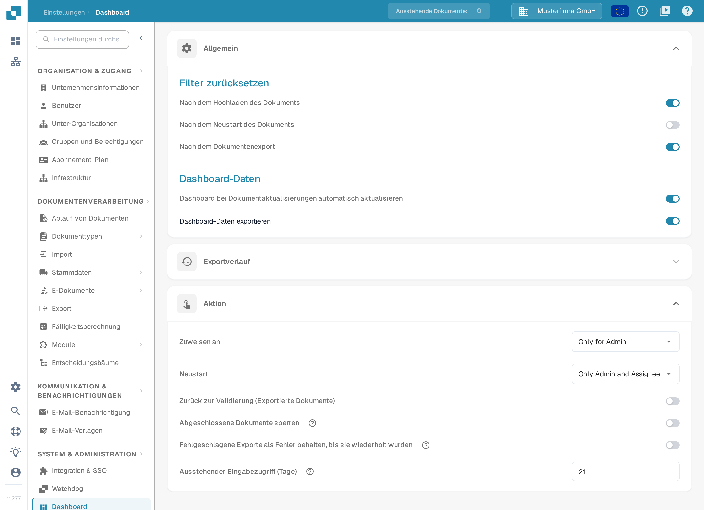
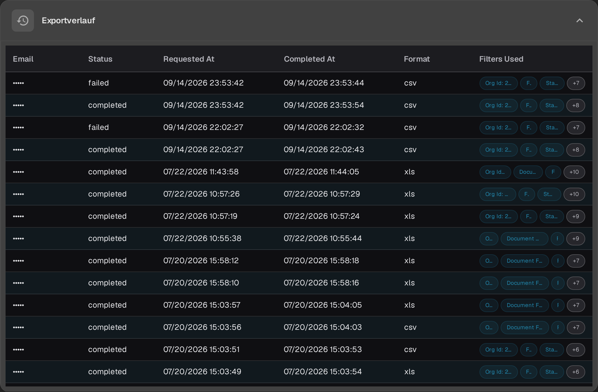
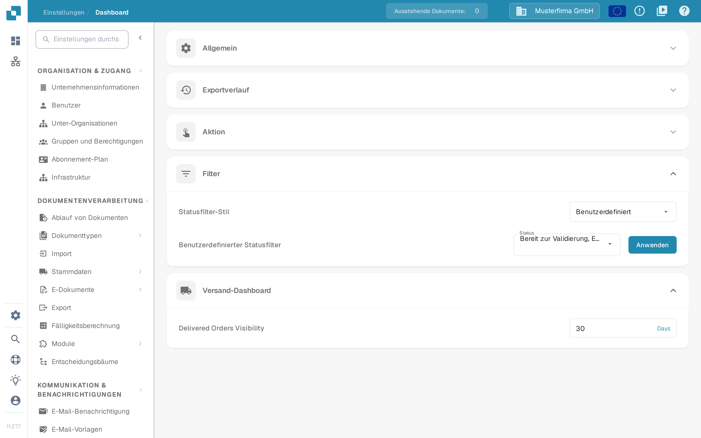

# Dashboard

## Übersicht

Die Dashboard-Einstellungen sind darauf ausgelegt, Administratoren dabei zu helfen, die Datenpräsentation und Interaktion innerhalb des DocBits-Dashboards zu steuern. Diese Einstellungen bestimmen, welche Informationen sofort nach dem Einloggen verfügbar sind, sodass die Benutzer schnellen Zugriff auf die relevantesten Daten für ihre Aufgaben haben.

<figure><figcaption>
Die Bereiche Allgemein und Aktion in der deutschen Oberfläche. Der Exportverlauf ist eingeklappt; die sichtbaren Schalterstellungen und Werte sind Beispieldaten einer Demo-Organisation.
</figcaption></figure>

## Zugriff auf die Dashboard-Einstellungen

Um auf die Dashboard-Einstellungen zuzugreifen, navigieren Sie zu:\
**Einstellungen → Dashboard**

Klappen Sie einen Abschnitt auf, um seine Steuerelemente zu prüfen. Einstellungen werden gespeichert, sobald Sie einen Schalter, eine Auswahl oder einen Zahlenwert ändern; **Anwenden** speichert die benutzerdefinierte Statusauswahl.

## **Allgemein**

* **Filter zurücksetzen**: Ermöglicht die Konfiguration, wann die Dashboard-Filter zurückgesetzt werden sollen, z. B. nach dem Hochladen des Dokuments, dem Neustart des Dokuments oder dem Dokumentenexport. Dies hilft, eine saubere Grundlage für die Datenansicht gemäß spezifischer Arbeitsabläufe zu erhalten.
* **Dashboard-Daten**:
  * **Dashboard bei Dokumentaktualisierungen automatisch aktualisieren**: Ein Schalter, der steuert, ob das Dashboard seine Daten automatisch neu lädt, wenn Dokumente aktualisiert werden. Ist die Option aktiv, werden Änderungen an Dokumenten – zum Beispiel eine Statusänderung durch eine andere Person – automatisch übernommen, sodass die Liste immer den aktuellen Stand zeigt, ohne dass Sie manuell aktualisieren müssen.
  * **Dashboard-Daten exportieren**: Diese Funktion fügt der Dashboard-Werkzeugleiste die Schaltfläche **Export** hinzu, mit der Sie die aktuelle Dashboard-Ansicht als **.csv**- oder **.xlsx**-Datei exportieren können. Eine Schritt-für-Schritt-Anleitung finden Sie unter [Dashboard-Daten exportieren](../../document-processing/module/export-dashboard-data.md).

## **Exportverlauf**

Im **Exportverlauf** sehen Sie eine Tabelle, die alle vergangenen Exporte zusammen mit wichtigen Informationen zu jeder Anfrage auflistet.

<figure><figcaption>
Kompakte Zeilen im Exportverlauf mit Filter-Chips und +N-Zählern für weitere Filter. In dieser Dev-Aufnahme sind E-Mail-Adressen und Organisations-IDs maskiert.
</figcaption></figure>

Die folgenden Details sind enthalten:

* **Email**: Die für den Export hinterlegte E-Mail-Adresse des Empfängers.
* **Status**: Der aktuelle Status des Exports (Pending, Completed oder Failed).
* **Requested At**: Datum und Uhrzeit, zu der der Export ausgelöst wurde.
* **Completed At**: Datum und Uhrzeit, zu der der Export abgeschlossen wurde.
* **Format**: Das für den Export verwendete Dateiformat (CSV, XLSX).
* **Filters Used**: Bis zu drei aktive Filter erscheinen als Chips in einer Zeile. Wurden mehr Filter angewendet, zeigt ein **+N**-Chip, wie viele weitere es sind. Zeigen Sie mit der Maus auf die Filterzelle, um die vollständige Liste in einem Tooltip zu sehen. Filter mit dem Wert **None** werden weggelassen.

Die Spaltenüberschriften und die Statuswerte dieser Tabelle zeigt die Oberfläche derzeit auf Englisch.

<mark style="color:red;">**Hinweis**</mark>: Um Tabellen zu exportieren, muss die Option Dashboard-Daten exportieren im Abschnitt [Allgemein](./#allgemein) aktiv sein.

## **Aktion**

* **Zuweisen an**: Diese Funktion legt fest, wer Dokumente zuweisen darf.
  * **Only for Admin**: Nur Administratorbenutzer können Dokumente zuweisen, unabhängig von den Berechtigungen, die Nicht-Administratoren erhalten haben.
  * **All Users**: Alle Benutzer, die die erforderlichen [Berechtigungen](../groups-users-and-permissions/groups-and-permissions/activating-permissions.md) erhalten haben, können Dokumente zuweisen.
* **Neustart**: Diese Funktion legt fest, wer Dokumente neu starten darf.
  * **Only for Admin**: Nur Benutzer mit Administratorrechten können Dokumente neu starten, unabhängig von den Berechtigungen, die Nicht-Administratoren erhalten haben.
  * **Only Admin and Assignee**: Nur Benutzer mit Administratorrechten und die zugewiesene Person können das Dokument neu starten.
  * **All Users**: Alle Benutzer, die die erforderlichen [Berechtigungen](../groups-users-and-permissions/groups-and-permissions/activating-permissions.md) erhalten haben, können Dokumente neu starten.

Die Auswahlwerte der Felder **Zuweisen an** und **Neustart** zeigt die Oberfläche derzeit auf Englisch.

* **Ausstehender Eingabezugriff (Tage)**: Legt fest, wie viele Tage eine Person, die im Aktivitätsprotokoll um eine Eingabe gebeten wurde, das Dokument schreibgeschützt öffnen kann; danach funktioniert der Link nicht mehr. Standard sind 14 Tage, und der Zugriff endet auch, sobald das Dokument weitergeht. Siehe [Pending Input](../../../../end-user-and-partner-section/end-user-section/pending-input.md).
* **Zurück zur Validierung (Exportierte Dokumente)**: Steuert die Aktion „Zurück zur Validierung“ für exportierte Dokumente.
* **Abgeschlossene Dokumente sperren**: Der Hilfetext erläutert, dass abgeschlossene Dokumente nach dem Sperren nur noch archiviert oder auf den Status **Fehler** gesetzt werden können. Arbeitsabläufe, die nach dem Export weiterlaufen müssen, verwenden den Status **Exportiert**.
* **Fehlgeschlagene Exporte als Fehler behalten, bis sie wiederholt wurden**: Behält für eine inaktive, von einem Workflow gestartete Exportkonfiguration den **Exportfehler** so lange bei, bis diese Konfiguration erneut erfolgreich exportiert. Ein erneuter Start des Exports allein hebt den Fehler nicht auf, wie der Hilfetext des Steuerelements erläutert.

## **Filter**

* **Statusfilter-Stil**: Wählen Sie **Alle**, **Statisch** oder **Benutzerdefiniert**, um festzulegen, welche Statusfilter angeboten werden. **Benutzerdefiniert** zeigt die Statusauswahl und die Schaltfläche **Anwenden**.
* **Benutzerdefinierter Statusfilter**: Ermöglicht die Erstellung und Anwendung benutzerdefinierter Filter, die auf bestimmte Dokumentstatus wie **Neu**, **Validierung** oder **Exportieren** zielen. So greifen Benutzer schnell auf Dokumente in bestimmten Verarbeitungsstufen zu.

<figure><figcaption>
Die Bereiche Filter und Versand-Dashboard in der deutschen Oberfläche. Die Statusauswahl ist ein Beispielwert; Allgemein, Exportverlauf und Aktion sind eingeklappt.
</figcaption></figure>

Die Schritte zum Auswählen von **Benutzerdefiniert**, zum Festlegen der Status, zum Anwenden der Auswahl oder zum Zurückkehren zu **Alle** finden Sie unter [Benutzerdefinierte Filter](page-1.md).

## Versand-Dashboard

* **Delivered Orders Visibility**: Diese Funktion legt fest, wie lange gelieferte Bestellungen sichtbar bleiben.

Feldbezeichnung und Einheit dieses Feldes zeigt die Oberfläche derzeit auf Englisch (**Days**).

Diese Dashboard-Einstellungen sind entscheidend, um sicherzustellen, dass die DocBits-Plattform so reaktionsschnell und nützlich wie möglich ist, und den Benutzern ein leistungsstarkes Werkzeug zur Verfügung zu stellen, um Dokumentenverarbeitungsaktivitäten direkt vom Dashboard aus zu überwachen und zu verwalten.
