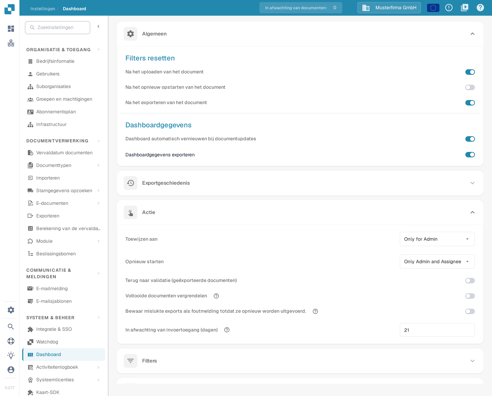
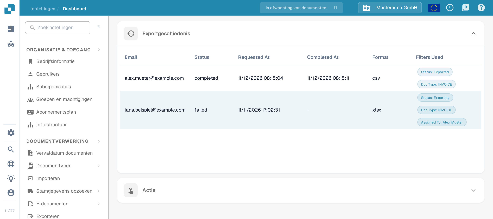
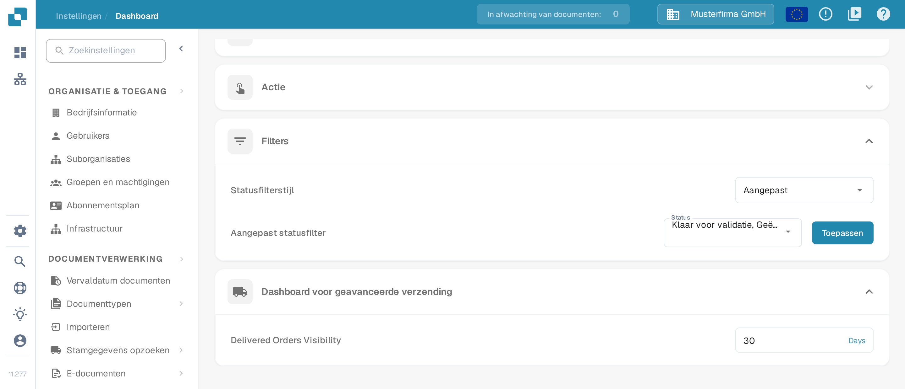

# Dashboard

## Overzicht

De dashboardinstellingen helpen beheerders te bepalen welke gegevens het DocBits-dashboard toont en hoe gebruikers ermee werken. Ze bepalen welke informatie direct na het inloggen beschikbaar is, zodat gebruikers snel toegang hebben tot de gegevens die voor hun taken relevant zijn.

<figure><figcaption>
Huidige weergave van Algemeen en Actie in de Nederlandse interface. Exportgeschiedenis is ingeklapt; de getoonde waarden zijn voorbeeldgegevens.
</figcaption></figure>

## Toegang tot de dashboardinstellingen

Om de dashboardinstellingen te openen, ga je naar:\
**Instellingen → Dashboard**

Klap een sectie open om de bediening te bekijken. Instellingen worden opgeslagen zodra je een schakelaar, een selectie of een getal wijzigt; **Toepassen** slaat de aangepaste statusselectie op.

## **Algemeen**

De sectie heet in de Nederlandse interface ook **Algemeen**.

* **Filters resetten**: hiermee stel je in wanneer dashboardfilters opnieuw moeten beginnen, bijvoorbeeld na het uploaden, het opnieuw opstarten of het exporteren van een document. De interface noemt de drie opties **Na het uploaden van het document**, **Na het opnieuw opstarten van het document** en **Na het exporteren van het document**. Zo begint de weergave bij elke stap van de werkstroom met een schone lei.
* **Dashboardgegevens**:
  * **Dashboard automatisch vernieuwen bij documentupdates**: schakelaar die bepaalt of het dashboard zijn gegevens automatisch herlaadt wanneer documenten veranderen. Staat de schakelaar aan, dan worden wijzigingen — bijvoorbeeld een statuswijziging door een andere gebruiker — vanzelf overgenomen, zodat de lijst altijd de actuele stand toont zonder handmatig vernieuwen.
  * **Dashboardgegevens exporteren**: voegt een knop **Exporteren** toe aan de werkbalk van het dashboard. Daarmee exporteer je de huidige dashboardweergave als **.csv**- of **.xlsx**-bestand. Voor de stappen zie [Dashboardgegevens exporteren](../../document-processing/module/export-dashboard-data.md).

## **Exportgeschiedenis**

In de **Exportgeschiedenis** zie je een tabel met alle eerdere exports en de belangrijkste gegevens van elke aanvraag.

<figure><figcaption>
Twee voorbeeldregels in de Exportgeschiedenis. De adressen eindigen op example.com; datums, statussen en filters zijn voorbeeldgegevens. De kolomkoppen Email, Status, Requested At, Completed At, Format en Filters Used staan in de Nederlandse interface nog in het Engels.
</figcaption></figure>

De tabel bevat de volgende gegevens:

* **Email**: het e-mailadres dat voor de export is vastgelegd.
* **Status**: de huidige status van de export, bijvoorbeeld **completed**, **failed** of een export die nog loopt (in de schermafbeelding **Exporting**).
* **Requested At**: de datum en het tijdstip waarop de export is gestart.
* **Completed At**: de datum en het tijdstip waarop de export is voltooid; bij een mislukte export staat er een streepje.
* **Format**: het bestandsformaat van de export (**csv** of **xlsx**).
* **Filters Used**: de actieve filters verschijnen als chips, elke chip met een naam en een waarde, bijvoorbeeld **Status: Exported** of **Doc Type: INVOICE**. Bij meer filters toont een **+N**-chip hoeveel extra filters er zijn. Wijs de filtercel aan om de volledige lijst in een tooltip te zien. Filters met de waarde **None** worden weggelaten.

In de Nederlandse interface staan de kolomkoppen en de chipnamen nog in het Engels.

<mark style="color:red;">**Opmerking**</mark>: om tabellen te kunnen exporteren, moet de optie Dashboardgegevens exporteren in de sectie [Algemeen](./#algemeen) aan staan.

## **Actie**

* **Toewijzen aan**: hiermee bepaal je wie documenten mag toewijzen. De opties staan in de Nederlandse interface in het Engels.
  * **Only for Admin**: alleen beheerders kunnen documenten toewijzen, ongeacht de machtigingen van niet-beheerders.
  * **All Users**: alle gebruikers met de benodigde [machtigingen](../groups-users-and-permissions/groups-and-permissions/activating-permissions.md) kunnen documenten toewijzen.
* **Opnieuw starten**: hiermee bepaal je wie documenten opnieuw mag starten. Ook deze opties staan in het Engels.
  * **Only for Admin**: alleen beheerders kunnen documenten opnieuw starten, ongeacht de machtigingen van niet-beheerders.
  * **Only Admin and Assignee**: alleen beheerders en de gebruiker aan wie het document is toegewezen, kunnen het document opnieuw starten.
  * **All Users**: alle gebruikers met de benodigde [machtigingen](../groups-users-and-permissions/groups-and-permissions/activating-permissions.md) kunnen documenten opnieuw starten.
* **Terug naar validatie (geëxporteerde documenten)**: bepaalt of een geëxporteerd document terug naar validatie kan.
* **Voltooide documenten vergrendelen**: volgens de help bij deze schakelaar kunnen vergrendelde documenten daarna alleen nog worden gearchiveerd of als fout (of exportfout) gemarkeerd; bewerken, hervatten, exporteren en toewijzen kan dan niet meer. Werkstromen die na de export doorlopen, bijvoorbeeld goedkeuring, gebruiken daarom de status **Geëxporteerd**.
* **Bewaar mislukte exports als foutmelding totdat ze opnieuw worden uitgevoerd.**: volgens de help blijft een document de status **exportfout** houden wanneer een inactieve exportconfiguratie — bijvoorbeeld een configuratie die alleen door een werkstroom wordt gestart — niet exporteert, totdat die configuratie opnieuw met succes exporteert. Alleen de export opnieuw starten haalt de fout niet weg.
* **In afwachting van invoertoegang (dagen)**: het aantal dagen dat iemand die in het activiteitenlogboek om invoer is gevraagd het document alleen-lezen kan openen; daarna werkt de koppeling niet meer, en de toegang eindigt ook zodra het document verder gaat. De standaardwaarde is 14 dagen. Zie [Pending Input](../../../../end-user-and-partner-section/end-user-section/pending-input.md).

## **Filters**

* **Statusfilterstijl**: kies **Alle**, **Statisch** of **Aangepast** om te bepalen welke statusfilters worden aangeboden. **Aangepast** toont de statuskeuze en de knop **Toepassen**.
* **Aangepast statusfilter**: hiermee maak en pas je eigen filters toe op bepaalde documentstatussen, zoals **Klaar voor validatie** of **Geëxporteerd**. Zo vind je snel de documenten die in een bepaalde stap van de verwerking staan.

<figure><figcaption>
Filters met de stijl Aangepast en het Dashboard voor geavanceerde verzending. De gekozen statussen en de 30 dagen zijn voorbeeldgegevens; de labels Delivered Orders Visibility en Days staan nog in het Engels.
</figcaption></figure>

Voor de stappen om **Aangepast** te kiezen, statussen te selecteren, de keuze toe te passen of terug te gaan naar **Alle**, zie [Aangepaste filters](page-1.md).

## Dashboard voor geavanceerde verzending

* **Delivered Orders Visibility**: hiermee geef je aan hoe lang geleverde bestellingen zichtbaar blijven. Het label en de eenheid **Days** staan in de Nederlandse interface nog in het Engels.

Deze dashboardinstellingen helpen om DocBits zo responsief en nuttig mogelijk te maken: je volgt en beheert de documentverwerking rechtstreeks vanuit het dashboard.
