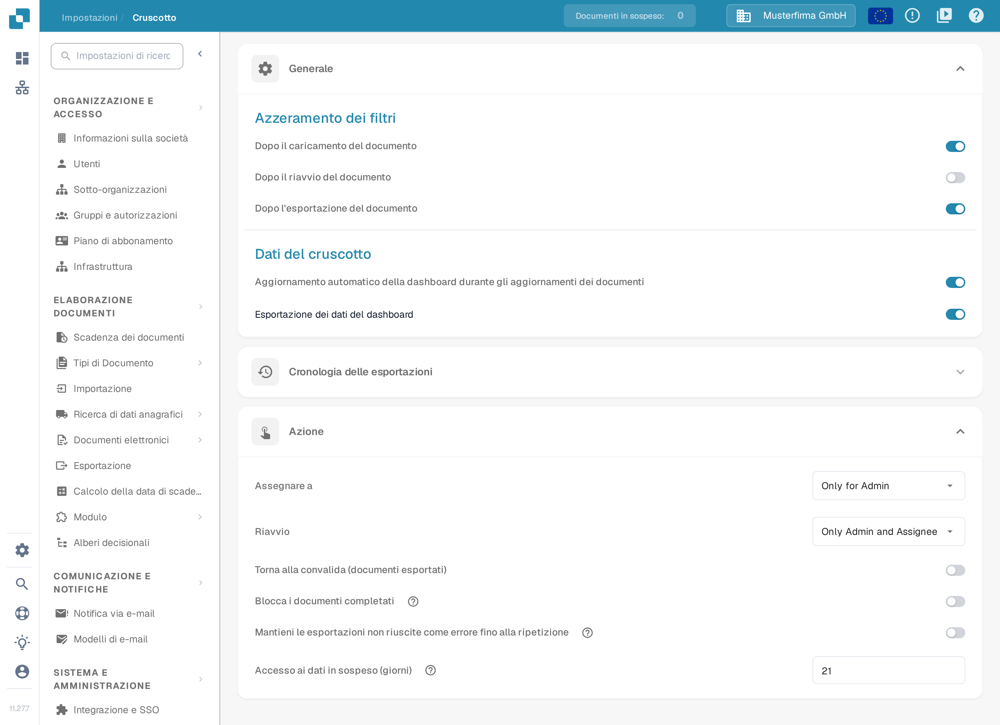
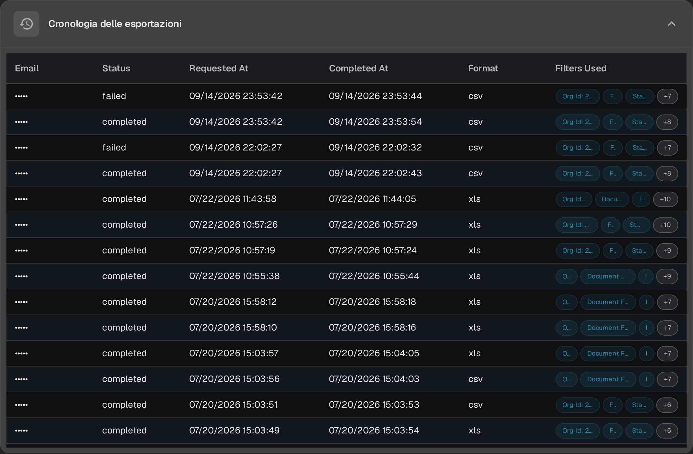
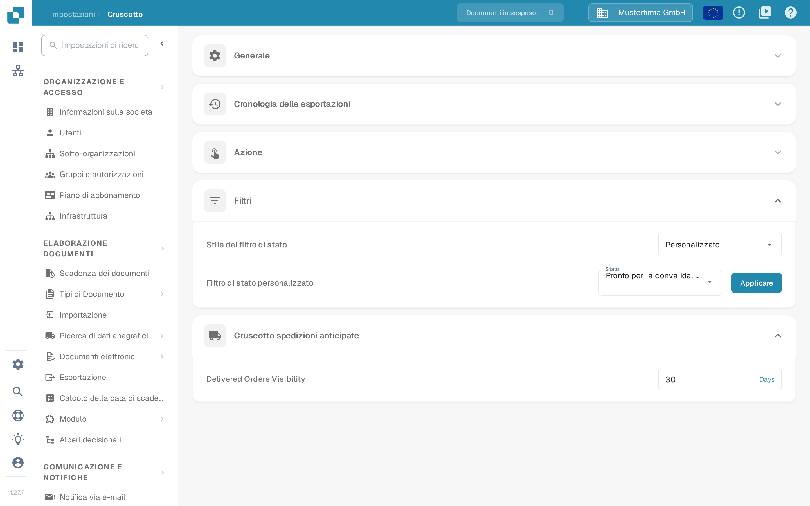

# Dashboard

## Panoramica

Le impostazioni della Dashboard aiutano gli amministratori a controllare come i dati vengono presentati e come si interagisce con il cruscotto di DocBits. Queste impostazioni stabiliscono quali informazioni sono subito disponibili dopo l'accesso, così ogni utente trova rapidamente i dati più importanti per le proprie attività.

<figure><figcaption>
Le impostazioni <strong>Generale</strong> e <strong>Azione</strong> nella interfaccia italiana. La sezione Cronologia delle esportazioni è chiusa; i valori visibili, per esempio i 21 giorni di accesso ai dati in sospeso, sono dati di esempio inventati per questa cattura.
</figcaption></figure>

## Accedere alle impostazioni della Dashboard

Per aprire le impostazioni della dashboard vai a:\
**Impostazioni → Cruscotto**

Nella barra laterale delle impostazioni la voce si chiama **Cruscotto** e si trova nella sezione **SISTEMA E AMMINISTRAZIONE**. Apri una sezione per vedere i suoi controlli. Le impostazioni vengono salvate appena cambi un interruttore, una scelta o un valore numerico; **Applicare** salva la selezione degli stati personalizzati.

## **Generale**

* **Azzeramento dei filtri**: stabilisce quando i filtri della dashboard devono essere azzerati, cioè **Dopo il caricamento del documento**, **Dopo il riavvio del documento** e **Dopo l'esportazione del documento**. Così la vista dei dati riparte pulita nelle fasi del flusso di lavoro che scegli.
* **Dati del cruscotto**:
  * **Aggiornamento automatico della dashboard durante gli aggiornamenti dei documenti**: un interruttore che decide se la dashboard ricarica i propri dati quando i documenti cambiano. Se è attivo, le modifiche — per esempio un cambio di stato fatto da un'altra persona — compaiono da sole, quindi l'elenco mostra sempre lo stato attuale senza dover ricaricare la pagina.
  * **Esportazione dei dati del dashboard**: questa funzione aggiunge alla barra degli strumenti della dashboard un pulsante per esportare la vista corrente come file **.csv** o **.xlsx**. Per la procedura passo passo vedi [Esportare i dati della dashboard](../../document-processing/module/export-dashboard-data.md).

## **Cronologia delle esportazioni**

Nella **Cronologia delle esportazioni** trovi una tabella con tutte le esportazioni già richieste e le informazioni principali su ogni richiesta.

<figure><figcaption>
Righe compatte della cronologia delle esportazioni con chip dei filtri e contatori +N per i filtri aggiuntivi. In questa cattura gli indirizzi e-mail e gli ID organizzazione sono oscurati.
</figcaption></figure>

La tabella riporta i seguenti dettagli. I titoli delle colonne restano in inglese anche nell'interfaccia italiana:

* **Email**: l'indirizzo del destinatario registrato per l'esportazione.
* **Status**: lo stato dell'esportazione, per esempio **completed** o **failed**.
* **Requested At**: la data e l'ora in cui l'esportazione è stata avviata.
* **Completed At**: la data e l'ora in cui l'esportazione è stata completata; un trattino indica che non è ancora finita.
* **Format**: il formato del file usato per l'esportazione (csv o xlsx).
* **Filters Used**: fino a tre filtri attivi compaiono come chip su una sola riga. Se i filtri applicati sono di più, un chip **+N** indica quanti altri ce ne sono. Passa il puntatore sulla cella dei filtri per vedere l'elenco completo in un suggerimento. I filtri con valore **None** non vengono mostrati.

<mark style="color:red;">**Nota**</mark>: per esportare le tabelle l'opzione **Esportazione dei dati del dashboard** nella sezione [Generale](./#generale) deve essere attiva.

## **Azione**

* **Assegnare a**: questa funzione permette di stabilire chi può assegnare i documenti. Le due scelte sono in inglese anche nell'interfaccia italiana:
  * **Only for Admin**: solo gli utenti amministratori possono assegnare i documenti, indipendentemente dalle autorizzazioni concesse agli altri utenti.
  * **All Users**: tutti gli utenti a cui sono state concesse le necessarie [autorizzazioni](../groups-users-and-permissions/groups-and-permissions/activating-permissions.md) possono assegnare i documenti.
* **Riavvio**: questa funzione permette di stabilire chi può riavviare i documenti. Le tre scelte sono in inglese anche nell'interfaccia italiana:
  * **Only for Admin**: solo gli utenti amministratori possono riavviare i documenti, indipendentemente dalle autorizzazioni concesse agli altri utenti.
  * **Only Admin and Assignee**: solo gli utenti amministratori e la persona a cui il documento è assegnato possono riavviarlo.
  * **All Users**: tutti gli utenti a cui sono state concesse le necessarie [autorizzazioni](../groups-users-and-permissions/groups-and-permissions/activating-permissions.md) possono riavviare i documenti.

* **Accesso ai dati in sospeso (giorni)**: stabilisce per quanti giorni la persona a cui è stata chiesta un'informazione nel flusso di attività può aprire il documento in sola lettura; dopo, il link non funziona più. Il valore predefinito è 14 giorni e l'accesso termina anche appena il documento prosegue. Vedi [Pending Input](../../../../end-user-and-partner-section/end-user-section/pending-input.md).
* **Torna alla convalida (documenti esportati)**: controlla l'azione che riporta in convalida un documento già esportato.
* **Blocca i documenti completati**: il testo di aiuto accanto all'opzione (icona **?**) spiega che un documento bloccato può solo essere archiviato o messo in uno stato di errore. I flussi di lavoro che devono proseguire dopo l'esportazione usano lo stato **Esportato**.
* **Mantieni le esportazioni non riuscite come errore fino alla ripetizione**: per una configurazione di esportazione inattiva avviata da un flusso di lavoro, mantiene lo stato di **errore di esportazione** finché quella configurazione non esporta di nuovo con successo. Riavviare soltanto l'esportazione non cancella l'errore, come spiega il testo di aiuto del controllo.

## **Filtri**

* **Stile del filtro di stato**: scegli **Tutti**, **Statico** o **Personalizzato** per decidere quali filtri di stato vengono offerti. **Personalizzato** mostra la scelta degli stati e il controllo **Applicare**.
* **Filtro di stato personalizzato**: permette di creare e applicare filtri personalizzati su stati specifici del documento, per esempio **Pronto per la convalida** o **Esportato**. Così si trovano subito i documenti che si trovano in una determinata fase di elaborazione.

<figure><figcaption>
I filtri con stile <strong>Personalizzato</strong> e il <strong>Cruscotto spedizioni anticipate</strong> nella interfaccia italiana. Gli stati selezionati e il valore di 30 giorni sono dati di esempio inventati per questa cattura.
</figcaption></figure>

Per i passaggi necessari a scegliere **Personalizzato**, selezionare gli stati, applicare la selezione o tornare a **Tutti**, vedi [Filtri Personalizzati](page-1.md).

## Cruscotto spedizioni anticipate

* **Delivered Orders Visibility**: questa opzione, il cui nome resta in inglese anche nell'interfaccia italiana, permette di indicare per quanti giorni gli ordini consegnati restano visibili. Il valore si inserisce in giorni; accanto al campo compare l'unità **Days**.

Queste impostazioni della dashboard sono importanti perché rendono la piattaforma DocBits il più possibile reattiva e utile: offrono uno strumento potente per monitorare e gestire l'elaborazione dei documenti direttamente dalla dashboard.
