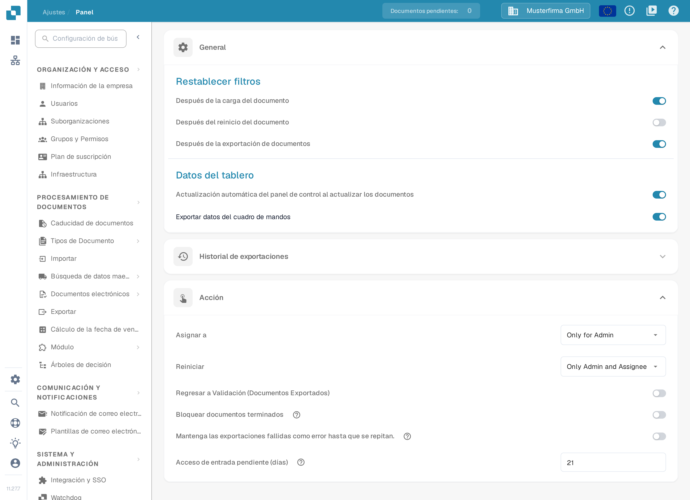
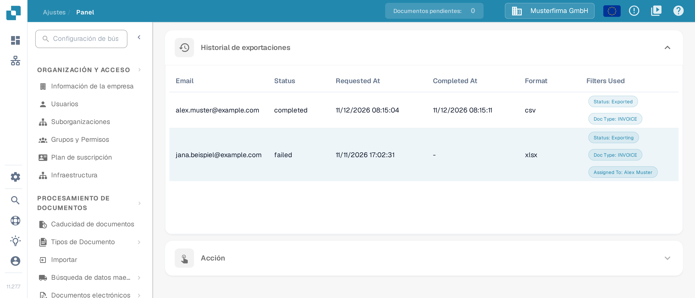
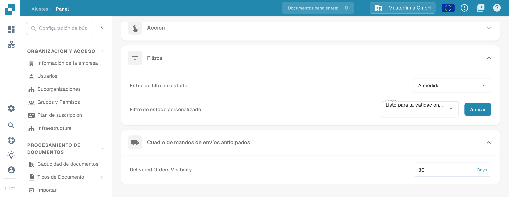

# Panel

## Resumen

Los ajustes del Panel ayudan a los administradores a controlar qué datos muestra el panel de DocBits y cómo se interactúa con ellos. Estos ajustes determinan qué información está disponible de inmediato al iniciar sesión, de modo que los usuarios accedan rápido a los datos más relevantes para sus tareas.

<figure><figcaption>
Valores actuales de General y Acción en la interfaz en español. Historial de exportaciones está contraído; los valores mostrados son datos de ejemplo.
</figcaption></figure>

## Acceder a los ajustes del Panel

Para acceder a los ajustes del panel, ve a:\
**Ajustes → Panel**

Despliega una sección para revisar sus controles. Los ajustes se guardan al cambiar un interruptor, una selección o un valor numérico; **Aplicar** guarda la selección de estados personalizada.

## **General**

La sección se llama **General** también en la interfaz en español.

* **Restablecer filtros**: permite configurar cuándo deben restablecerse los filtros del panel. Las opciones son **Después de la carga del documento**, **Después del reinicio del documento** y **Después de la exportación de documentos**. Así la vista parte de un estado limpio en cada etapa del flujo de trabajo.
* **Datos del tablero**:
  * **Actualización automática del panel de control al actualizar los documentos**: interruptor que controla si el panel recarga sus datos cuando los documentos cambian. Si está activo, los cambios —por ejemplo, un cambio de estado hecho por otra persona— se reflejan solos, sin recargar la página a mano.
  * **Exportar datos del cuadro de mandos**: añade el botón **Exportar** a la barra de herramientas del panel y permite exportar la vista actual del panel como archivo **.csv** o **.xlsx**. Para el procedimiento paso a paso, consulta [Exportar datos del cuadro de mandos](../../document-processing/module/export-dashboard-data.md).

## **Historial de exportaciones**

En el **Historial de exportaciones** verás una tabla que lista todas las exportaciones anteriores junto con la información clave de cada solicitud.

<figure><figcaption>
Tabla del Historial de exportaciones con dos filas de ejemplo. Las direcciones terminan en example.com y las fechas, formatos y filtros mostrados son datos de ejemplo.
</figcaption></figure>

La tabla incluye estos datos:

* **Email**: la dirección de correo registrada para la exportación.
* **Status**: el estado actual de la exportación (en la captura, por ejemplo, completed o failed).
* **Requested At**: la fecha y la hora en que se inició la exportación.
* **Completed At**: la fecha y la hora en que se completó la exportación.
* **Format**: el formato de archivo usado para la exportación (CSV, XLSX).
* **Filters Used**: hasta tres filtros activos aparecen como chips en una sola línea. Si se aplicaron más filtros, un chip **+N** indica cuántos más hay. Al pasar el puntero sobre la celda de filtros se ve la lista completa. Los filtros con el valor **None** se omiten.

En la interfaz en español los encabezados de esta tabla todavía aparecen en inglés.

<mark style="color:red;">**Nota**</mark>: para exportar las tablas debe estar activa la opción Exportar datos del cuadro de mandos de la sección [General](./#general).

## **Acción**

* **Asignar a**: permite definir quién puede asignar documentos. Las opciones se muestran en inglés en la interfaz.
  * **Only for Admin**: solo los usuarios administradores pueden asignar documentos, independientemente de los permisos concedidos a los demás usuarios.
  * **All Users**: todos los usuarios a los que se hayan concedido los [permisos](../groups-users-and-permissions/groups-and-permissions/activating-permissions.md) necesarios pueden asignar documentos.
* **Reiniciar**: permite definir quién puede reiniciar documentos. Las opciones se muestran en inglés en la interfaz.
  * **Only for Admin**: solo los usuarios con privilegios de administrador pueden reiniciar documentos, independientemente de los permisos concedidos a los demás usuarios.
  * **Only Admin and Assignee**: solo los usuarios con privilegios de administrador y la persona asignada pueden reiniciar el documento.
  * **All Users**: todos los usuarios a los que se hayan concedido los [permisos](../groups-users-and-permissions/groups-and-permissions/activating-permissions.md) necesarios pueden reiniciar documentos.
* **Regresar a Validación (Documentos Exportados)**: controla la acción de devolver a validación documentos que ya se exportaron.
* **Bloquear documentos terminados**: el texto de ayuda del control explica que, una vez bloqueados, los documentos terminados solo pueden archivarse o ponerse en un estado de error. Los flujos de trabajo que deben continuar después de la exportación usan el estado **Exportado**.
* **Mantenga las exportaciones fallidas como error hasta que se repitan**: en una configuración de exportación inactiva iniciada por un flujo de trabajo, mantiene el **error de exportación** hasta que esa configuración vuelva a exportar correctamente. Reiniciar solo la exportación no borra el fallo, como indica el texto de ayuda del control.
* **Acceso de entrada pendiente (días)**: define cuántos días la persona a la que se le pidió una entrada en el flujo de actividad puede abrir el documento en modo de solo lectura; después, el enlace deja de funcionar. El valor predeterminado es 14 días y el acceso también termina en cuanto el documento avanza. Consulta [Pending Input](../../../../end-user-and-partner-section/end-user-section/pending-input.md).

## **Filtros**

* **Estilo de filtro de estado**: elige **Todo**, **Estático** o **A medida** para controlar qué filtros de estado se ofrecen. **A medida** muestra la selección de estados y el control **Aplicar**.
* **Filtro de estado personalizado**: permite crear y aplicar filtros propios dirigidos a estados concretos del documento, como "Nuevo", "Validante" o "Exportando". Así se accede rápido a los documentos que están en una etapa determinada del procesamiento.

<figure><figcaption>
Filtros con el estilo A medida y el Cuadro de mandos de envíos anticipados. Los estados elegidos y los 30 días son datos de ejemplo y no se aplicó ningún cambio.
</figcaption></figure>

Para los pasos de elegir **A medida**, seleccionar estados, aplicar la selección o volver a **Todo**, consulta [Filtros Personalizados](page-1.md).

## Cuadro de mandos de envíos anticipados

* **Delivered Orders Visibility**: permite indicar durante cuánto tiempo serán visibles los pedidos entregados. La etiqueta y la unidad **Days** aparecen en inglés en la interfaz.

Estos ajustes del panel son decisivos para que la plataforma DocBits responda lo mejor posible y sea útil: ofrecen a los usuarios una herramienta potente para supervisar y gestionar el procesamiento de documentos directamente desde el panel.
