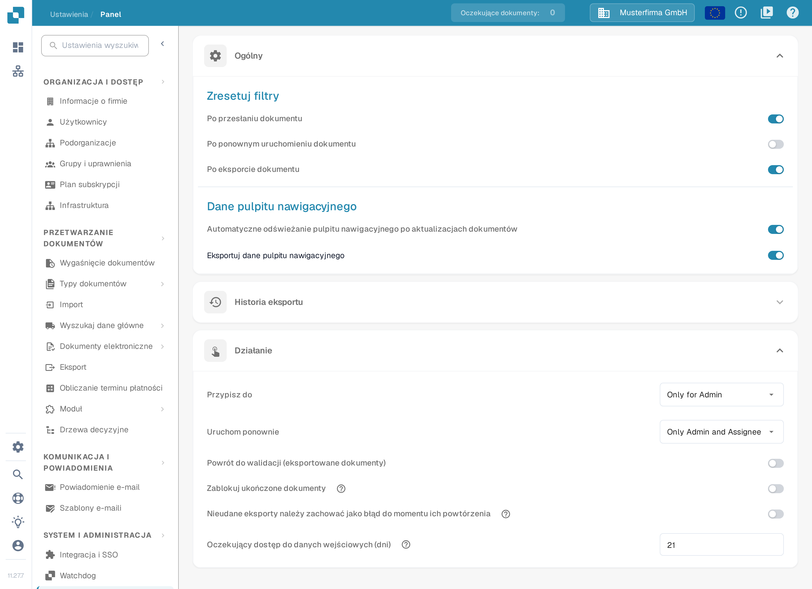
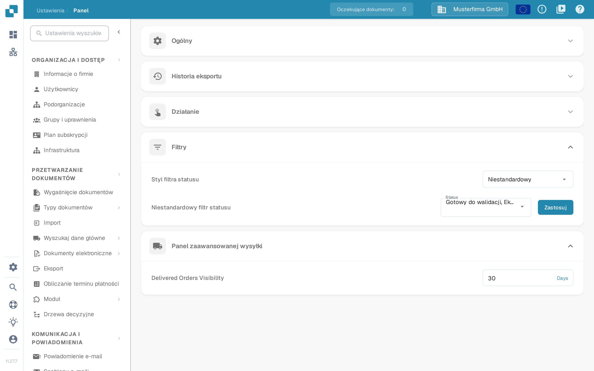

# Pulpit

## Przegląd

Ustawienia pulpitu nawigacyjnego pomagają administratorom kontrolować sposób prezentacji danych i pracy z panelem DocBits. Te ustawienia określają, jakie informacje są dostępne od razu po zalogowaniu, dzięki czemu użytkownicy szybko docierają do danych najważniejszych dla ich zadań.

<figure><figcaption>
Sekcje <strong>Ogólny</strong> i <strong>Działanie</strong> w polskim interfejsie. Sekcja Historia eksportu jest zwinięta; widoczne wartości, na przykład 21 dni oczekującego dostępu do danych wejściowych, to wymyślone dane przykładowe dla tego zrzutu.
</figcaption></figure>

## Uzyskiwanie dostępu do ustawień pulpitu

Aby otworzyć ustawienia pulpitu nawigacyjnego, przejdź do:\
**Ustawienia → Panel**

W pasku bocznym ustawień wpis nazywa się **Panel** i znajduje się w sekcji **SYSTEM I ADMINISTRACJA**. Rozwiń sekcję, aby zobaczyć jej elementy sterujące. Ustawienia zapisują się od razu po zmianie przełącznika, wyboru lub wartości liczbowej; **Zastosuj** zapisuje wybór niestandardowych statusów.

## **Ogólny**

* **Zresetuj filtry**: określa, kiedy filtry pulpitu mają się resetować, na przykład **Po przesłaniu dokumentu**, **Po ponownym uruchomieniu dokumentu** i **Po eksporcie dokumentu**. Dzięki temu widok danych zaczyna się od czystego stanu na wybranych etapach pracy.
* **Dane pulpitu nawigacyjnego**:
  * **Automatyczne odświeżanie pulpitu nawigacyjnego po aktualizacjach dokumentów**: przełącznik decyduje, czy pulpit odświeża swoje dane, gdy dokumenty się zmieniają. Po włączeniu zmiany — na przykład status zmieniony przez inną osobę — pojawiają się same, więc lista zawsze pokazuje aktualny stan bez ręcznego odświeżania strony.
  * **Eksportuj dane pulpitu nawigacyjnego**: ta funkcja dodaje do paska narzędzi pulpitu przycisk eksportu bieżącego widoku do pliku **.csv** lub **.xlsx**. Instrukcję krok po kroku znajdziesz w sekcji [Eksportuj dane pulpitu nawigacyjnego](../../document-processing/module/export-dashboard-data.md).

## **Historia eksportu**

W **Historii eksportu** znajdziesz tabelę ze wszystkimi dotychczasowymi eksportami i najważniejszymi informacjami o każdym żądaniu.

<figure><figcaption>
Zwarte wiersze historii eksportu z chipami filtrów i licznikami +N dla dodatkowych filtrów. Na tym zrzucie adresy e-mail i identyfikatory organizacji są zamaskowane.
</figcaption></figure>

Tabela zawiera następujące informacje. Nagłówki kolumn pozostają po angielsku również w polskim interfejsie:

* **Email**: adres e-mail odbiorcy zapisany dla eksportu.
* **Status**: stan eksportu, na przykład **completed** lub **failed**.
* **Requested At**: data i godzina rozpoczęcia eksportu.
* **Completed At**: data i godzina zakończenia eksportu; myślnik oznacza, że eksport jeszcze się nie zakończył.
* **Format**: format pliku użyty do eksportu (csv lub xlsx).
* **Filters Used**: maksymalnie trzy aktywne filtry pojawiają się jako chipy w jednym wierszu. Jeśli zastosowano więcej filtrów, chip **+N** pokazuje, ile ich jeszcze jest. Wskaż komórkę filtrów, aby zobaczyć pełną listę w podpowiedzi. Filtry o wartości **None** nie są wyświetlane.

<mark style="color:red;">**Uwaga**</mark>: aby eksportować tabele, opcja **Eksportuj dane pulpitu nawigacyjnego** w sekcji [Ogólny](./#ogolny) musi być włączona.

## **Działanie**

* **Przypisz do**: ta funkcja pozwala określić, kto może przypisywać dokumenty. Obie opcje pozostają po angielsku również w polskim interfejsie:
  * **Only for Admin**: tylko użytkownicy z uprawnieniami administratora mogą przypisywać dokumenty, niezależnie od uprawnień przyznanych pozostałym użytkownikom.
  * **All Users**: wszyscy użytkownicy, którym przyznano niezbędne [uprawnienia](../groups-users-and-permissions/groups-and-permissions/activating-permissions.md), mogą przypisywać dokumenty.
* **Uruchom ponownie**: ta funkcja pozwala określić, kto może ponownie uruchamiać dokumenty. Trzy opcje pozostają po angielsku również w polskim interfejsie:
  * **Only for Admin**: tylko użytkownicy z uprawnieniami administratora mogą ponownie uruchamiać dokumenty, niezależnie od uprawnień przyznanych pozostałym użytkownikom.
  * **Only Admin and Assignee**: tylko użytkownicy z uprawnieniami administratora oraz osoba, której dokument przypisano, mogą go ponownie uruchomić.
  * **All Users**: wszyscy użytkownicy, którym przyznano niezbędne [uprawnienia](../groups-users-and-permissions/groups-and-permissions/activating-permissions.md), mogą ponownie uruchamiać dokumenty.

* **Oczekujący dostęp do danych wejściowych (dni)**: określa, przez ile dni osoba poproszona o informację w strumieniu aktywności może otwierać dokument tylko do odczytu; po tym czasie link przestaje działać. Wartość domyślna to 14 dni, a dostęp kończy się również wtedy, gdy dokument przejdzie dalej. Zobacz [Oczekujące dane wejściowe](../../../../end-user-and-partner-section/end-user-section/pending-input.md).
* **Powrót do walidacji (eksportowane dokumenty)**: kontroluje akcję przywracania do walidacji dokumentu, który został już wyeksportowany.
* **Zablokuj ukończone dokumenty**: tekst pomocy przy opcji (ikona **?**) wyjaśnia, że zablokowany dokument można już tylko zarchiwizować albo ustawić dla niego status błędu. Przepływy pracy, które muszą być kontynuowane po eksporcie, korzystają ze statusu **Eksportowano**.
* **Nieudane eksporty należy zachować jako błąd do momentu ich powtórzenia**: w przypadku nieaktywnej konfiguracji eksportu uruchomionej przez przepływ pracy utrzymuje status **błąd eksportu**, dopóki ta konfiguracja nie wyeksportuje ponownie z powodzeniem. Samo ponowne uruchomienie eksportu nie usuwa błędu, co wyjaśnia tekst pomocy przy tej opcji.

## **Filtry**

* **Styl filtra statusu**: wybierz **Wszystko**, **Statyczny** lub **Niestandardowy**, aby zdecydować, jakie filtry statusu są oferowane. **Niestandardowy** pokazuje wybór statusów oraz przycisk **Zastosuj**.
* **Niestandardowy filtr statusu**: pozwala tworzyć i stosować filtry dla wybranych statusów dokumentu, na przykład **Gotowy do walidacji** lub **Eksportowano**. Dzięki temu od razu znajdujesz dokumenty znajdujące się na określonym etapie przetwarzania.

<figure><figcaption>
Filtry ze stylem <strong>Niestandardowy</strong> oraz <strong>Panel zaawansowanej wysyłki</strong> w polskim interfejsie. Wybrane statusy i wartość 30 dni to wymyślone dane przykładowe dla tego zrzutu.
</figcaption></figure>

Kroki potrzebne do wybrania opcji **Niestandardowy**, zaznaczenia statusów, zastosowania wyboru i powrotu do **Wszystko** znajdziesz w sekcji [Filtry niestandardowe](page-1.md).

## Panel zaawansowanej wysyłki

* **Delivered Orders Visibility**: ta opcja, której nazwa pozostaje po angielsku również w polskim interfejsie, pozwala wskazać, przez ile dni dostarczone zamówienia pozostają widoczne. Wartość podaje się w dniach; obok pola widnieje jednostka **Days**.

Te ustawienia pulpitu są ważne, ponieważ czynią platformę DocBits jak najbardziej responsywną i użyteczną: dają potężne narzędzie do monitorowania i zarządzania przetwarzaniem dokumentów bezpośrednio z pulpitu nawigacyjnego.
