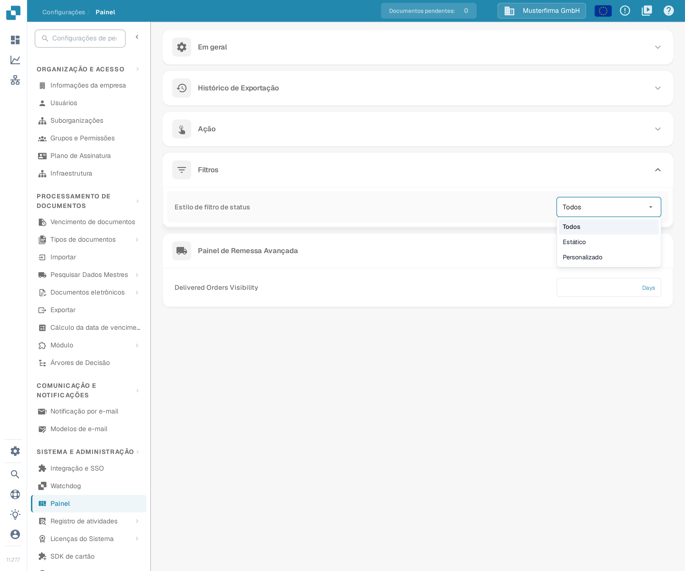
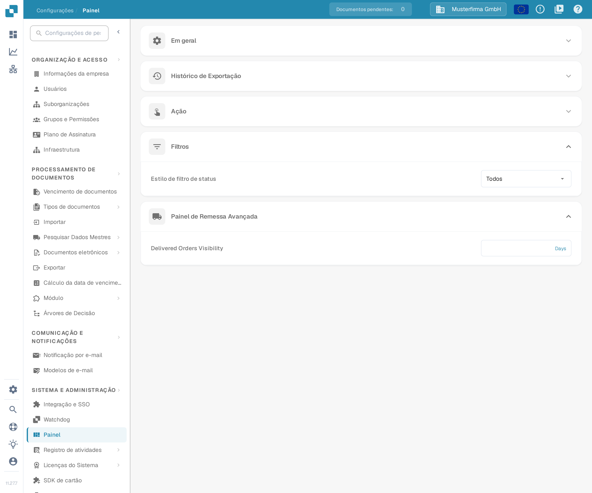

# Personalizando Filtros

Os filtros do painel restringem a lista de documentos à pesquisa atual. A definição **Estilo de filtro de status** é separada: determina que status o filtro de status do painel oferece.

## Filtrar a lista de documentos

Abra o painel e utilize o campo de pesquisa ou os controlos de filtro. O menu de filtros inteligentes oferece atalhos como **Atrasado**, **Em breve**, **Atribuído a mim**, **Validação pendente**, **Correspondência completa de PO** e **Correspondência parcial de PO**.

<figure><figcaption>
Pesquisa de documentos e filtros rápidos.
</figcaption></figure>

Pode combinar vários filtros. Para remover um, clique no **X** do respetivo chip. A filtragem altera apenas os documentos que vê; não altera os valores extraídos de um documento, a sua aprovação nem o estado de exportação.

## Configurar o filtro de status

Abra **Configurações → Painel → Filtros** e escolha o **Estilo de filtro de status**:

* **Todos** mostra a lista completa de status.
* **Estático** mostra uma lista predefinida mais curta.
* **Personalizado** permite escolher os status de que a sua organização necessita.

<figure><figcaption>
Os três estilos de filtro de status.
</figcaption></figure>

A alteração do estilo é guardada imediatamente. Com **Personalizado**, escolha os status em **Filtro de status personalizado** e clique em **Aplicar**. Aplicar uma lista vazia repõe o estilo em **Todos**.

<figure><figcaption>
A definição do filtro de status nas configurações do painel.
</figcaption></figure>

Os administradores da organização definem o valor predefinido da organização. Quando outros utilizadores têm acesso a estes controlos, a sua seleção é guardada como preferência pessoal, que prevalece sobre o valor predefinido da organização.
