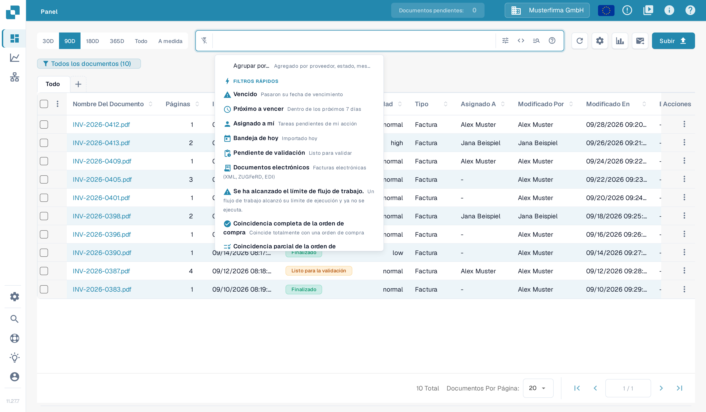
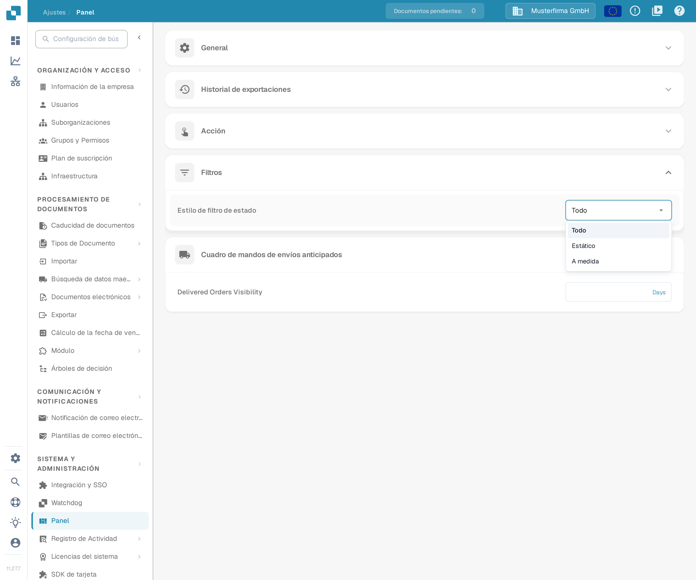
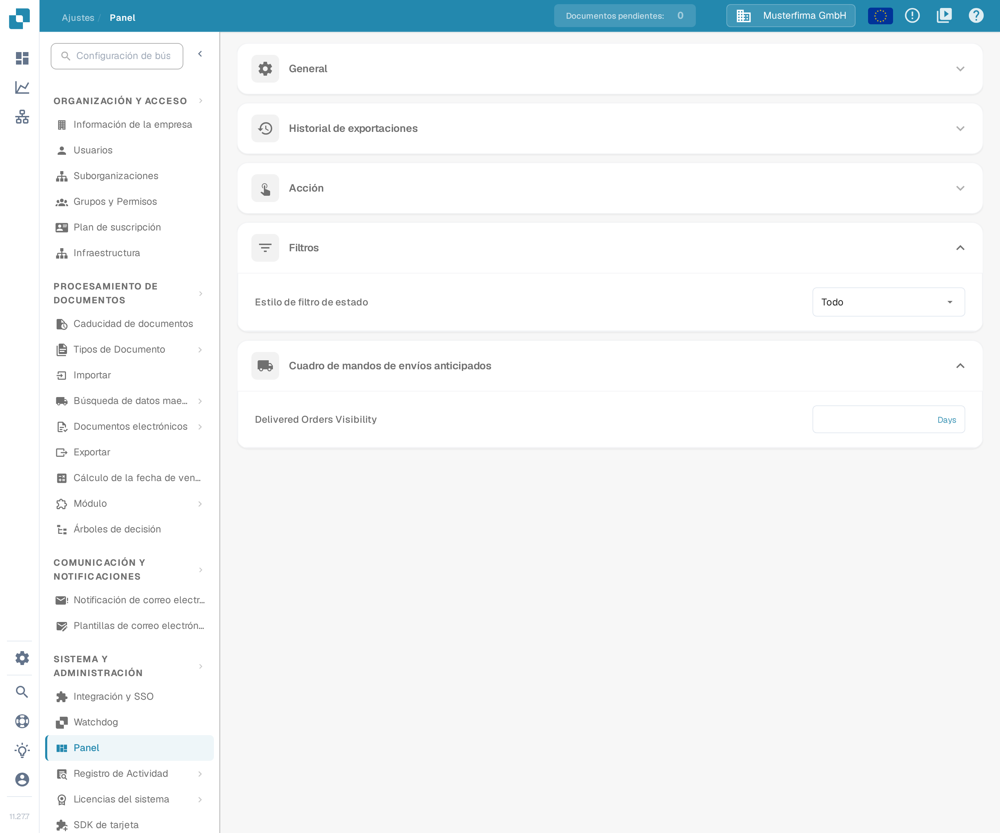

# Personalizar filtros

Los filtros del Panel limitan la lista de documentos de la búsqueda actual. La configuración del **filtro de estado** es independiente: decide qué estados ofrece el filtro de estado del Panel.

## Filtrar la lista de documentos

Abra el Panel y utilice el campo de búsqueda o los controles de filtro. El menú de filtros rápidos ofrece accesos como **Vencido**, **Próximo a vencer**, **Asignado a mí**, **Pendiente de validación**, **Coincidencia completa de la orden de compra** y **Coincidencia parcial de la orden de compra**.

<figure><figcaption>
Menú de filtros rápidos del Panel con datos de ejemplo inventados.
</figcaption></figure>

Puede combinar varios filtros. Para quitar uno, haga clic en la **X** de su etiqueta. El filtrado solo cambia los documentos que ve; no modifica los valores extraídos de un documento, su aprobación ni su estado de exportación.

## Configurar el filtro de estado

Abra **Ajustes → Panel → Filtros** y elija un **Estilo de filtro de estado**:

* **Todo** muestra la lista completa de estados.
* **Estático** muestra una lista predefinida más corta.
* **A medida** le permite elegir los estados que necesita su organización.

<figure><figcaption>
Los tres estilos de filtro de estado.
</figcaption></figure>

Cambiar el estilo se guarda de inmediato. Con **A medida**, elija los estados en **Filtro de estado personalizado** y haga clic en **Aplicar**. Si aplica una lista vacía, el estilo vuelve a **Todo**.

<figure><figcaption>
La configuración del filtro de estado en los ajustes del Panel.
</figcaption></figure>

Los administradores de la organización definen el valor predeterminado para la organización. Cuando otros usuarios tienen acceso a estos controles, su selección se guarda como preferencia personal y prevalece sobre el valor predeterminado de la organización.
