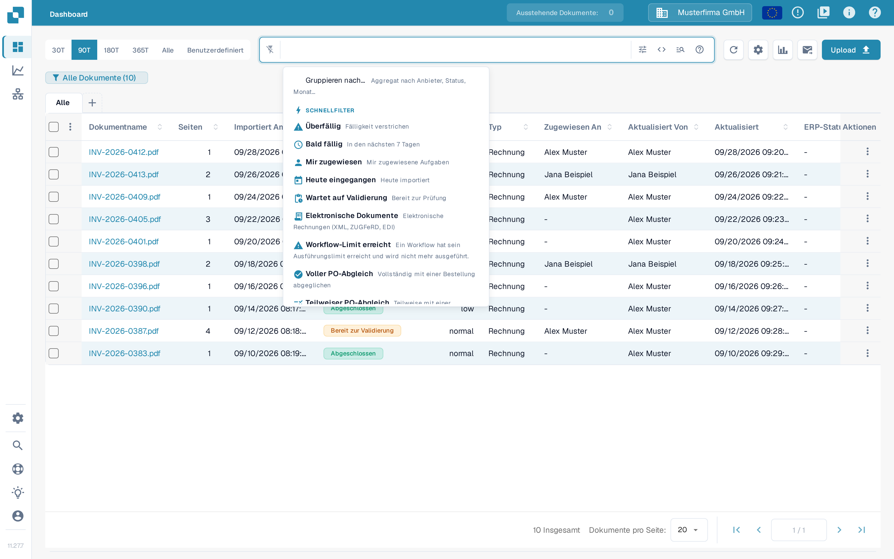
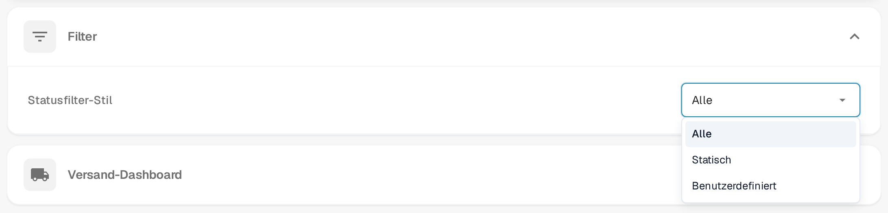
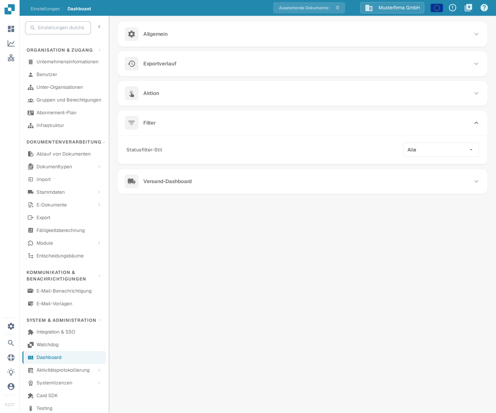

# Filter anpassen

Dashboardfilter grenzen die Dokumentenliste für Ihre aktuelle Suche ein. Die Einstellung **Statusfilter** ist davon getrennt: Sie entscheidet, welche Status der Statusfilter im Dashboard überhaupt anbietet.

## Dokumentenliste filtern

Öffnen Sie das Dashboard und verwenden Sie das Suchfeld oder die Filtersteuerung. Das Schnellfiltermenü bietet Kurzbefehle wie **Überfällig**, **Bald fällig**, **Mir zugewiesen**, **Wartet auf Validierung**, **Voller PO-Abgleich** und **Teilweiser PO-Abgleich**.

<figure><figcaption>
Schnellfilter über dem Suchfeld: Der erste Eintrag ist nur hervorgehoben, es wurde kein Filter angewendet.
</figcaption></figure>

Sie können mehrere Filter kombinieren. Um einen Filter zu entfernen, klicken Sie auf das **X** an seinem Chip. Das Filtern ändert nur, welche Dokumente Sie sehen; die extrahierten Werte, den Freigabe- oder den Exportstatus eines Dokuments ändert es nicht.

## Statusfilter konfigurieren

Öffnen Sie **Einstellungen → Dashboard → Filter** und wählen Sie einen **Statusfilter-Stil**:

* **Alle** zeigt die vollständige Statusliste.
* **Statisch** zeigt eine vorgegebene, kürzere Liste.
* **Benutzerdefiniert** lässt Sie die Status auswählen, die Ihre Organisation benötigt.

<figure><figcaption>
Die drei Statusfilter-Stile. Es wurde keine Option ausgewählt.
</figcaption></figure>

Eine Änderung des Stils wird sofort gespeichert. Bei **Benutzerdefiniert** wählen Sie die Status unter **Benutzerdefinierter Statusfilter** und klicken auf **Anwenden**. Wenn Sie eine leere Liste anwenden, wechselt der Stil zurück zu **Alle**.

<figure><figcaption>
Die Statusfilter-Einstellung in den Dashboard-Einstellungen. Gezeigt ist der vorgefundene Zustand mit dem Stil Alle; es wurde nichts geändert.
</figcaption></figure>

Organisationsadministratoren legen die Vorgabe für die Organisation fest. Wo andere Benutzer Zugriff auf diese Steuerelemente haben, wird ihre Auswahl als persönliche Einstellung gespeichert; sie hat Vorrang vor der Vorgabe der Organisation.
