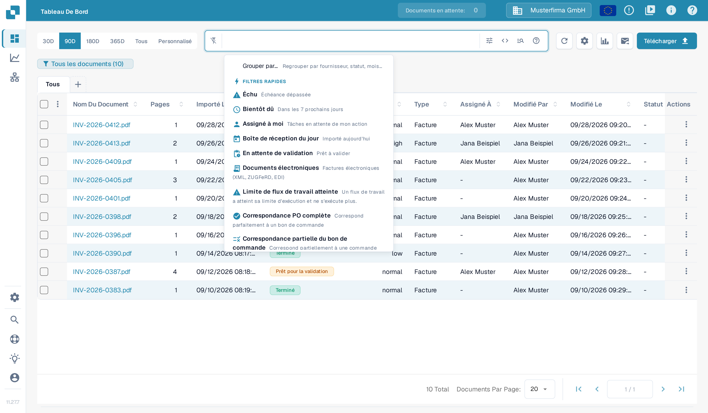
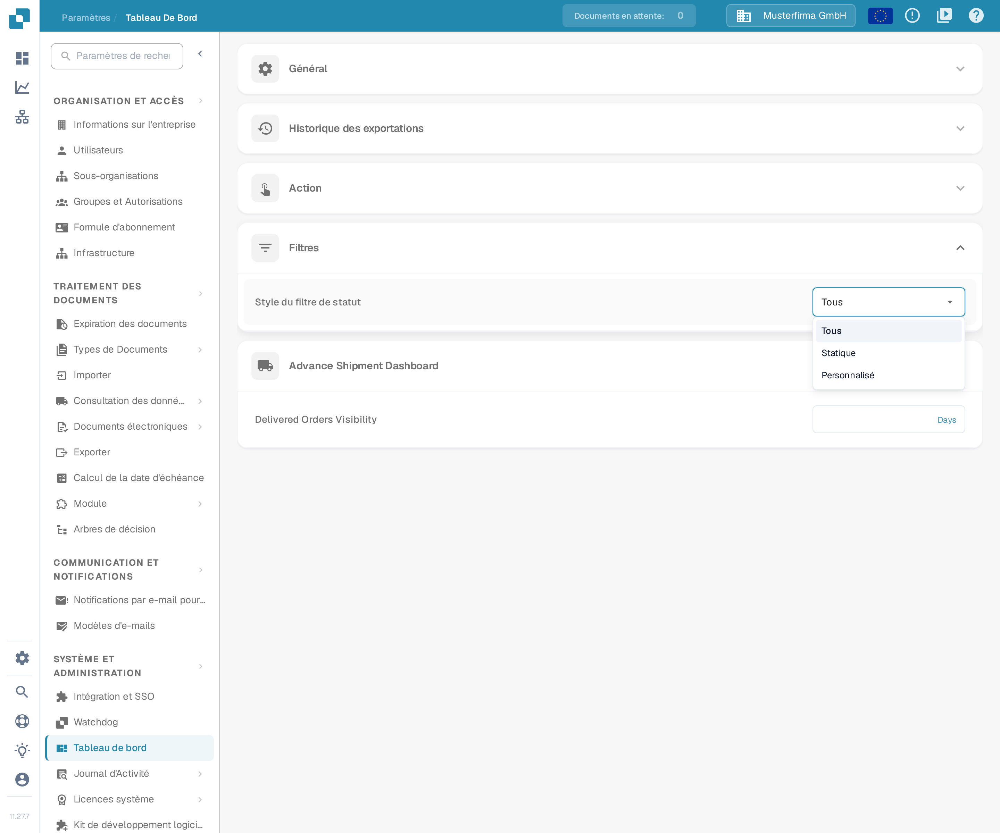
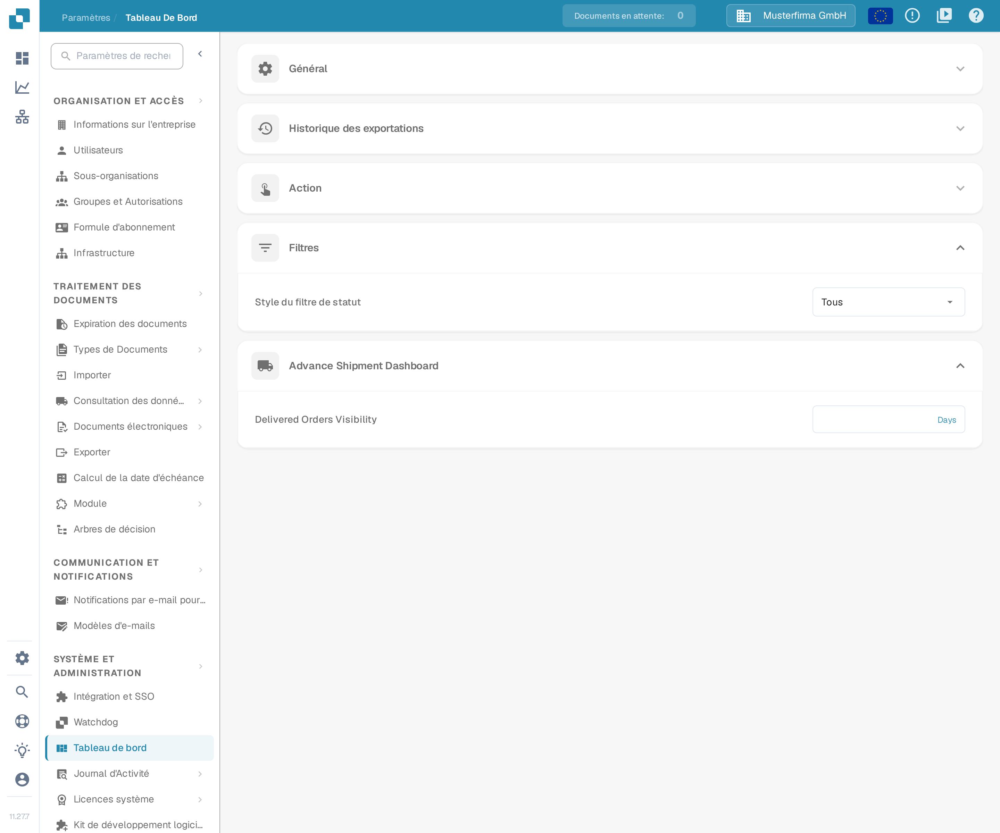

# Personnalisation des filtres

Les filtres du tableau de bord restreignent la liste des documents pour votre recherche en cours. Le réglage du **style du filtre de statut** est distinct : il détermine quels statuts le filtre de statut du tableau de bord propose.

## Filtrer la liste des documents

Ouvrez le tableau de bord et utilisez le champ de recherche ou les commandes de filtre. Le menu des filtres rapides propose des raccourcis comme **Échu**, **Bientôt dû**, **Assigné à moi**, **En attente de validation**, **Correspondance PO complète** et **Correspondance partielle du bon de commande**.

<figure><figcaption>
Le menu des filtres rapides, ouvert au-dessus du champ de recherche.
</figcaption></figure>

Vous pouvez combiner plusieurs filtres. Pour en retirer un, cliquez sur le **X** de son étiquette. Le filtrage modifie uniquement les documents affichés ; il ne change ni les valeurs extraites d'un document, ni son approbation, ni son statut d'export.

Comment rechercher un document, filtrer par statut, responsable ou plage de dates et gérer les onglets de types de documents : consultez le [guide de filtrage des documents](../../../../end-user-and-partner-section/end-user-section/dashboard/filtering-documents.md).

## Configurer le filtre de statut

Ouvrez **Paramètres → Tableau de bord → Filtres** et choisissez un **Style du filtre de statut** :

* **Tous** affiche la liste complète des statuts.
* **Statique** affiche une liste prédéfinie plus courte.
* **Personnalisé** vous permet de choisir les statuts dont votre organisation a besoin.

<figure><figcaption>
Les trois styles de filtre de statut.
</figcaption></figure>

Changer de style l'enregistre immédiatement. Avec **Personnalisé**, choisissez les statuts sous **Filtre d'état personnalisé** et cliquez sur **Appliquer**. Appliquer une liste vide ramène le style à **Tous**.

<figure><figcaption>
Le réglage du filtre de statut dans les paramètres du tableau de bord.
</figcaption></figure>

Les administrateurs de l'organisation définissent la valeur par défaut pour l'organisation. Lorsque d'autres utilisateurs ont accès à ces réglages, leur choix est enregistré comme préférence personnelle, qui prime sur la valeur par défaut de l'organisation.
