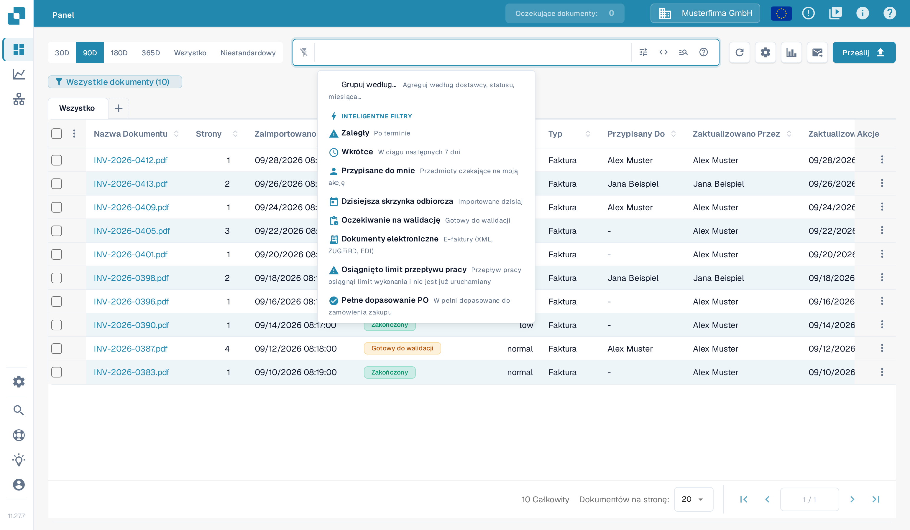
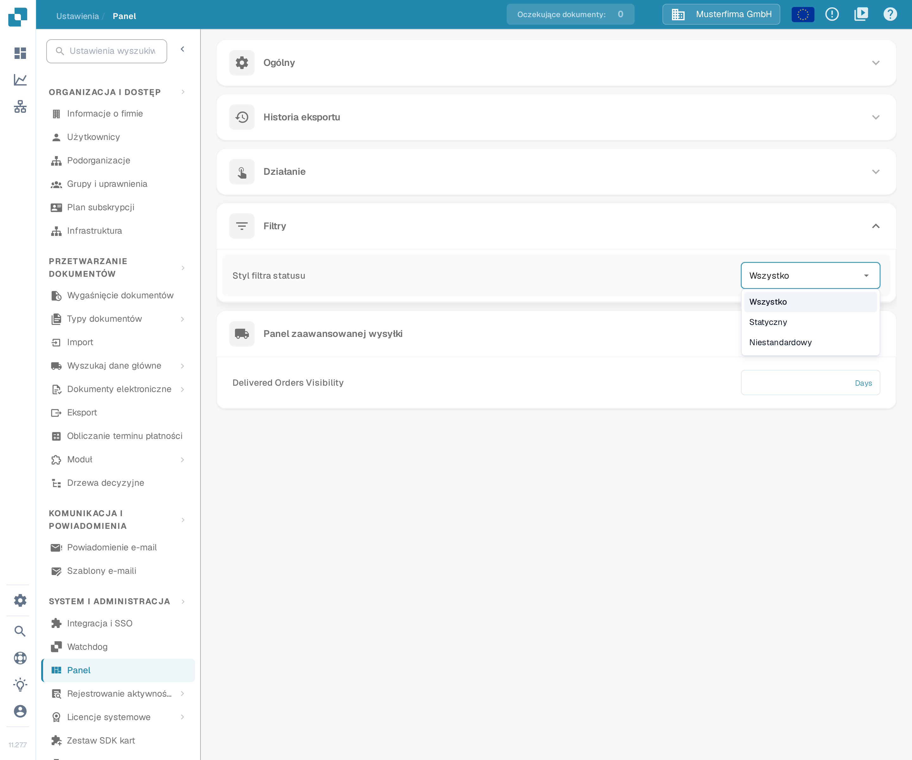
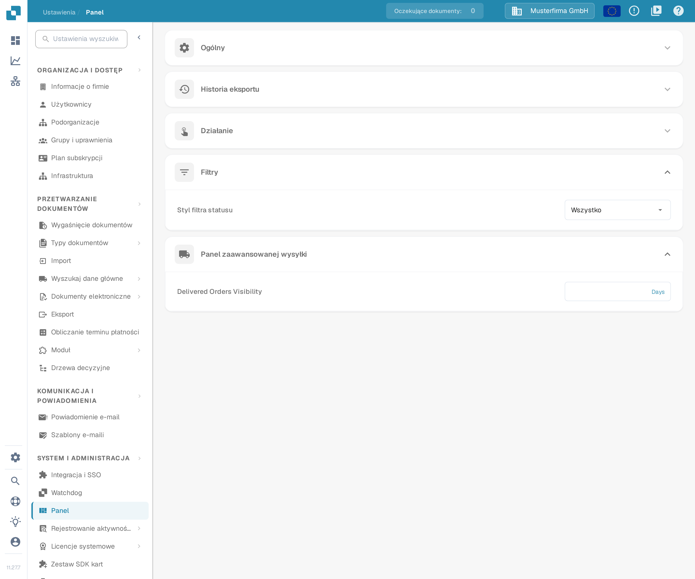

# Dostosowywanie filtrów

Filtry pulpitu nawigacyjnego zawężają listę dokumentów do bieżącego wyszukiwania. Ustawienie **Styl filtra statusu** jest osobne: decyduje o tym, jakie statusy oferuje w ogóle filtr statusu na pulpicie nawigacyjnym.

## Filtrowanie listy dokumentów

Otwórz pulpit nawigacyjny i skorzystaj z pola wyszukiwania lub elementów sterujących filtrem. Menu inteligentnych filtrów oferuje skróty, takie jak **Zaległy**, **Wkrótce**, **Przypisane do mnie**, **Oczekiwanie na walidację**, **Pełne dopasowanie PO** i **Częściowe dopasowanie PO**.

<figure><figcaption>
Wyszukiwanie dokumentów i szybkie filtry.
</figcaption></figure>

Możesz łączyć kilka filtrów. Aby usunąć jeden z nich, kliknij **X** na jego etykiecie. Filtrowanie zmienia tylko to, które dokumenty widzisz; nie zmienia wyodrębnionych wartości dokumentu, jego zatwierdzenia ani statusu eksportu.

## Konfigurowanie filtra statusu

Otwórz **Ustawienia → Panel → Filtry** i wybierz **Styl filtra statusu**:

* **Wszystko** pokazuje pełną listę statusów.
* **Statyczny** pokazuje wcześniej zdefiniowaną, krótszą listę.
* **Niestandardowy** pozwala wybrać statusy, których potrzebuje Twoja organizacja.

<figure><figcaption>
Trzy style filtra statusu.
</figcaption></figure>

Zmiana stylu jest zapisywana natychmiast. W przypadku opcji **Niestandardowy** wybierz statusy w sekcji **Niestandardowy filtr statusu** i kliknij **Zastosuj**. Zastosowanie pustej listy przywraca styl **Wszystko**.

<figure><figcaption>
Ustawienie filtra statusu w ustawieniach pulpitu nawigacyjnego.
</figcaption></figure>

Administratorzy organizacji ustawiają wartość domyślną dla organizacji. Jeśli inni użytkownicy mają dostęp do tych ustawień, ich wybór jest zapisywany jako preferencja osobista, która ma pierwszeństwo przed ustawieniem domyślnym organizacji.
