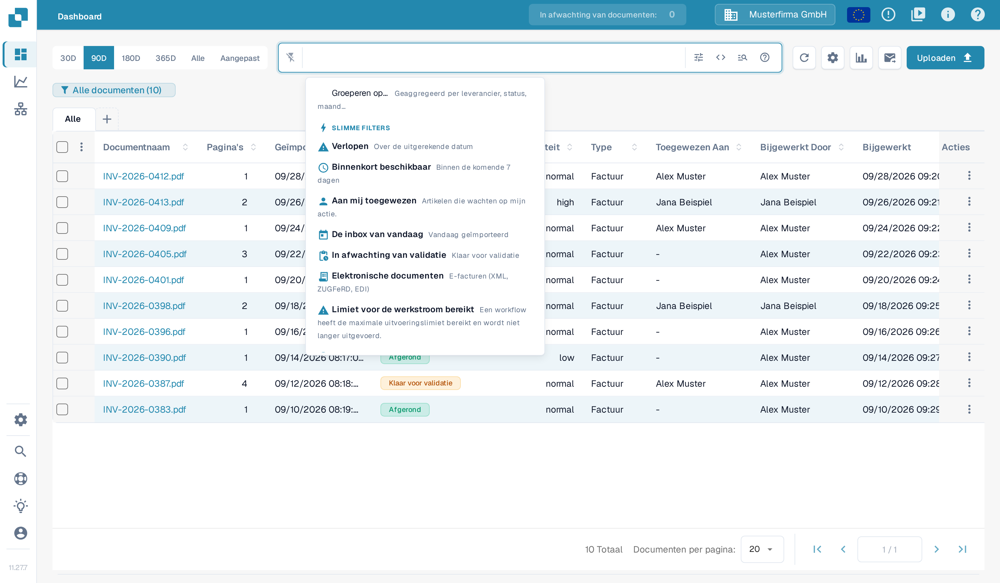
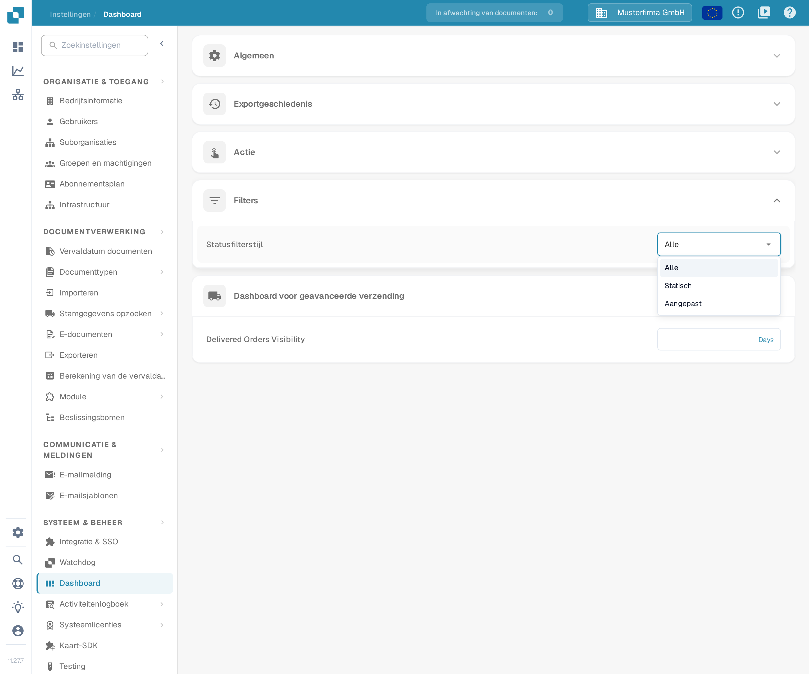
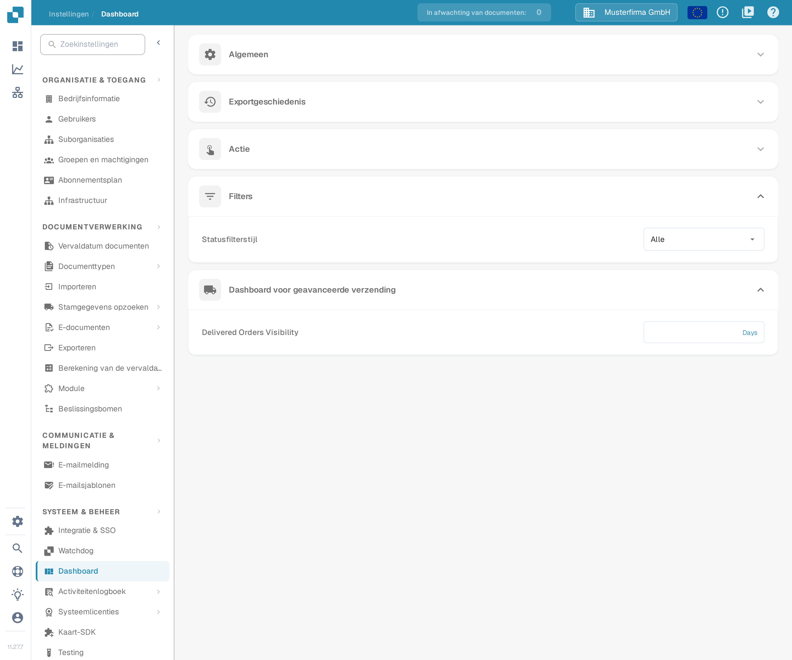

# Filters aanpassen

Dashboardfilters beperken de documentenlijst voor je huidige zoekopdracht. De instelling **Statusfilterstijl** staat daar los van: die bepaalt welke statussen het statusfilter van het dashboard überhaupt aanbiedt.

## De documentenlijst filteren

Open het dashboard en gebruik het zoekveld of de filterknoppen. Het menu Slimme filters biedt snelkoppelingen zoals **Verlopen**, **Binnenkort beschikbaar**, **Aan mij toegewezen**, **In afwachting van validatie**, **Volledige PO-match** en **Gedeeltelijke PO-match**.

<figure><figcaption>
Het menu Slimme filters boven het zoekveld. Er is geen filter toegepast en er is niet gezocht.
</figcaption></figure>

Je kunt meerdere filters combineren. Om er een te verwijderen, klik je op het kruisje (X) op de chip. Filteren verandert alleen welke documenten je ziet; het verandert niets aan de uitgelezen waarden, de goedkeuring of de exportstatus van een document.

## Het statusfilter configureren

Open **Instellingen → Dashboard → Filters** en kies een **Statusfilterstijl**:

* **Alle** toont de volledige statussenlijst.
* **Statisch** toont een vooraf bepaalde, kortere lijst.
* **Aangepast** laat je de statussen kiezen die je organisatie nodig heeft.

<figure><figcaption>
De drie stijlen van het statusfilter. Er is niets gekozen.
</figcaption></figure>

Een wijziging van de stijl wordt meteen opgeslagen. Kies bij **Aangepast** de statussen onder **Aangepast statusfilter** en klik op **Toepassen**. Pas je een lege lijst toe, dan gaat de stijl terug naar **Alle**.

<figure><figcaption>
De instelling van het statusfilter in de dashboardinstellingen. Getoond is de gevonden toestand met de stijl Alle; er is niets gewijzigd.
</figcaption></figure>

Beheerders van de organisatie stellen de standaard voor de organisatie in. Waar andere gebruikers toegang tot deze instellingen hebben, wordt hun keuze opgeslagen als persoonlijke voorkeur, die voorgaat op de standaard van de organisatie.
