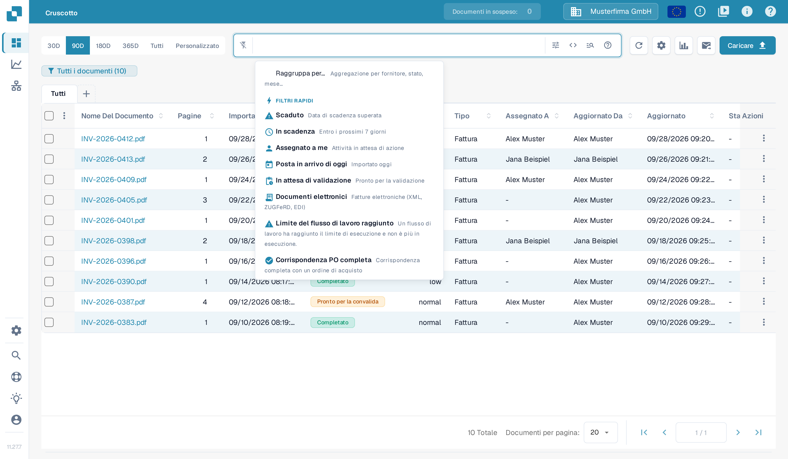
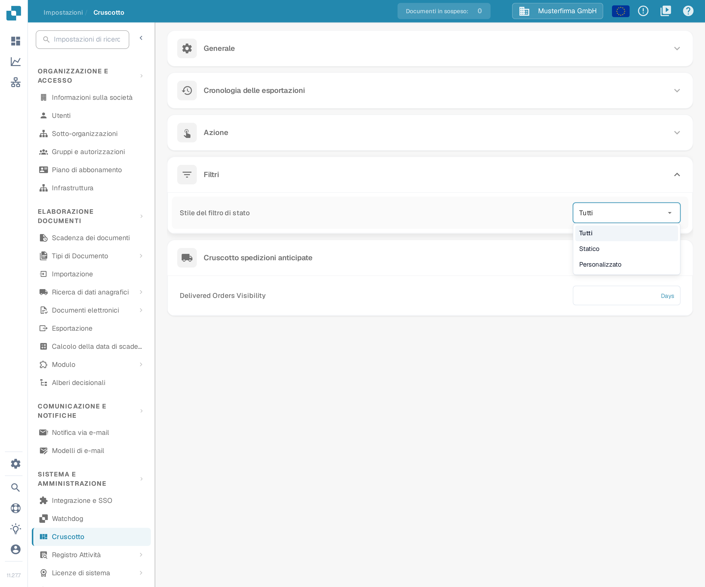
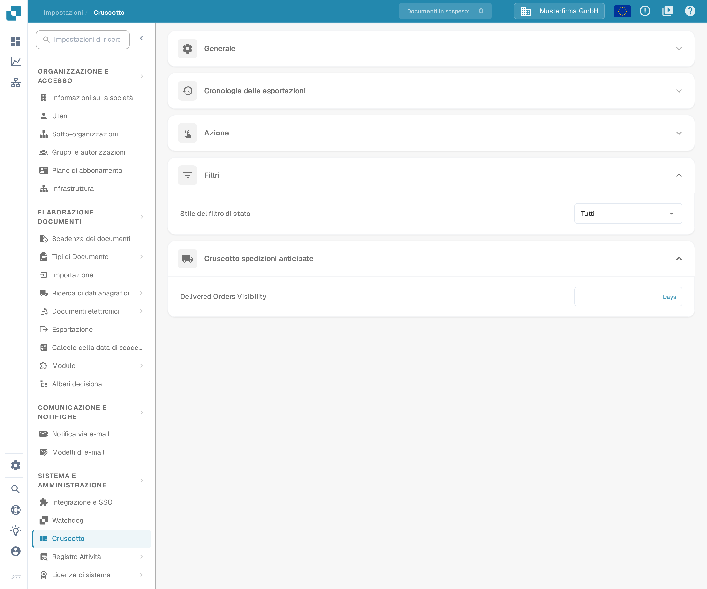

# Personalizzare i Filtri

I filtri della dashboard limitano l'elenco dei documenti per la ricerca corrente. L'impostazione **Stile del filtro di stato** è separata: stabilisce quali stati il filtro di stato della dashboard può offrire.

## Filtrare l'elenco dei documenti

Apri la dashboard e usa il campo di ricerca o i controlli dei filtri. Il menu dei filtri rapidi offre scorciatoie come **Scaduto**, **In scadenza**, **Assegnato a me**, **In attesa di validazione**, **Corrispondenza PO completa** e **Corrispondenza parziale dell'ordine di acquisto**.

<figure><figcaption>
Il menu dei filtri rapidi sopra il campo di ricerca. Nessun filtro è applicato.
</figcaption></figure>

Puoi combinare più filtri. Per rimuoverne uno, fai clic sulla **X** del suo chip. Il filtro cambia solo quali documenti vedi; non modifica i valori estratti di un documento né il suo stato di approvazione o di esportazione.

## Configurare il filtro di stato

Apri **Impostazioni → Cruscotto → Filtri** e scegli uno **Stile del filtro di stato**:

* **Tutti** mostra l'elenco completo degli stati.
* **Statico** mostra un elenco predefinito più breve.
* **Personalizzato** ti permette di scegliere gli stati di cui ha bisogno la tua organizzazione.

<figure><figcaption>
I tre stili del filtro di stato. Nessuna voce è stata scelta.
</figcaption></figure>

La modifica dello stile viene salvata subito. Con **Personalizzato** scegli gli stati in **Filtro di stato personalizzato** e fai clic su **Applicare**. Se applichi un elenco vuoto, lo stile torna a **Tutti**.

<figure><figcaption>
L'impostazione del filtro di stato nelle impostazioni della dashboard. È mostrato lo stato trovato con lo stile Tutti; nulla è stato modificato.
</figcaption></figure>

Gli amministratori dell'organizzazione impostano il valore predefinito per l'organizzazione. Dove altri utenti hanno accesso a questi controlli, la loro scelta viene salvata come preferenza personale, che ha la precedenza sul valore predefinito dell'organizzazione.
