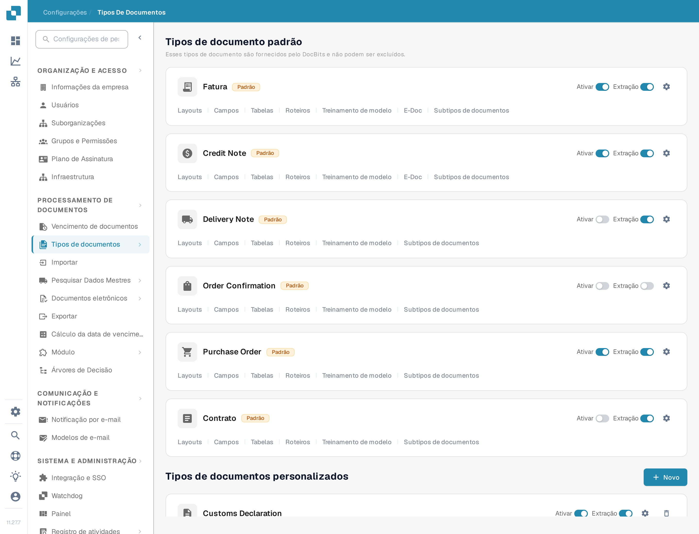
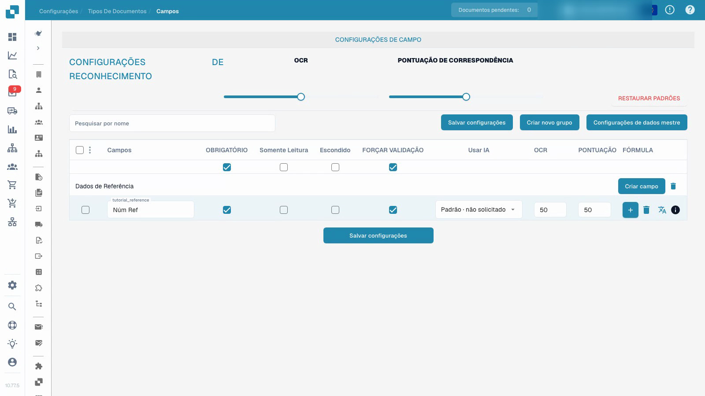

# Tipos de documento


Tipos de documento no DocBits: criar, configurar e atribuir definições de processamento


<figure><figcaption>
A página Tipos de documento. Cada cartão tem os interruptores Ativar e Extração, a roda dentada das configurações e as ligações de configuração descritas abaixo.
</figcaption></figure>

## Visão geral

A página Tipos de documento lista todos os tipos de documento reconhecidos e processados pelo DocBits. Está dividida em duas secções:

* **Tipos de documento padrão**: tipos pré-configurados fornecidos pelo DocBits (Fatura, Credit Note, Delivery Note, Order Confirmation, Contrato, ZUGFeRD, etc.). Não podem ser excluídos.
* **Tipos de documentos personalizados**: tipos que você cria para as suas necessidades específicas. Podem ser editados e excluídos.

## Controlos de cada tipo de documento

Cada cartão de tipo de documento mostra:

| Controlo | Função |
|---------|-------------|
| **Ativar** | Interruptor que ativa ou desativa este tipo de documento para processamento. Consulte [Ativar ou desativar um tipo de documento](activation.md). |
| **Extração** | Interruptor que seleciona o modo de extração, **Flex** ou **Fix**. Não liga nem desliga a extração. |
| **Configurações** (roda dentada) | Abre [Mais Configurações](more-settings/README.md) deste tipo de documento, por exemplo **Regras de Validação Personalizadas**, **Regras de Transformação** e **Detecção de duplicatas**. |

## Ligações de configuração

Cada cartão tem, sob o nome do tipo de documento, ligações para as áreas de configuração desse tipo de documento. Uma ligação só aparece quando a funcionalidade correspondente está ativada para o tipo, por isso um cartão pode mostrar menos ligações do que a lista abaixo.

| Ligação | O que configura | Guia |
|------|--------------------|-------|
| **Layouts** | Onde os campos ficam na imagem do documento, na vista de validação. | [Gestor de Layouts](layout-manager/README.md) |
| **Campos** | Os campos de dados que o DocBits extrai deste tipo de documento. | [Campos](fields/README.md) |
| **Tabelas** | As colunas da tabela de linhas. | [Colunas de tabela](table-columns/README.md) |
| **Regras de Validação** | As suas próprias regras para valores que têm de estar corretos antes de um documento poder ser exportado. | [Regras de Validação Personalizadas](custom-validation-rules.md) |
| **Regras de Transformação** | Etapas que corrigem valores depois da extração e antes da validação. | [Regras de transformação](transformation-rules.md) |
| **Roteiros** | Scripts executados durante o processamento de um documento. | [Script](script/README.md) |
| **Treinamento de modelo** | Os dados de treino e o modelo deste tipo de documento. | [Treino de modelos](model-training/README.md) |
| **E-Doc** | Normas de documentos eletrónicos como XRechnung, ZUGFeRD, EDI e FatturaPA. | [e-docs](edi/README.md) |
| **Subtipos de documentos** | Subcategorias deste tipo de documento, por exemplo uma por modelo de fornecedor. | [Subtipos de documentos](document-sub-types.md) |
| **Registros** | Uma entrada por cada avaliação de uma regra de validação, transformação ou seleção de layout, incluindo o percurso da condição. | [Registros](custom-validation-rules.md#logs) |

## Regras de validação personalizadas

As regras de validação personalizadas são regras que você escreve para um único tipo de documento. Verificam valores que as verificações padrão dos campos não conseguem cobrir, por exemplo um número de identificação fiscal de fornecedor que só é obrigatório em faturas alemãs acima de 250 EUR, ou uma data de vencimento que não pode ser anterior à data da fatura. Cada regra tem uma condição que decide se é aplicada, uma verificação que tem de ser verdadeira e uma severidade que decide se uma violação bloqueia o documento (Erro) ou apenas mostra uma mensagem (Aviso).

Antes de as utilizar, tenha em conta duas coisas:

* As regras são ativadas **por tipo de documento**, não para toda a organização. Abra a roda dentada do cartão e, no painel **Regras de Validação Personalizadas**, ligue o interruptor. O cartão passa então a mostrar a ligação **Regras de Validação**.
* Enquanto o interruptor estiver ligado, as verificações de montante integradas (montante total = líquido + imposto, e as verificações dos montantes das linhas) são substituídas pelas suas regras. Recrie como regras as verificações em que confia antes de o ligar.

A ligação no cartão abre a lista de regras do tipo de documento, onde pode criar, ativar, editar, testar e excluir regras.


Para copiar uma regra em vez de a reconstruir, siga [Duplicar uma Regra de Validação Personalizada](duplicate-a-custom-validation-rule.md).


[Regras de Validação Personalizadas](custom-validation-rules.md) explica todo o fluxo de trabalho: a ativação, a lista de regras, os três níveis (campo de cabeçalho, linha da tabela e tabela completa), as verificações (Required, Formula, Pattern, Range, Compare fields, Allowed values e List of Values), a etapa de condição [Condições da Regra (Applies when)](rule-conditions-applies-when.md), o teste de uma regra com um documento, a execução em [Registros](custom-validation-rules.md#logs), receitas prontas a usar e resolução de problemas.

## Configurar campos e dados obrigatórios


Tipos de documento


[Ver com legendas](https://docbits-videos.fra1.cdn.digitaloceanspaces.com/settings-assistant/document-types-fields-admin/v1/pt.html)

A gravação mostra a interface de teste real. Os valores configurados e as designações técnicas mantêm o seu significado original.

Configure o campo de referência num tipo de teste personalizado e isolado, guarde a designação e as opções de verificação obrigatória e confirme-as depois de recarregar a página.

O vídeo utiliza um tipo de teste personalizado já criado e isolado. Altera o campo de referência desse tipo; não altera a configuração de faturas existente.

1. Abra o tipo de documento e selecione os respetivos campos.
2. Verifique o grupo de campos e o nome técnico estável do campo. A designação apresentada é uma configuração separada; alterá-la não cria um novo identificador de campo.
3. Torne o campo de referência obrigatório, mantendo-o visível e editável. A informação obrigatória tem de ser fornecida; a configuração não inventa um valor em falta nem garante uma extração correta.
4. Configure a revisão explícita do campo separadamente do valor obrigatório. Só de leitura, oculto, os limiares de OCR e os limiares de Match Score têm efeitos próprios; não são interruptores intermutáveis.
5. Guarde a configuração, volte a abri-la e confirme a designação e os indicadores guardados.

<figure><figcaption>
Opções de campo guardadas num tipo de documento de teste separado.
</figcaption></figure>

O resultado demonstrado prova que a configuração do campo foi guardada e recarregada. Não constitui treino de modelos, aprovação de faturas, exportação nem um teste de validação posterior. Antes de usar uma configuração em produção, teste documentos representativos e o fluxo de trabalho previsto para um utilizador normal.

## Criar um tipo de documento personalizado

1. Desça até à secção **Tipos de documentos personalizados**.
2. Clique em **+ Novo**.
3. Introduza um nome claro para o novo tipo de documento.
4. Complete os passos de configuração apresentados para o modo de extração pretendido, os campos, os grupos e eventuais tabelas.

O treino de modelos e a configuração de extração são independentes de simplesmente guardar um indicador de campo obrigatório.


Consulte [Tipos de Documento](../../../setup/document-types/) para instruções de configuração detalhadas.

