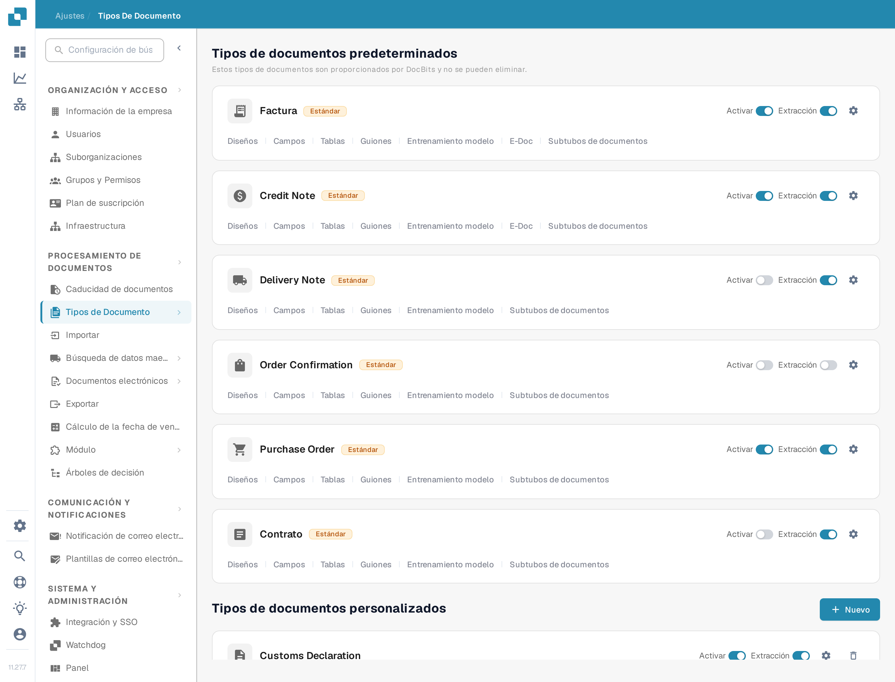
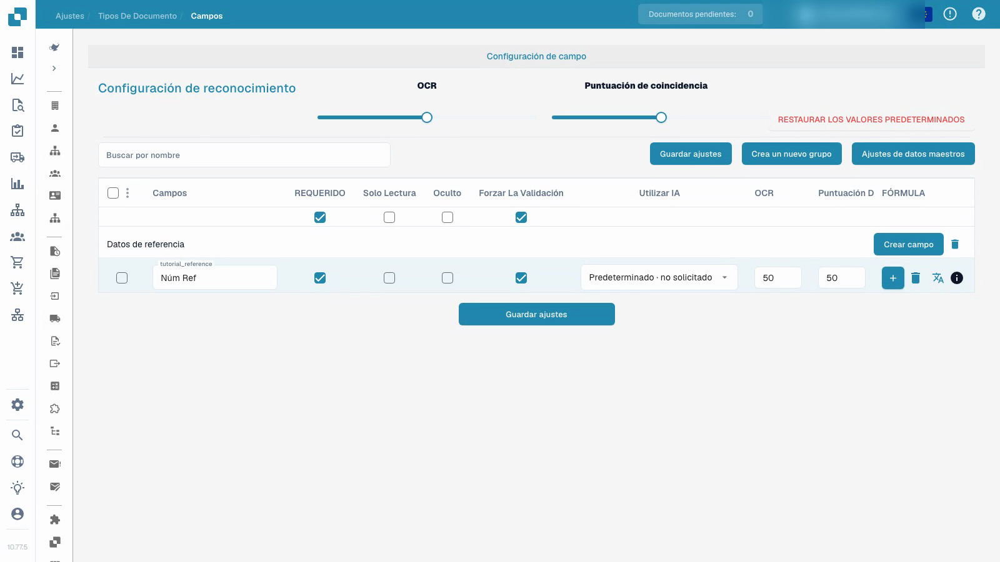

# Tipos de documentos


DocBits Tipos de documento explicados: crear, configurar y asignar ajustes de procesamiento


<figure><figcaption>
La página Tipos de documento. Cada tarjeta lleva los interruptores Activar y Extracción, el engranaje de configuración y los enlaces de configuración que se describen abajo.
</figcaption></figure>

## Descripción general

La página Tipos de documento enumera todos los tipos de documento que DocBits reconoce y procesa. Se divide en dos secciones:

* **Tipos de documentos predeterminados**: tipos preconfigurados que proporciona DocBits (Factura, Credit Note, Delivery Note, Order Confirmation, Contrato, ZUGFeRD, etc.). No se pueden eliminar.
* **Tipos de documentos personalizados**: tipos que usted crea para sus propias necesidades. Se pueden editar y eliminar.

## Controles de cada tipo de documento

Cada tarjeta de un tipo de documento muestra:

| Control | Descripción |
|---------|-------------|
| **Activar** | Interruptor que activa o desactiva este tipo de documento para el procesamiento. Consulte [Activar o desactivar un tipo de documento](activation.md). |
| **Extracción** | Interruptor que elige el modo de extracción, **Flex** o **Fix**. No activa ni desactiva la extracción. |
| **Configuración** (icono de engranaje) | Abre [Más ajustes](more-settings/README.md) de este tipo de documento, por ejemplo las reglas de validación personalizadas, las reglas de transformación y la detección de duplicados. |

## Enlaces de configuración

Debajo de los interruptores Activar y Extracción, cada tarjeta lleva enlaces a las áreas de configuración de ese tipo de documento. Un enlace aparece solo cuando la función correspondiente está activada para el tipo, por lo que una tarjeta puede mostrar menos enlaces que la lista siguiente.

| Enlace | Qué se configura allí | Guía |
|------|--------------------|-------|
| **Diseños** | Dónde se sitúan los campos sobre la imagen del documento en la vista de validación. | [Gestor de diseños](layout-manager/README.md) |
| **Campos** | Los campos de datos que DocBits extrae de este tipo de documento. | [Campos](fields/README.md) |
| **Tablas** | Las columnas de la tabla de posiciones. | [Columnas de tabla](table-columns/README.md) |
| **Reglas de validación** | Sus propias reglas para valores que deben ser correctos antes de que un documento se pueda exportar. | [Reglas de validación personalizadas](custom-validation-rules.md) |
| **Reglas de transformación** | Pasos que corrigen valores después de la extracción y antes de la validación. | [Reglas de transformación](transformation-rules.md) |
| **Guiones** | Guiones que se ejecutan mientras se procesa un documento. | [Script](script/README.md) |
| **Entrenamiento modelo** | Los datos de entrenamiento y el modelo de este tipo de documento. | [Entrenamiento del modelo](model-training/README.md) |
| **E-Doc** | Estándares de documentos electrónicos como XRechnung, ZUGFeRD, EDI y FatturaPA. | [Documentos electrónicos](edi/README.md) |
| **Subtubos de documentos** | Subcategorías de este tipo de documento, por ejemplo una por plantilla de proveedor. | [Subtipos de documento](document-sub-types.md) |
| **Registros** | Una entrada por cada evaluación de una regla de validación, de transformación o de selección de diseño, incluido el seguimiento de la condición. | [Registros](custom-validation-rules.md#logs) |

## Reglas de validación personalizadas

Las reglas de validación personalizadas son reglas que **usted** escribe para un solo tipo de documento. Comprueban valores que las comprobaciones de campo estándar no cubren, por ejemplo un NIF de proveedor que solo es obligatorio para facturas alemanas por encima de 250 EUR, o una fecha de vencimiento que no debe ser anterior a la fecha de la factura. Cada regla tiene una condición que decide si se aplica, una comprobación que debe cumplirse y una gravedad que decide si una infracción bloquea el documento (Error) o solo muestra un mensaje (Advertencia).

Antes de usarlas, conviene conocer dos puntos:

* Las reglas se activan **por tipo de documento**, no para toda la organización. Abra el engranaje de la tarjeta, abra la sección **Reglas de validación personalizadas** y active el interruptor. La tarjeta muestra después el enlace **Reglas de validación**.
* Mientras el interruptor está activado, sus reglas sustituyen las comprobaciones de importes integradas (importe total = neto + impuestos y las comprobaciones de importes de línea). Vuelva a crear como reglas las comprobaciones en las que confía antes de activarlo.

El enlace de la tarjeta abre la lista de reglas del tipo de documento, donde se crean, activan, editan, prueban y eliminan las reglas.


Para copiar una regla en lugar de volver a crearla, siga [Duplicar una regla de validación personalizada](duplicate-a-custom-validation-rule.md).


[Reglas de validación personalizadas](custom-validation-rules.md) describe todo el flujo de trabajo: la activación, la lista de reglas, los tres niveles (campo de cabecera, línea de tabla, tabla completa), las comprobaciones (Required, Formula, Pattern, Range, Compare fields, Allowed values, List of Values), el paso de condición [Condiciones de la regla (se aplica cuando)](rule-conditions-applies-when.md), la prueba de una regla con un documento, la ejecución en los [Registros](custom-validation-rules.md#logs), recetas listas para usar y la resolución de problemas.

## Configurar campos e información requerida


Tipos de documentos


[Ver con subtítulos](https://docbits-videos.fra1.cdn.digitaloceanspaces.com/settings-assistant/document-types-fields-admin/v1/es.html)

La grabación muestra la interfaz de prueba real. Los valores configurados y las etiquetas técnicas conservan su significado original.

Configure el campo de referencia en un tipo de prueba personalizado y aislado, guarde su etiqueta y los ajustes de revisión obligatoria, y verifíquelos después de volver a cargar.

El video utiliza un tipo de prueba personalizado y aislado ya creado. Cambia el campo de referencia de ese tipo; no cambia la configuración de factura existente.

1. Abra el tipo de documento y seleccione sus campos.
2. Verifique el grupo de campos y el nombre técnico estable del campo. Una etiqueta de visualización legible es una configuración separada; cambiarla no crea un nuevo ID de campo.
3. Haga que el campo de referencia sea obligatorio mientras lo mantiene visible y editable. Se debe proporcionar la información requerida; la configuración no inventa un valor faltante ni garantiza una extracción correcta.
4. Configure la revisión explícita de campos por separado del valor requerido. Solo lectura, oculto, los umbrales de OCR y los umbrales de Match Score tienen sus propios efectos; no son interruptores intercambiables.
5. Guarde la configuración, vuelva a abrirla y verifique la etiqueta de visualización y los indicadores almacenados.

<figure><figcaption>
Campos guardados en un tipo de documento de prueba aislado.
</figcaption></figure>

El resultado demostrado prueba que la configuración del campo se guardó y se volvió a cargar. No constituye entrenamiento de modelos, aprobación de facturas, exportación o una prueba de validación posterior. Antes de usar una configuración en producción, pruebe documentos representativos y el flujo de trabajo previsto para usuarios ordinarios.

## Crear un tipo de documento personalizado

1. Desplácese hasta la sección **Tipos de documentos personalizados**.
2. Haga clic en **+ Nuevo**.
3. Introduzca un nombre claro para el nuevo tipo de documento.
4. Complete los pasos de configuración ofrecidos para el modo de extracción previsto, los campos, los grupos y las tablas que correspondan.

El entrenamiento del modelo y la configuración de extracción son independientes de simplemente guardar un indicador de campo obligatorio.


Consulte [Configurar un tipo de documento](../../../setup/document-types/) para conocer el procedimiento de configuración.

