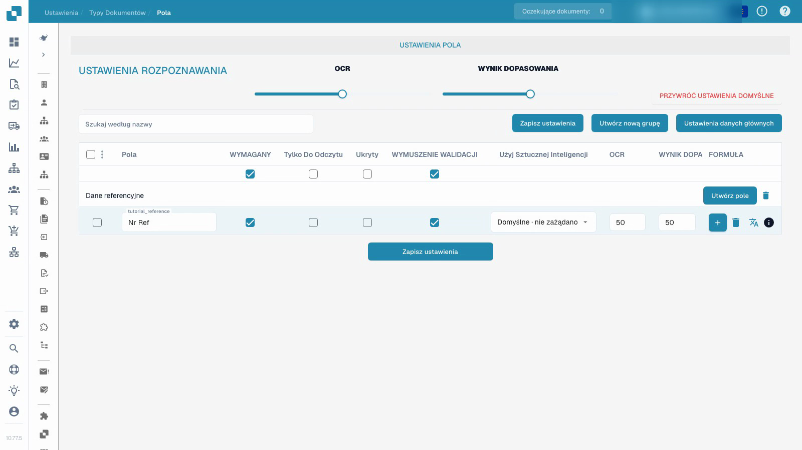

# Typy dokumentów


DocBits Typy dokumentów: tworzenie, konfiguracja i przypisywanie ustawień przetwarzania


<figure><figcaption>
Strona Typy dokumentów. Każda karta ma przełączniki Aktywować i Ekstrakcja, ikonę ustawień oraz opisane poniżej linki do konfiguracji.
</figcaption></figure>

## Przegląd

Strona Typy dokumentów zawiera wszystkie typy dokumentów rozpoznawane i przetwarzane przez DocBits. Dzieli się na dwie sekcje:

* **Domyślne typy dokumentów**: typy dostarczane przez DocBits (Faktura, Credit Note, Delivery Note, Order Confirmation, Umowa, ZUGFeRD itd.). Nie można ich usunąć.
* **Niestandardowe typy dokumentów**: typy tworzone na własne potrzeby. Można je edytować i usuwać.

## Kontrolki na karcie typu dokumentu

Każda karta typu dokumentu pokazuje:

| Kontrolka | Opis |
|---------|-------------|
| **Aktywować** | Przełącznik, który włącza lub wyłącza przetwarzanie tego typu dokumentu. Zobacz [Aktywacja lub dezaktywacja typu dokumentu](activation.md). |
| **Ekstrakcja** | Przełącznik wyboru trybu ekstrakcji, **Flex** lub **Fix**. Nie włącza ani nie wyłącza ekstrakcji. |
| **Ustawienia** (ikona koła zębatego) | Otwiera [Więcej ustawień](more-settings/README.md) tego typu dokumentu, na przykład niestandardowe reguły walidacji, zasady transformacji i wykrywanie duplikatów. |

## Linki do konfiguracji

Pod przełącznikami Aktywować i Ekstrakcja każda karta ma linki do obszarów konfiguracji tego typu dokumentu. Link pojawia się tylko wtedy, gdy pasująca funkcja jest włączona dla danego typu, dlatego karta może pokazywać mniej linków niż poniższa lista.

| Link | Co konfigurujesz | Przewodnik |
|------|--------------------|-------|
| **Układy** | Rozmieszczenie pól na obrazie dokumentu w widoku walidacji. | [Menedżer układu](layout-manager/README.md) |
| **Pola** | Pola danych, które DocBits ekstrahuje z tego typu dokumentu. | [Pola](fields/README.md) |
| **Tabele** | Kolumny tabeli pozycji. | [Kolumny tabeli](table-columns/README.md) |
| **Reguły walidacji** | Własne reguły dla wartości, które muszą być poprawne, zanim dokument zostanie wyeksportowany. | [Niestandardowe reguły walidacji](custom-validation-rules.md) |
| **Zasady transformacji** | Kroki, które poprawiają wartości po ekstrakcji i przed walidacją. | [Zasady transformacji](transformation-rules.md) |
| **Skrypty** | Skrypty uruchamiane podczas przetwarzania dokumentu. | [Skrypt](script/README.md) |
| **Szkolenie modelowe** | Dane treningowe i model dla tego typu dokumentu. | [Trenowanie modelu](model-training/README.md) |
| **E-dokument** | Standardy dokumentów elektronicznych, takie jak XRechnung, ZUGFeRD, EDI i FatturaPA. | [e-docs](edi/README.md) |
| **Podtypy dokumentów** | Podkategorie tego typu dokumentu, na przykład jedna na szablon dostawcy. | [Podtypy dokumentów](document-sub-types.md) |
| **Dzienniki** | Wpis na każde sprawdzenie reguły walidacji, zasady transformacji lub wyboru układu, wraz ze śladem warunku. | [Dzienniki](custom-validation-rules.md#logs) |

Etykiety linków pochodzą z interfejsu. Trzy ostatnie funkcje włączasz osobno dla typu dokumentu, dlatego na powyższym zrzucie ich linki nie są widoczne; karta Faktura pokazuje tam Układy, Pola, Tabele, Skrypty, Szkolenie modelowe, E-dokument i Podtypy dokumentów. Niektóre etykiety produktu mogą pozostać po angielsku, na przykład **Validation Rules**.

## Niestandardowe reguły walidacji

Niestandardowe reguły walidacji to reguły, które **Ty** piszesz dla jednego typu dokumentu. Sprawdzają wartości, których standardowe kontrole pól nie obejmują — na przykład numer identyfikacji podatkowej dostawcy wymagany tylko dla niemieckich faktur powyżej 250 EUR albo termin płatności, który nie może być wcześniejszy niż data faktury. Każda reguła ma warunek decydujący, czy w ogóle obowiązuje, kontrolę, która musi być spełniona, oraz ważność decydującą, czy naruszenie blokuje dokument (Błąd), czy tylko pokazuje komunikat (Ostrzeżenie).

Zanim ich użyjesz, poznaj dwie rzeczy:

* Reguły włącza się **dla każdego typu dokumentu**, a nie dla całej organizacji. Otwórz ikonę ustawień na karcie, otwórz panel **Niestandardowe reguły walidacji** i włącz przełącznik. Karta pokaże wtedy link reguł walidacji.
* Gdy przełącznik jest włączony, Twoje reguły zastępują wbudowane kontrole kwot (kwota całkowita = netto + podatek oraz kontrole kwot pozycji). Odtwórz kontrole, na których polegasz, jako reguły przed włączeniem.

Link na karcie otwiera listę reguł tego typu dokumentu. Tam tworzysz, aktywujesz, edytujesz, testujesz i usuwasz reguły.


Aby skopiować regułę zamiast budować ją od nowa, postępuj zgodnie z [Duplikowanie niestandardowej reguły walidacji](duplicate-a-custom-validation-rule.md).


[Niestandardowe reguły walidacji](custom-validation-rules.md) opisuje cały przebieg pracy: włączanie, listę reguł, trzy poziomy (pole nagłówka, wiersz tabeli, cała tabela), kontrole (Required, Formula, Pattern, Range, Compare fields, Dozwolone wartości, List of Values), krok warunku [Warunki reguł (Dotyczy, gdy)](rule-conditions-applies-when.md), testowanie reguły na dokumencie, wykonanie w [Dziennikach](custom-validation-rules.md#logs), gotowe przepisy i rozwiązywanie problemów.

## Konfiguruj pola i wymagane informacje


Typy dokumentów


[Oglądaj z napisami](https://docbits-videos.fra1.cdn.digitaloceanspaces.com/settings-assistant/document-types-fields-admin/v1/pl.html)

Nagranie pokazuje rzeczywisty interfejs testowy. Skonfigurowane wartości i nazwy techniczne zachowują swoje pierwotne znaczenie.

Skonfiguruj pole referencyjne w izolowanym niestandardowym typie testowym, zapisz jego etykietę i ustawienia wymagalności, a następnie sprawdź je po ponownym wczytaniu.

Film wykorzystuje już utworzony, izolowany niestandardowy typ testowy. Zmienia pole referencyjne tego typu; nie zmienia istniejącej konfiguracji faktury.

1. Otwórz typ dokumentu i wybierz jego pola.
2. Sprawdź grupę pól i stabilną techniczną nazwę pola. Czytelna etykieta wyświetlania to osobne ustawienie; jej zmiana nie tworzy nowego identyfikatora pola.
3. Ustaw pole referencyjne jako wymagane, zachowując je widocznym i edytowalnym. Wymagane informacje muszą zostać podane; ustawienie nie wymyśla brakującej wartości ani nie gwarantuje poprawnej ekstrakcji.
4. Skonfiguruj jawną weryfikację pola niezależnie od wymaganej wartości. Tylko do odczytu, ukrycie, progi OCR i progi Match Score działają osobno; nie są wymiennymi przełącznikami.
5. Zapisz konfigurację, otwórz ją ponownie i sprawdź zapisaną etykietę wyświetlania oraz ustawione znaczniki.

<figure><figcaption>
Zapisane ustawienia pola w izolowanym niestandardowym typie testowym.
</figcaption></figure>

Pokazany wynik potwierdza, że konfiguracja pola została zapisana i wczytana ponownie. Nie jest to trenowanie modelu, zatwierdzanie faktury, eksport ani późniejszy test walidacji. Przed użyciem konfiguracji w środowisku produkcyjnym przetestuj reprezentatywne dokumenty i zamierzony przebieg pracy zwykłego użytkownika.

## Tworzenie niestandardowego typu dokumentu

1. Przewiń do sekcji **Niestandardowe typy dokumentów**.
2. Kliknij **+ Nowy**.
3. Wpisz jasną nazwę nowego typu dokumentu.
4. Przejdź przez oferowane kroki konfiguracji dla zamierzonego trybu ekstrakcji, pól, grup i ewentualnych tabel.

Trenowanie modelu i konfiguracja ekstrakcji to coś innego niż samo zapisanie znacznika pola wymaganego.


Szczegółową konfigurację opisuje [Typy dokumentów](../../../setup/document-types/).

