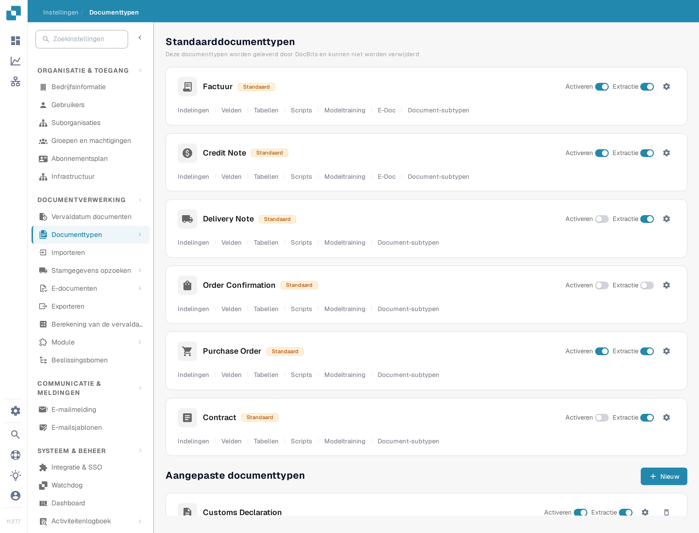
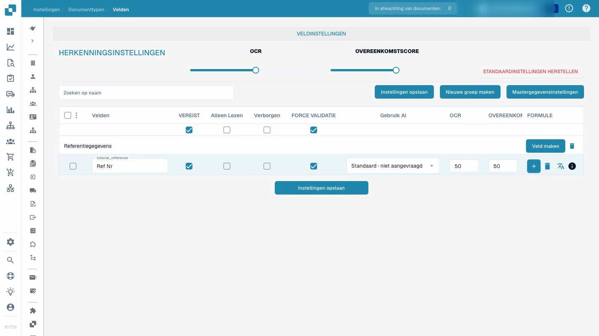

# Documenttypen


Documenttypen in DocBits: aanmaken, configureren en verwerkingsinstellingen toewijzen


<figure><figcaption>
De pagina Documenttypen. Elke kaart heeft de schakelaars Activeren en Extractie, het tandwiel voor de instellingen en de configuratielinks die hieronder worden beschreven.
</figcaption></figure>

## Overzicht

De pagina Documenttypen toont alle documenttypen die DocBits herkent en verwerkt. De pagina bestaat uit twee secties:

* **Standaarddocumenttypen**: typen die DocBits meelevert (Factuur, Credit Note, Delivery Note, Order Confirmation, Contract, ZUGFeRD enz.). Deze kunnen niet worden verwijderd.
* **Aangepaste documenttypen**: typen die u voor uw eigen bedrijfsprocessen aanmaakt. Deze kunt u bewerken en verwijderen.

## Bedieningselementen op een documenttypekaart

Elke documenttypekaart toont:

| Bedieningselement | Beschrijving |
|---------|-------------|
| **Activeren** | Schakelaar die dit documenttype voor verwerking in- of uitschakelt. Zie [Een documenttype activeren of deactiveren](activation.md). |
| **Extractie** | Schakelaar die de extractiemodus kiest, **Flex** of **Fix**. Hiermee schakelt u de extractie niet in of uit. |
| **Instellingen** (tandwiel) | Opent [Meer instellingen](more-settings/README.md) voor dit documenttype, bijvoorbeeld Aangepaste validatieregels, Transformatieregels en Duplicaatdetectie. |

## Verwijzingen naar de configuratie

Onder de schakelaars Activeren en Extractie heeft elke kaart links naar de configuratiegebieden van dat documenttype. Een link verschijnt alleen als de bijbehorende functie voor het type is ingeschakeld, dus een kaart kan minder links tonen dan de lijst hieronder.

| Link | Wat u configureert | Handleiding |
|------|--------------------|-------|
| **Indelingen** | Waar de velden op de documentafbeelding in de validatieweergave staan. | [Lay-outbeheer](layout-manager/README.md) |
| **Velden** | De gegevensvelden die DocBits uit dit documenttype haalt. | [Velden](fields/README.md) |
| **Tabellen** | De kolommen van de regeltabel. | [Tabelkolommen](table-columns/README.md) |
| **Validatieregels** | Uw eigen regels voor waarden die juist moeten zijn voordat een document kan worden geëxporteerd. | [Aangepaste validatieregels](custom-validation-rules.md) |
| **Transformatieregels** | Stappen die waarden na de extractie en vóór de validatie corrigeren. | [Transformatieregels](transformation-rules.md) |
| **Scripts** | Scripts die tijdens de verwerking van een document worden uitgevoerd. | [Script](script/README.md) |
| **Modeltraining** | De trainingsgegevens en het model voor dit documenttype. | [Modeltraining](model-training/README.md) |
| **E-Doc** | Elektronische documentstandaarden zoals XRechnung, ZUGFeRD, EDI en FatturaPA. | [e-docs](edi/README.md) |
| **Document-subtypen** | Subcategorieën van dit documenttype, bijvoorbeeld één per leveranciersjabloon. | [Documentsubtypen](document-sub-types.md) |
| **Logboeken** | Eén vermelding per beoordeling van een validatie-, transformatie- of indelingselectieregel, inclusief het doorlopen van de voorwaarde. | [Logboeken](custom-validation-rules.md#logs) |

## Aangepaste validatieregels

Aangepaste validatieregels zijn regels die **u** voor één documenttype schrijft. Ze controleren waarden die de standaard veldcontroles niet kunnen afdekken, bijvoorbeeld een btw-identificatienummer van een leverancier dat alleen voor Duitse facturen boven 250 EUR nodig is, of een vervaldatum die niet eerder mag liggen dan de factuurdatum. Elke regel heeft een voorwaarde die bepaalt of de regel van toepassing is, een controle die waar moet zijn, en een ernst die bepaalt of een schending het document blokkeert (Fout) of alleen een melding toont (Waarschuwing).

Let op twee dingen voordat u ze gebruikt:

* De regels worden **per documenttype** ingeschakeld, niet voor de hele organisatie. Open het tandwiel van de kaart, open het paneel **Aangepaste validatieregels** en zet de schakelaar aan. De kaart toont dan de link **Validatieregels**.
* Zolang de schakelaar aan staat, worden de ingebouwde bedragcontroles (totaalbedrag = netto + belasting, en de controles op regelbedragen) vervangen door uw regels. Maak de controles waarop u vertrouwt eerst opnieuw aan als regels voordat u de schakelaar aanzet.

De link op de kaart opent de regellijst van het documenttype, waar u regels aanmaakt, activeert, bewerkt, test en verwijdert.


Om een regel te kopiëren in plaats van opnieuw op te bouwen, volgt u [Een aangepaste validatieregel dupliceren](duplicate-a-custom-validation-rule.md).


[Aangepaste validatieregels](custom-validation-rules.md) beschrijft de hele werkwijze: inschakelen, de regellijst, de drie niveaus (koptekstveld, tabelregel, hele tabel), de controles (Verplicht, Formule, Patroon, Bereik, Vergelijk velden, Toegestane waarden, List of Values), de voorwaardestap [Regelvoorwaarden (Applies when)](rule-conditions-applies-when.md), een regel testen op een document, de uitvoering in de [Logboeken](custom-validation-rules.md#logs), kant-en-klare recepten en probleemoplossing.

## Velden en vereiste informatie configureren


Documenttypen


[Bekijk met ondertiteling](https://docbits-videos.fra1.cdn.digitaloceanspaces.com/settings-assistant/document-types-fields-admin/v1/nl.html)

De opname toont de werkelijke testinterface. Geconfigureerde waarden en technische labels behouden hun oorspronkelijke betekenis.

Configureer het referentieveld in een geïsoleerd aangepast testtype, sla het label en de instellingen voor verplichte controle op en controleer ze na het opnieuw laden.

De video gebruikt een reeds aangemaakt, geïsoleerd aangepast testtype. Hij wijzigt het referentieveld van dat type; de bestaande factuurconfiguratie wordt niet gewijzigd.

1. Open het documenttype en selecteer de velden ervan.
2. Controleer de veldgroep en de stabiele technische veldnaam. Een leesbaar weergavelabel is een aparte instelling; het wijzigen ervan maakt geen nieuwe veld-ID aan.
3. Maak het referentieveld verplicht terwijl het zichtbaar en bewerkbaar blijft. Vereiste informatie moet worden aangeleverd; de instelling verzint geen ontbrekende waarde en garandeert geen correcte extractie.
4. Configureer de expliciete veldcontrole apart van de vereiste waarde. Alleen-lezen, verborgen, OCR-drempels en Match Score-drempels hebben elk hun eigen effect; het zijn geen onderling uitwisselbare schakelaars.
5. Sla de configuratie op, open deze opnieuw en controleer het opgeslagen weergavelabel en de instellingen.

<figure><figcaption>
Opgeslagen veldinstellingen in een geïsoleerd aangepast testtype.
</figcaption></figure>

Het getoonde resultaat bewijst dat de veldconfiguratie is opgeslagen en opnieuw geladen. Het is geen modeltraining, factuurgoedkeuring, export of validatietest verder in het proces. Test representatieve documenten en de beoogde workflow voor gewone gebruikers voordat u een configuratie in productie gebruikt.

## Een aangepast documenttype maken

1. Scrol naar de sectie **Aangepaste documenttypen**.
2. Klik op **+ Nieuw**.
3. Voer een duidelijke naam voor het nieuwe documenttype in.
4. Doorloop de aangeboden configuratiestappen voor de beoogde extractiemodus, velden, groepen en eventuele tabellen.

Modeltraining en extractieconfiguratie staan los van het alleen opslaan van de instelling voor een verplicht veld.


Zie [Documenttypen](../../../setup/document-types/) voor gedetailleerde configuratiestappen.

