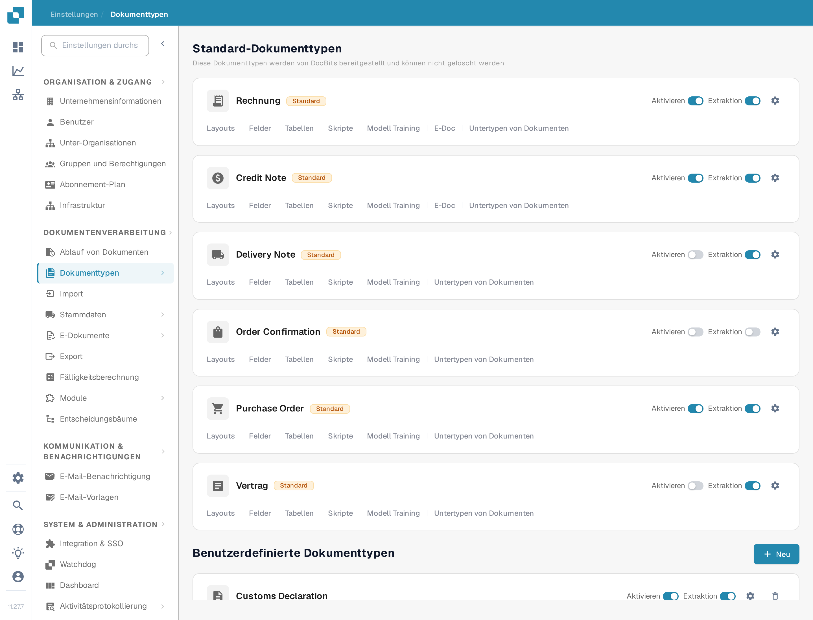
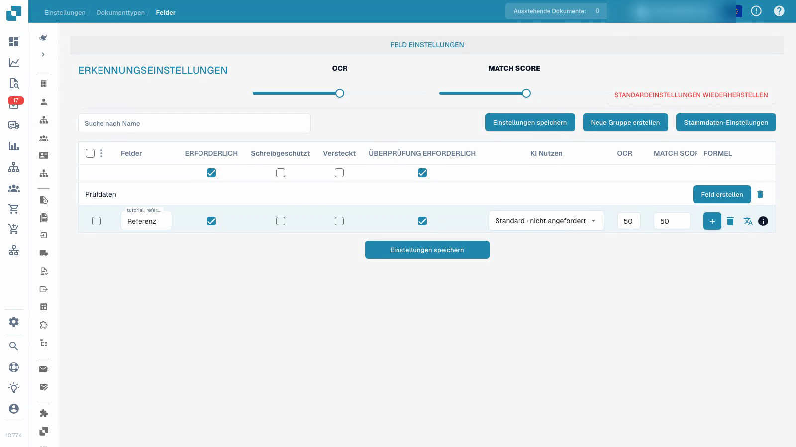

# Dokumenttypen


DocBits Dokumenttypen erklärt: anlegen, konfigurieren und Verarbeitungseinstellungen zuweisen


<figure><figcaption>
Die Seite Dokumenttypen. Jede Karte trägt die Schalter Aktivieren und Extraktion, das Zahnrad und die unten beschriebenen Verknüpfungen zur Konfiguration.
</figcaption></figure>

## Übersicht

Die Seite Dokumenttypen listet alle Dokumenttypen, die DocBits erkennt und verarbeitet. Sie ist in zwei Bereiche geteilt:

* **Standard-Dokumenttypen**: Von DocBits bereitgestellte Typen (Rechnung, Credit Note, Delivery Note, Order Confirmation, Vertrag, ZUGFeRD usw.). Sie lassen sich nicht löschen.
* **Benutzerdefinierte Dokumenttypen**: Typen, die Sie für Ihre eigenen Anforderungen anlegen. Sie lassen sich bearbeiten und löschen.

## Steuerelemente einer Dokumenttyp-Karte

Jede Karte eines Dokumenttyps zeigt:

| Steuerelement | Bedeutung |
|---------|-------------|
| **Aktivieren** | Schalter, der diesen Dokumenttyp für die Verarbeitung ein- oder ausschaltet. Siehe [Dokumenttyp aktivieren oder deaktivieren](activation.md). |
| **Extraktion** | Schalter, der den Extraktionsmodus **Flex** oder **Fix** wählt. Er schaltet die Extraktion nicht ein oder aus. |
| **Einstellungen** (Zahnrad) | Öffnet die [Weiteren Einstellungen](more-settings/README.md) dieses Dokumenttyps, zum Beispiel benutzerdefinierte Validierungsregeln, Transformationsregeln und Duplikaterkennung. |

## Verknüpfungen zur Konfiguration

Unter den Schaltern Aktivieren und Extraktion trägt jede Karte Verknüpfungen zu den Konfigurationsbereichen dieses Dokumenttyps. Eine Verknüpfung erscheint nur, wenn die passende Funktion für den Typ eingeschaltet ist; eine Karte kann deshalb weniger Verknüpfungen zeigen als die folgende Liste.

| Verknüpfung | Was Sie dort konfigurieren | Anleitung |
|------|--------------------|-------|
| **Layouts** | Wo die Felder in der Validierungsansicht auf dem Dokumentbild liegen. | [Layout-Manager](layout-manager/README.md) |
| **Felder** | Die Datenfelder, die DocBits aus diesem Dokumenttyp extrahiert. | [Felder](fields/README.md) |
| **Tabellen** | Die Spalten der Positionstabelle. | [Tabellenspalten](table-columns/README.md) |
| **Validierungsregeln** | Ihre eigenen Regeln für Werte, die korrekt sein müssen, bevor ein Dokument exportiert werden kann. | [Benutzerdefinierte Validierungsregeln](custom-validation-rules.md) |
| **Transformationsregeln** | Schritte, die Werte nach der Extraktion und vor der Validierung korrigieren. | [Transformationsregeln](transformation-rules.md) |
| **Skripte** | Skripte, die während der Verarbeitung eines Dokuments laufen. | [Skripte](script/README.md) |
| **Modell Training** | Die Trainingsdaten und das Modell für diesen Dokumenttyp. | [Modelltraining](model-training/README.md) |
| **E-Doc** | Elektronische Dokumentstandards wie XRechnung, ZUGFeRD, EDI und FatturaPA. | [E-Dokumente](edi/README.md) |
| **Untertypen von Dokumenten** | Unterkategorien dieses Dokumenttyps, zum Beispiel eine je Lieferantenvorlage. | [Dokument-Untertypen](document-sub-types.md) |
| **Logs** | Ein Eintrag je Auswertung einer Validierungs-, Transformations- oder Layout-Auswahlregel, einschließlich des Verlaufs der Bedingungen. | [Logs](custom-validation-rules.md#logs) |

## Benutzerdefinierte Validierungsregeln

Benutzerdefinierte Validierungsregeln sind Regeln, die **Sie** für einen einzelnen Dokumenttyp schreiben. Sie prüfen Werte, die die eingebauten Feldprüfungen nicht abdecken, zum Beispiel eine Lieferanten-Steuernummer, die nur für deutsche Rechnungen über 250 EUR Pflicht ist, oder ein Fälligkeitsdatum, das nicht vor dem Rechnungsdatum liegen darf. Jede Regel hat eine Bedingung, die entscheidet, ob sie überhaupt gilt, eine Prüfung, die zutreffen muss, und einen Schweregrad, der entscheidet, ob ein Verstoß das Dokument blockiert (Fehler) oder nur eine Meldung zeigt (Warnung).

Bevor Sie die Regeln nutzen, sollten Sie zwei Punkte kennen:

* Die Regeln werden **pro Dokumenttyp** eingeschaltet, nicht für die gesamte Organisation. Öffnen Sie das Zahnrad der Karte, öffnen Sie den Bereich **Benutzerdefinierte Validierungsregeln** und schalten Sie den Umschalter ein. Die Karte zeigt danach die Verknüpfung **Validierungsregeln**.
* Solange der Umschalter eingeschaltet ist, ersetzen Ihre Regeln die eingebauten Betragsprüfungen (Gesamtbetrag = Netto + Steuer und die Prüfungen der Positionsbeträge). Legen Sie die Prüfungen, auf die Sie sich verlassen, vor dem Einschalten als Regeln neu an.

Die Verknüpfung auf der Karte öffnet die Regelliste des Dokumenttyps. Dort legen Sie Regeln an, aktivieren, bearbeiten, testen und löschen sie.


Um eine Regel zu kopieren, statt sie neu aufzubauen, folgen Sie [Benutzerdefinierte Validierungsregel duplizieren](duplicate-a-custom-validation-rule.md).


[Benutzerdefinierte Validierungsregeln](custom-validation-rules.md) beschreibt den gesamten Ablauf: das Einschalten, die Regelliste, die drei Ebenen (Kopffeld, Tabellenzeile, ganze Tabelle), die Prüfungen (Required, Formula, Pattern, Range, Compare fields, Allowed values, List of Values), den Bedingungsschritt [Regelbedingungen (Applies when)](rule-conditions-applies-when.md), das Testen einer Regel an einem Dokument, die Ausführung in den [Logs](custom-validation-rules.md#logs), fertige Rezepte und die Fehlersuche.

## Felder und Pflichtangaben konfigurieren


Dokumenttypen


[Mit Untertiteln ansehen](https://docbits-videos.fra1.cdn.digitaloceanspaces.com/settings-assistant/document-types-fields-admin/v1/de.html)

Die Aufnahme zeigt die echte Oberfläche. Einzelne Produktbeschriftungen können noch unübersetzt sein.

Konfigurieren Sie das Referenzfeld in einem eigenen, getrennten Testtyp, speichern Sie Beschriftung und Prüfmerkmale und kontrollieren Sie beides nach dem Neuladen.

Das Video verwendet einen bereits angelegten, getrennten Testtyp. Es ändert dessen Referenzfeld und nicht die bestehende Rechnungskonfiguration.

1. Öffnen Sie den Dokumenttyp und wählen Sie seine Felder.
2. Prüfen Sie Feldgruppe und den gleichbleibenden technischen Feldnamen. Die lesbare Beschriftung ist eine eigene Einstellung; eine Änderung erzeugt keine neue Feld-ID.
3. Machen Sie das Referenzfeld erforderlich und lassen Sie es dabei sichtbar und bearbeitbar. Pflichtangaben müssen geliefert werden; die Einstellung erfindet keinen fehlenden Wert und garantiert keine korrekte Erkennung.
4. Legen Sie die ausdrückliche Feldprüfung getrennt vom Pflichtwert fest. Schreibschutz, Ausblenden, OCR-Schwellenwerte und Match-Score-Schwellenwerte wirken jeweils eigenständig; sie sind keine austauschbaren Schalter.
5. Speichern Sie die Konfiguration, öffnen Sie sie erneut und kontrollieren Sie die gespeicherte Beschriftung und die gesetzten Merkmale.

<figure><figcaption>
Gespeicherte Feldmerkmale eines eigenen Testtyps.
</figcaption></figure>

Das gezeigte Ergebnis belegt, dass die Feldkonfiguration gespeichert und erneut geladen wurde. Es ist kein Modelltraining, keine Rechnungsfreigabe, kein Export und kein nachgelagerter Validierungstest. Prüfen Sie eine Konfiguration vor dem produktiven Einsatz mit repräsentativen Dokumenten und im vorgesehenen Ablauf mit einem normalen Benutzerkonto.

## Eigenen Dokumenttyp anlegen

1. Scrollen Sie zum Bereich **Benutzerdefinierte Dokumenttypen**.
2. Wählen Sie **+ Neu**.
3. Geben Sie einen verständlichen Namen für den neuen Dokumenttyp ein.
4. Durchlaufen Sie die angebotenen Einrichtungsschritte für den vorgesehenen Extraktionsmodus, die Felder, die Gruppen und gegebenenfalls Tabellen.

Modelltraining und Extraktionskonfiguration sind etwas anderes als das bloße Speichern eines Pflichtfeldmerkmals.


Die ausführliche Einrichtung beschreibt [Dokumenttyp einrichten](../../../setup/document-types/).

