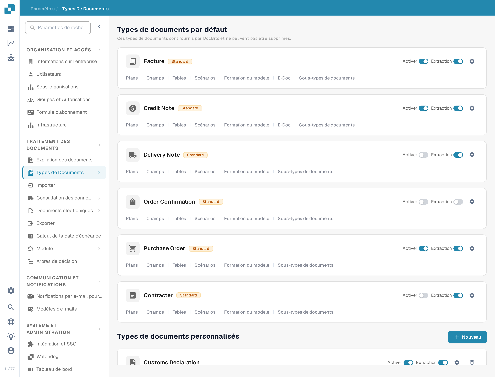
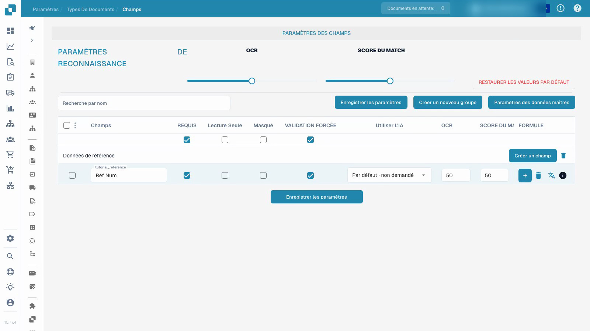

# Types de documents

La vidéo montre la configuration des champs dans un type de document de test personnalisé et isolé.


Types de documents


[Regarder avec des sous-titres](https://docbits-videos.fra1.cdn.digitaloceanspaces.com/settings-assistant/document-types-fields-admin/v1/fr.html)

Remarque : Certaines étiquettes de produits natifs peuvent ne pas être traduites. L'enregistrement préserve l'interface utilisateur réelle.

<figure><figcaption>
La page Types de documents. Chaque carte porte les commutateurs Activer et Extraction, l'icône d'engrenage et les liens de configuration décrits ci-dessous.
</figcaption></figure>

## Aperçu

La page Types de documents répertorie tous les types de documents reconnus et traités par DocBits. Elle est divisée en deux sections :

* **Types de documents par défaut** : types préconfigurés fournis par DocBits (Facture, Credit Note, Delivery Note, Order Confirmation, Purchase Order, Contract, ZUGFeRD, etc.). Ils ne peuvent pas être supprimés.
* **Types de documents personnalisés** : types que vous créez pour vos propres besoins métier. Ils peuvent être modifiés et supprimés.

L'interface française n'affiche en français qu'une partie de ces noms. Le type **Contract** apparaît actuellement sous le libellé fautif **Contracter** ; les autres types par défaut gardent leur nom anglais.

## Contrôles sur une carte de type de document

Chaque carte de type de document affiche :

| Contrôle | Description |
|---------|-------------|
| **Activer** | Commutateur qui active ou désactive ce type de document pour le traitement. Voir [Activer ou désactiver un type de document](activation.md). |
| **Extraction** | Commutateur qui sélectionne le mode d'extraction, **Flex** ou **Fix**. Il n'active ni ne désactive l'extraction ; [Activer ou désactiver un type de document](activation.md) explique la différence entre les deux commutateurs. |
| **Engrenage** (icône de réglages) | Ouvre les [paramètres supplémentaires](more-settings/README.md) de ce type de document, page intitulée **Plus De Paramètres**, par exemple les règles de validation personnalisées, les règles de transformation et la détection des doublons. |

## Liens de configuration

Sous les commutateurs Activer et Extraction, chaque carte porte des liens vers les zones de configuration de ce type de document. Un lien n'apparaît que si la fonction correspondante est activée pour le type, si bien qu'une carte peut afficher moins de liens que la liste ci-dessous.

| Lien sur la carte | Ce que vous configurez | Guide |
|------|--------------------|-------|
| **Plans** | L'emplacement des champs sur l'image du document dans la vue de validation. | [Gestionnaire de mise en page](layout-manager/README.md) |
| **Champs** | Les champs de données que DocBits extrait pour ce type de document. | [Champs](fields/README.md) |
| **Tables** | Les colonnes du tableau de lignes. | [Colonnes de tableau](table-columns/README.md) |
| **Règles de validation** | Vos propres règles pour les valeurs qui doivent être correctes avant l'exportation d'un document. | [Règles de validation personnalisées](custom-validation-rules.md) |
| **Règles de transformation** | Les étapes qui corrigent les valeurs après l'extraction et avant la validation. | [Règles de transformation](transformation-rules.md) |
| **Scripts** | Les scripts exécutés pendant le traitement d'un document. | [Scripts](script/README.md) |
| **Formation du modèle** | Les données d'entraînement et le modèle de ce type de document. | [Formation du modèle](model-training/README.md) |
| **E-Doc** | Les normes de documents électroniques telles que XRechnung, ZUGFeRD, EDI et FatturaPA. | [Documents électroniques](edi/README.md) |
| **Sous-types de documents** | Les sous-catégories de ce type de document, par exemple une par modèle de fournisseur. | [Sous-types de documents](document-sub-types.md) |
| **Journaux** | Une entrée par évaluation d'une règle de validation, de transformation ou de sélection de mise en page, avec la trace de la condition. | [Journaux](custom-validation-rules.md#logs) |

Les libellés ci-dessus sont ceux de l'interface française actuelle. Le lien des scripts y porte le libellé **Scénarios**, bien qu'il ouvre l'éditeur de scripts du type de document ; ne cherchez donc pas un lien nommé « Scripts ». Les liens des règles de validation, des règles de transformation et des journaux n'apparaissent que si le module correspondant est activé pour ce type de document.

## Règles de validation personnalisées

Les règles de validation personnalisées sont des règles que **vous** rédigez pour un seul type de document. Elles vérifient des valeurs que les contrôles de champ standard ne peuvent pas couvrir, par exemple un numéro d'identification fiscale de fournisseur exigé uniquement pour les factures allemandes supérieures à 250 EUR, ou une date d'échéance qui ne doit pas être antérieure à la date de facture. Chaque règle a une condition qui décide si elle s'applique, un contrôle qui doit être vrai et une gravité qui décide si une violation bloque le document (Error) ou affiche seulement un message (Warning).

Avant de les utiliser, deux points à connaître :

* Les règles s'activent **par type de document**, pas pour toute l'organisation. Ouvrez l'engrenage de la carte, ouvrez la section des règles de validation personnalisées et activez le bouton. La carte affiche alors un lien vers les règles de validation.
* Tant que le bouton est activé, les contrôles de montants intégrés (montant total = net + taxe, ainsi que les contrôles de montant des lignes) sont remplacés par vos règles. Recréez sous forme de règles les contrôles dont vous dépendez avant de l'activer.

Le lien de la carte ouvre la liste des règles du type de document, où vous créez, activez, modifiez, testez et supprimez des règles.


Pour copier une règle au lieu de la reconstruire, suivez [Dupliquer une règle de validation personnalisée](duplicate-a-custom-validation-rule.md).


[Règles de validation personnalisées](custom-validation-rules.md) décrit tout le déroulement : l'activation, la liste des règles, les trois niveaux (champ d'en-tête, ligne de tableau, tableau entier), les contrôles (Required, Formula, Pattern, Range, Compare fields, Allowed values, List of Values), l'étape de condition [Conditions de règle (Applies when)](rule-conditions-applies-when.md), le test d'une règle sur un document, les [journaux](custom-validation-rules.md#logs) d'exécution, des recettes prêtes à l'emploi et le dépannage.

## Configurer les champs et les informations requises

La vidéo utilise un type de document de test personnalisé, déjà créé dans un cadre séparé. Elle modifie le champ de référence de ce type ; elle ne modifie pas la configuration de facture existante.

Configurez le champ de référence dans un type de test personnalisé isolé, enregistrez son libellé et ses paramètres de révision obligatoire, puis vérifiez-les après un rechargement.

1. Ouvrez le type de document et sélectionnez ses champs.
2. Vérifiez le groupe de champs et le nom technique stable du champ. Une étiquette d'affichage lisible est un paramètre distinct ; la modifier ne crée pas un nouvel ID de champ.
3. Rendez le champ de référence obligatoire tout en le gardant visible et modifiable. Les informations requises doivent être fournies ; le paramètre n'invente pas une valeur manquante ni ne garantit une extraction correcte.
4. Configurez la révision explicite des champs séparément de la valeur requise. La lecture seule, les éléments masqués, les seuils OCR et les seuils Match Score ont leurs propres effets ; ce ne sont pas des commutateurs interchangeables.
5. Enregistrez la configuration, rouvrez-la et vérifiez l'étiquette d'affichage et les indicateurs stockés.

<figure><figcaption>
Champs enregistrés dans un type de document de test isolé.
</figcaption></figure>

Le résultat démontré prouve que la configuration du champ a été enregistrée et rechargée. Il ne constitue pas un entraînement de modèle, une approbation de facture, une exportation ou un test de validation en aval. Avant d'utiliser une configuration en production, testez des documents représentatifs et le flux de travail prévu pour les utilisateurs ordinaires.

## Créer un type de document personnalisé

1. Faites défiler la page jusqu'à la section **Types de documents personnalisés**.
2. Cliquez sur **+ Nouveau**.
3. Saisissez un nom clair pour le nouveau type de document.
4. Complétez les étapes de configuration proposées pour le mode d'extraction prévu, les champs, les groupes et les tableaux éventuels.

L'entraînement du modèle et la configuration de l'extraction sont distincts du simple enregistrement d'un indicateur de champ obligatoire.


Voir [Configurer un type de document](../../../setup/document-types/) pour la procédure de configuration détaillée.


## Enregistrement supplémentaire


Types de documents

