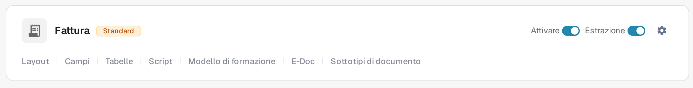
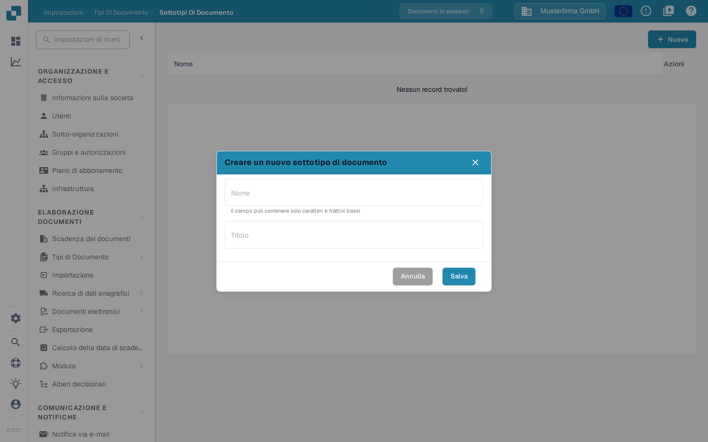

# Creare un nuovo Sottotipo

Creare un sottotipo di documento quando un tipo di documento richiede proprie impostazioni dei campi, un proprio layout di convalida o propri script. È necessario avere accesso a **Impostazioni → Tipi di Documento**.

## 1. Aprire il tipo di documento

Aprire **Impostazioni → Tipi di Documento**. Nella scheda del tipo di documento interessato, selezionare **Sottotipi di documento**. L'esempio seguente usa **Fattura**; scegliere il tipo che corrisponde ai propri documenti. Gli altri link della scheda portano alle impostazioni dell'intero tipo di documento.

<figure><figcaption>
Aprire i sottotipi del tipo di documento che si desidera configurare.
</figcaption></figure>

## 2. Avviare un nuovo sottotipo

In **Sottotipi di documento**, selezionare **+ Nuovo**. I sottotipi esistenti, se presenti, compaiono nell'elenco; il menu **Azioni** (i tre puntini) si riferisce a una riga esistente.

<figure><figcaption>
Nell'organizzazione di prova l'elenco è vuoto. Selezionare + Nuovo per aprire la finestra di creazione.
</figcaption></figure>

## 3. Denominarlo e salvarlo

Inserire un **Nome** con lettere e trattini bassi, quindi inserire un **Titolo** descrittivo. Entrambi i campi sono obbligatori. Lo screenshot mostra la finestra ancora vuota, prima di inserire i valori. Selezionare **Salva** per creare il sottotipo oppure **Annulla** per uscire senza crearlo.

<figure><figcaption>
La finestra viene mostrata vuota. Annulla la chiude senza creare alcun sottotipo.
</figcaption></figure>

Dopo il salvataggio, il nuovo sottotipo compare nell'elenco. Per definirne campi, layout o script, aprire il suo menu **Azioni** e seguire [Configurare sottotipi](configure-subtypes.md). Queste impostazioni vengono effettuate dopo la creazione, non nella finestra **+ Nuovo**.
