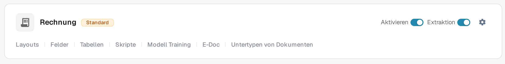
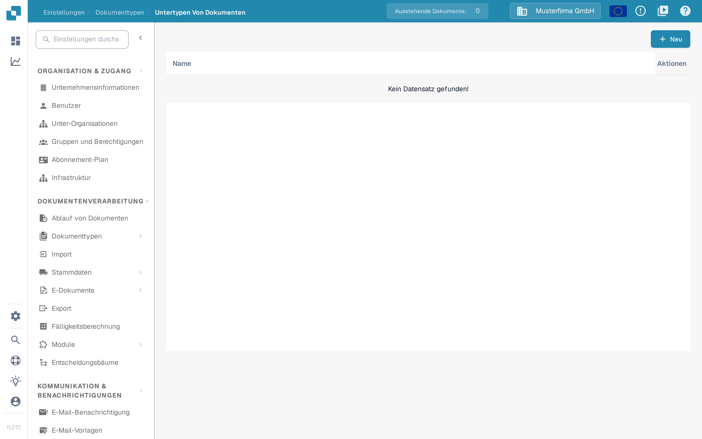
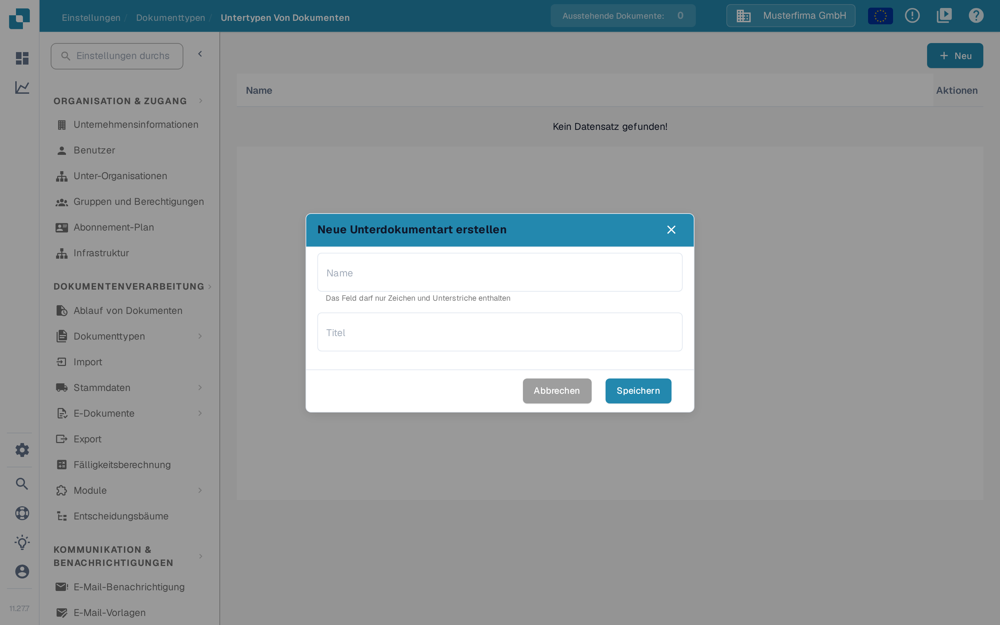

# Erstellen eines neuen Untertyps

Erstellen Sie einen Dokument-Untertyp, wenn eine Art von Dokument eigene Feldeinstellungen, ein eigenes Validierungslayout oder eigene Skripte benötigt. Sie benötigen Zugriff auf **Einstellungen → Dokumenttypen**.

## 1. Dokumenttyp öffnen

Öffnen Sie **Einstellungen → Dokumenttypen**. Wählen Sie in der Karte des betreffenden Dokumenttyps **Untertypen von Dokumenten**. Das folgende Beispiel verwendet **Rechnung**; wählen Sie den Typ, der zu Ihren Dokumenten passt. Andere Links in der Karte führen zu den Einstellungen des gesamten Dokumenttyps.

<figure><figcaption>
Öffnen Sie die Untertypen des Dokumenttyps, den Sie konfigurieren möchten.
</figcaption></figure>

## 2. Neuen Untertyp starten

Wählen Sie auf **Untertypen von Dokumenten** die Schaltfläche **+ Neu**. Vorhandene Untertypen erscheinen, sofern vorhanden, in der Liste; das Drei-Punkte-Menü **Aktionen** ist für eine vorhandene Zeile vorgesehen.

<figure><figcaption>
Die Liste ist in dieser Testorganisation leer. Wählen Sie + Neu, um den Dialog zum Erstellen zu öffnen.
</figcaption></figure>

## 3. Benennen und speichern

Geben Sie im Feld **Name** Buchstaben und Unterstriche ein und tragen Sie anschließend im Feld **Titel** eine aussagekräftige Bezeichnung ein. Beide Felder sind Pflichtfelder. Der Screenshot zeigt den leeren Dialog vor der Eingabe von Werten. Wählen Sie **Speichern**, um den Untertyp zu erstellen, oder **Abbrechen**, um ohne Erstellen zu verlassen.

<figure><figcaption>
Der Dialog vor der Eingabe von Werten. Abbrechen schließt ihn, ohne einen Untertyp zu erstellen.
</figcaption></figure>

Nach dem Speichern erscheint der neue Untertyp in der Liste. Um seine Felder, sein Layout oder seine Skripte festzulegen, öffnen Sie das Menü **Aktionen** und folgen Sie [Untertypen konfigurieren](configure-subtypes.md). Diese Einstellungen werden nach dem Erstellen vorgenommen, nicht im Dialog **+ Neu**.
