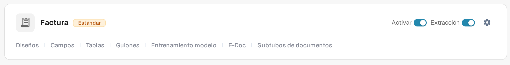

# Crear un nuevo subtipo

Cree un subtipo de documento cuando un tipo de documento necesite sus propios ajustes de campos, su propio diseño de validación o sus propios scripts. Necesita acceso a **Ajustes → Tipos de Documento**.

## 1. Abrir el tipo de documento

Abra **Ajustes → Tipos de Documento**. En la tarjeta del tipo de documento correspondiente, seleccione **Subtubos de documentos**. El ejemplo siguiente utiliza **Factura**; elija el tipo que corresponda a sus documentos. Los demás enlaces de la tarjeta llevan a los ajustes de todo el tipo de documento.

<figure><figcaption>
Abra los subtipos del tipo de documento que desea configurar.
</figcaption></figure>

## 2. Iniciar un nuevo subtipo

En **Subtubos de documentos**, seleccione **+ Nuevo**. Los subtipos existentes, si los hay, aparecen en la lista; el menú **Acciones** de tres puntos corresponde a una fila existente.

<figure><figcaption>
La lista está vacía en esta organización de prueba. Seleccione + Nuevo para abrir el diálogo de creación.
</figcaption></figure>

## 3. Nombrarlo y guardarlo

Introduzca un **Nombre** con letras y guiones bajos y, a continuación, introduzca un **Titulo** descriptivo. Ambos campos son obligatorios. La captura de pantalla muestra el diálogo vacío antes de introducir valores. Seleccione **Guardar** para crear el subtipo, o **Cancelar** para salir sin crearlo.

<figure><figcaption>
El diálogo antes de introducir valores. Cancelar lo cierra sin crear un subtipo.
</figcaption></figure>

Después de guardar, el nuevo subtipo aparece en la lista. Para definir sus campos, su diseño o sus scripts, abra su menú **Acciones** y siga [Configurar subtipos](configure-subtypes.md). Estos ajustes se realizan después de la creación, no en el diálogo **+ Nuevo**.
