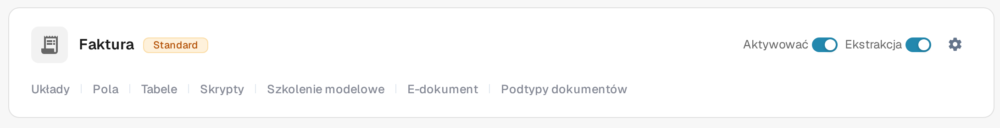

# Tworzenie nowego Podtypu

Utwórz podtyp dokumentu, gdy jeden rodzaj dokumentu potrzebuje własnych ustawień pól, układu walidacji lub skryptów. Potrzebujesz dostępu do **Ustawienia → Typy dokumentów**.

## 1. Otwórz typ dokumentu

Otwórz **Ustawienia → Typy dokumentów**. W karcie odpowiedniego typu dokumentu wybierz **Podtypy dokumentów**. Poniższy przykład używa typu **Faktura**; wybierz typ pasujący do Twoich dokumentów. Inne linki w karcie prowadzą do ustawień całego typu dokumentu.

<figure><figcaption>
Otwórz podtypy typu dokumentu, który chcesz skonfigurować.
</figcaption></figure>

## 2. Rozpocznij nowy podtyp

Na stronie **Podtypy dokumentów** wybierz **+ Nowy**. Istniejące podtypy, jeśli są, pojawiają się na liście; menu **Akcje** (trzy kropki) dotyczy istniejącego wiersza.

<figure><figcaption>
Lista jest pusta w tej organizacji testowej. Wybierz + Nowy, aby otworzyć okno tworzenia.
</figcaption></figure>

## 3. Nazwij go i zapisz

W polu **Nazwa** podaj nazwę złożoną z liter i podkreślników, a następnie wpisz opisowy **Tytuł**. Oba pola są wymagane. Zrzut ekranu pokazuje puste okno przed wprowadzeniem jakichkolwiek wartości. Wybierz **Zapisz**, aby utworzyć podtyp, lub **Anulować**, aby wyjść bez tworzenia go.

<figure><figcaption>
Okno jest pokazane przed wprowadzeniem wartości. Anulować zamyka je bez tworzenia podtypu.
</figcaption></figure>

Po zapisaniu nowy podtyp pojawia się na liście. Aby ustawić jego pola, układ lub skrypty, otwórz jego menu **Akcje** i postępuj zgodnie z instrukcją [Konfiguruj podtypy](configure-subtypes.md). Te ustawienia wykonuje się po utworzeniu, a nie w oknie **+ Nowy**.
