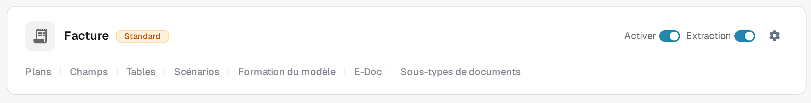
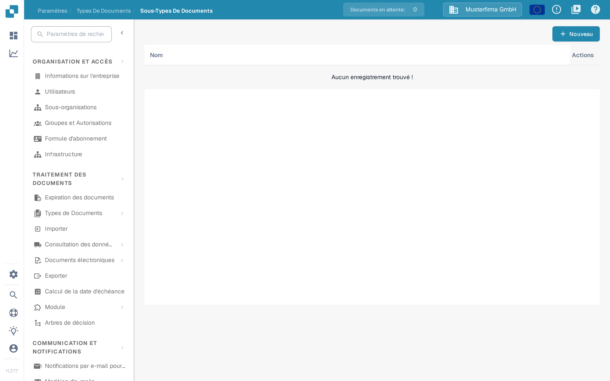

# Créer un nouveau Sous-type

Créez un sous-type de document lorsqu'un type de document a besoin de ses propres paramètres de champs, de sa propre mise en page de validation ou de ses propres scénarios. Vous devez avoir accès à **Paramètres → Types de Documents**.

## 1. Ouvrir le type de document

Ouvrez **Paramètres → Types de Documents**. Dans la carte du type de document concerné, sélectionnez **Sous-types de documents**. L'exemple ci-dessous utilise **Facture** ; choisissez le type qui correspond à vos documents. Les autres liens de la carte mènent aux paramètres du type de document entier.

<figure><figcaption>
Ouvrez les sous-types du type de document que vous souhaitez configurer.
</figcaption></figure>

## 2. Démarrer un nouveau sous-type

Sur la page **Sous-Types De Documents**, sélectionnez **+ Nouveau**. Les sous-types existants, lorsqu'il y en a, apparaissent dans la liste ; le menu **Actions** à trois points concerne une ligne existante.

<figure><figcaption>
La liste est vide dans cette organisation de test. Sélectionnez + Nouveau pour ouvrir la boîte de dialogue de création.
</figcaption></figure>

## 3. Le nommer et l'enregistrer

Saisissez un **Nom** composé de lettres et de traits de soulignement, puis saisissez un **Titre** descriptif. Les deux champs sont obligatoires. La capture montre la boîte de dialogue vide avant toute saisie. Sélectionnez **Enregistrer** pour créer le sous-type, ou **Annuler** pour quitter sans le créer.

<figure><figcaption>
La boîte de dialogue est affichée avant la saisie. Annuler la ferme sans créer de sous-type.
</figcaption></figure>

Après l'enregistrement, le nouveau sous-type apparaît dans la liste. Pour définir ses champs, sa mise en page ou ses scénarios, ouvrez son menu **Actions** et suivez [Configurer les sous-types](configure-subtypes.md). Ces paramètres se définissent après la création, et non dans la boîte de dialogue **+ Nouveau**.
