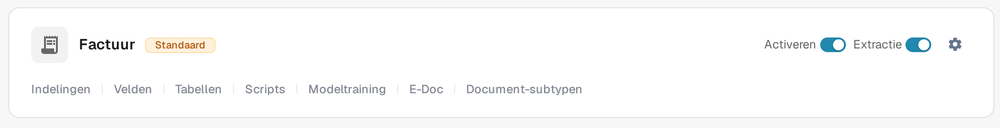
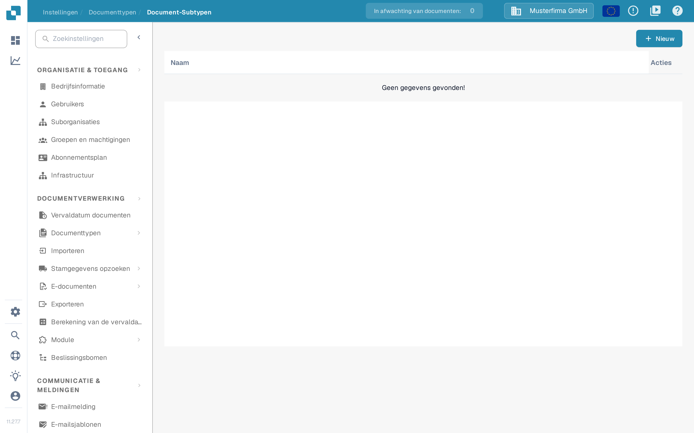

# Een nieuw subtype maken

Maak een documentsubtype aan wanneer documenten van één type eigen veldinstellingen, een eigen validatielay-out of eigen scripts nodig hebben. U hebt toegang nodig tot **Instellingen → Documenttypen**.

## 1. Open het documenttype

Open **Instellingen → Documenttypen**. Kies in de kaart van het betreffende documenttype **Document-subtypen**. Het voorbeeld hieronder gebruikt **Factuur**; kies het type dat bij uw documenten hoort. De andere links in de kaart leiden naar instellingen voor het hele documenttype.

<figure><figcaption>
Open de subtypen van het documenttype dat u wilt configureren.
</figcaption></figure>

## 2. Start een nieuw subtype

Kies op de pagina **Document-Subtypen** de knop **+ Nieuw**. Bestaande subtypen staan in de lijst; het menu met drie puntjes (**Acties**) hoort bij een bestaande rij.

<figure><figcaption>
De lijst is leeg in deze testorganisatie. Kies + Nieuw om het aanmaakvenster te openen.
</figcaption></figure>

## 3. Geef het een naam en sla het op

Voer een **Naam** in met letters en onderstrepingstekens en vul daarna een beschrijvende **Titel** in. Beide velden zijn verplicht. De schermafbeelding toont het lege venster voordat waarden zijn ingevuld. Kies **Opslaan** om het subtype aan te maken, of **Annuleren** om te stoppen zonder aan te maken.

<figure><figcaption>
Het venster wordt getoond voordat waarden zijn ingevuld. Annuleren sluit het zonder een subtype aan te maken.
</figcaption></figure>

Na het opslaan verschijnt het nieuwe subtype in de lijst. Om de velden, de lay-out of de scripts in te stellen, opent u het menu **Acties** en volgt u [Subtypes configureren](configure-subtypes.md). Deze instellingen past u na het aanmaken toe, niet in het venster **+ Nieuw**.
