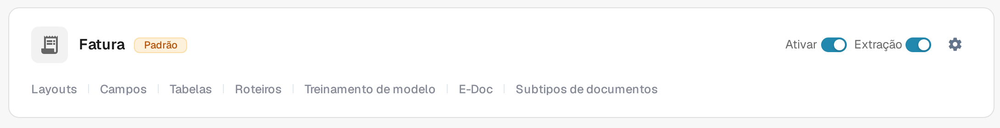
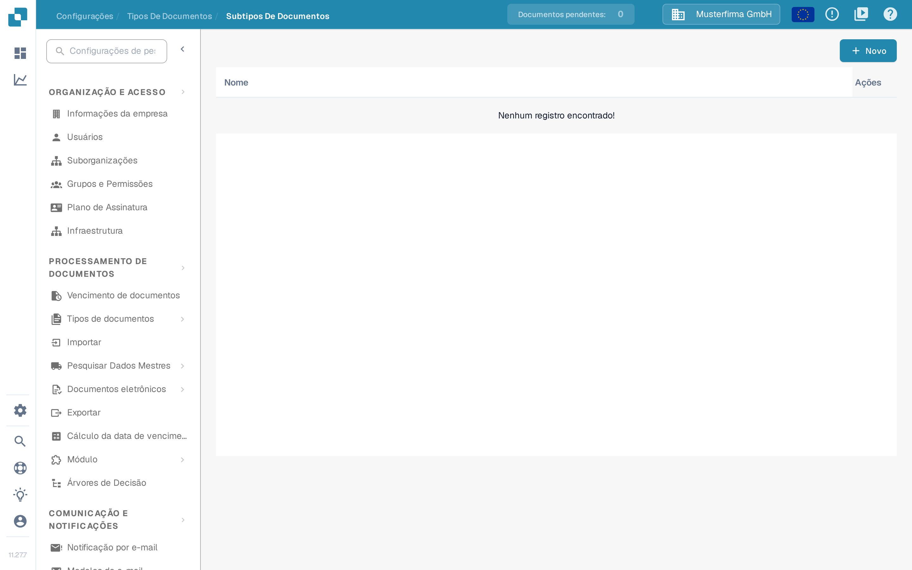

# Criando um novo Subtipo

Crie um subtipo de documento quando um tipo de documento precisar de configurações de campo próprias, de um layout de validação diferente ou de scripts próprios. Você precisa de acesso a **Configurações → Tipos De Documentos**.

## 1. Abra o tipo de documento

Abra **Configurações → Tipos De Documentos**. No cartão do tipo de documento relevante, selecione **Subtipos de documentos**. O exemplo abaixo usa **Fatura**; escolha o tipo que corresponde aos seus documentos. Os outros links do cartão levam às configurações do tipo de documento inteiro.

<figure><figcaption>
Abra os subtipos do tipo de documento que deseja configurar.
</figcaption></figure>

## 2. Inicie um novo subtipo

Em **Subtipos De Documentos**, selecione **+ Novo**. Subtipos existentes, quando houver, aparecem na lista; o menu **Ações** (três pontos) é para uma linha existente.

<figure><figcaption>
A lista está vazia nesta organização de teste. Selecione + Novo para abrir a janela de criação.
</figcaption></figure>

## 3. Dê um nome e salve

Insira um **Nome** usando letras e sublinhados e, em seguida, um **Título** descritivo. Ambos os campos são obrigatórios. A captura de tela mostra a janela vazia antes de inserir qualquer valor. Selecione **Salvar** para criar o subtipo ou **Cancelar** para sair sem criá-lo.

<figure><figcaption>
A janela é mostrada antes de inserir valores. Cancelar fecha-a sem criar um subtipo.
</figcaption></figure>

Depois de salvar, o novo subtipo aparece na lista. Para definir seus campos, layout ou scripts, abra o menu **Ações** dele e siga [Configurar subtipos](configure-subtypes.md). Essas configurações são feitas após a criação, não na janela **+ Novo**.
