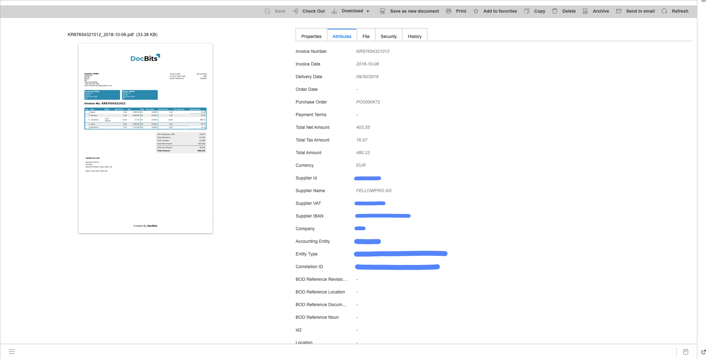
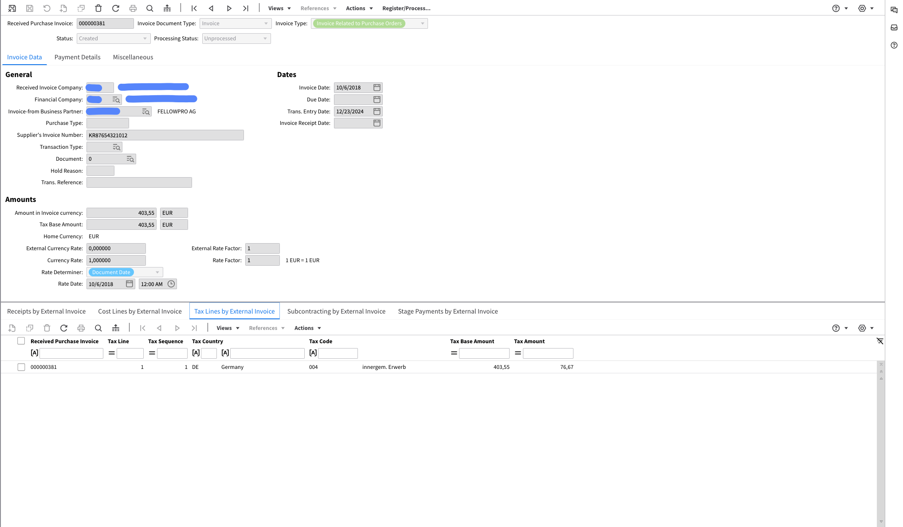
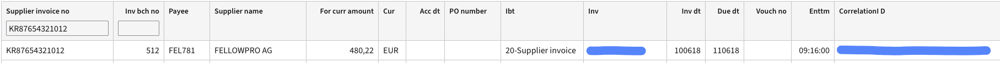
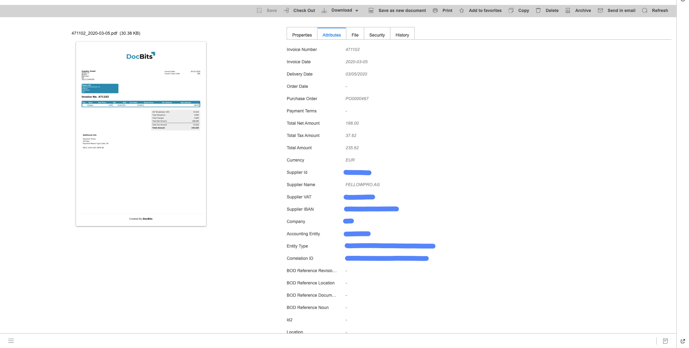
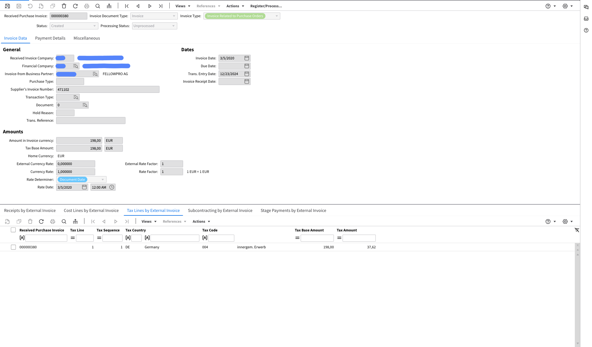
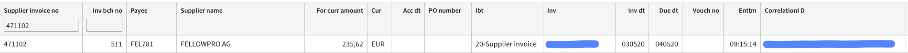

# FacturX

### **Estendido:**

Exportações para o sistema de gerenciamento de documentos (IDM):

<figure><figcaption></figcaption></figure>

Exportado para Infor ERP / SAP:

<figure><figcaption></figcaption></figure>

Exportado para Infor M3:

<figure><figcaption></figcaption></figure>

### **Básico:**

Exportações para o sistema de gerenciamento de documentos (IDM):

<figure><figcaption></figcaption></figure>

Exportado para Infor ERP / SAP:

<figure><figcaption></figcaption></figure>

Exportado para Infor M3:

<figure><figcaption></figcaption></figure>
