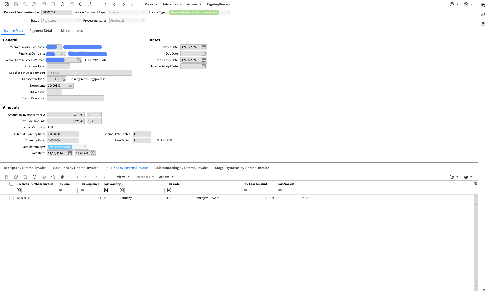

# XRechnung 2.1

导出到文档管理系统（IDM）：

<figure><figcaption></figcaption></figure>

导出到 Infor ERP / SAP：

<figure><figcaption></figcaption></figure>

导出到 Infor M3：

<figure><figcaption></figcaption></figure>
