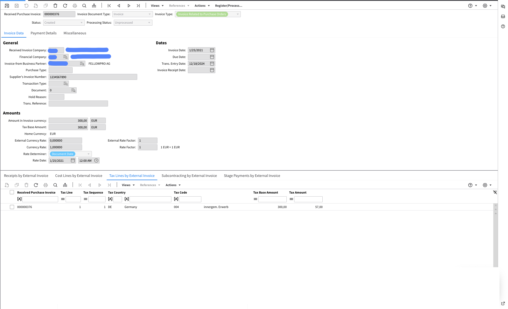

# XRechnung 2.2

Exportaciones al sistema de gestión documental (IDM):

<figure><figcaption></figcaption></figure>

Exportado a Infor ERP / SAP:

<figure><figcaption></figcaption></figure>

Exportado a Infor M3:

<figure><figcaption></figcaption></figure>
