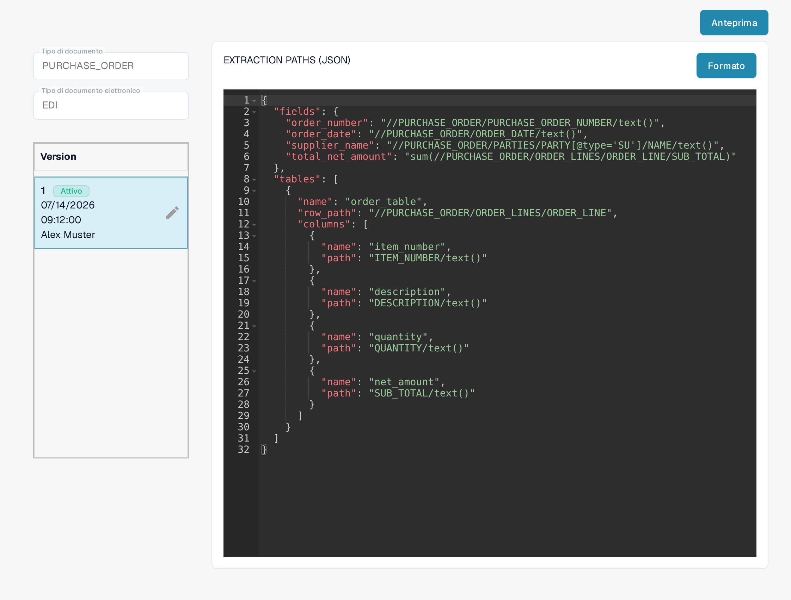

# Guida al File dei Percorsi di Estrazione EDI

La configurazione **Percorsi di Estrazione** indica a DocBits dove trovare i valori della fattura in un documento EDI/XML strutturato. Associa i campi del documento e le colonne delle tabelle a espressioni XPath. Modifica questa configurazione solo se gestisci i formati dei documenti elettronici per la tua organizzazione.

## Aprire i percorsi di estrazione

1. Vai su **Impostazioni → Tipi Di Documento**.
2. Apri **E-Doc** per il tipo di documento che vuoi configurare. Le catture qui sotto usano **PURCHASE_ORDER**.
3. Espandi **EDI** e seleziona **EXTRACTION PATHS**. La riga è contrassegnata come **JSON**.

<figure><figcaption>
Il gruppo EDI contiene voci separate per STRUCTURE DESCRIPTOR, TRANSFORMATION, PREVIEW ed EXTRACTION PATHS; quest'ultima è contrassegnata come JSON.
</figcaption></figure>

Se devi modificare un altro componente EDI, usa la guida corrispondente di [Trasformazione](edi-transformation-file-guide.md) o [Anteprima](edi-preview-file-guide.md).

## Leggere la mappatura

La pagina di dettaglio mostra a sinistra il tipo di documento e il formato elettronico selezionati, sotto le relative versioni e a destra la mappatura JSON. Il badge **Attivo** identifica la versione attualmente in uso. **Formato** ordina il JSON per la lettura; non attiva alcuna versione.

<figure><figcaption>
La mappatura EDI della versione attiva, con l'editor JSON a destra dell'elenco delle versioni.
</figcaption></figure>

Il JSON ha due parti principali:

* `fields` associa un campo DocBits, ad esempio `order_number`, al percorso XPath del valore nell'XML.
* `tables` identifica una riga ripetuta con `row_path` e associa ogni colonna della tabella con `name` e `path`.

Ad esempio, la mappatura visibile include `"order_number": "//PURCHASE_ORDER/PURCHASE_ORDER_NUMBER/text()"`. La tabella `order_table` usa `"row_path": "//PURCHASE_ORDER/ORDER_LINES/ORDER_LINE"`. La struttura del tuo XML e i nomi dei campi DocBits possono essere diversi; copia i percorsi dal tuo documento di esempio invece che da questo esempio.

## Creare e verificare una modifica

La matita accanto alla versione attiva crea una **bozza**. Apporta le modifiche JSON in quella bozza. Verifica i nomi dei campi e i percorsi sul tuo XML prima di attivarla. Il segno di spunta della bozza attiva quella versione; attivando una nuova versione si sostituisce quella attiva in precedenza. Usa l'icona del cestino solo per eliminare una bozza indesiderata.

Fai clic su **Anteprima** per aprire il pannello di prova. Nel campo **Document Id...** inserisci l'ID di un documento EDI caricato e fai clic su **Test**. Confronta i valori restituiti con il documento di origine. La cattura mostra un identificatore di esempio inventato, visibile solo nella parte finale del campo, e la risposta di esempio del sistema; i valori non provengono da un documento reale.

<figure><figcaption>
Pannello di prova con un ID di esempio inventato e una risposta di esempio; non si afferma alcun risultato reale.
</figcaption></figure>

Ti serve l'ID del documento? Apri il documento caricato in DocBits e copia il suo ID. Per il contesto di questi file, consulta [Impostazioni EDI](README.md) e la [guida video EDI](edi-videos.md).

## Regole effettive e attivazione

Se una nota di credito elettronica appare come Invoice, segui la [guida alla diagnosi della classificazione](../credit-note-recognized-as-invoice.md). Descrive l'origine personalizzata o predefinita effettivamente applicata, i codici del tipo, i Percorsi di Estrazione e l'attivazione sicura.

Le viste mostrano una configurazione e una versione esistenti. Le impostazioni variano in base al tipo di documento e al formato. Convalida le modifiche in una bozza prima dell'attivazione.

Nella versione dell'interfaccia mostrata, alcune etichette come **Version** e **Document Id...** restano in inglese. Gli identificatori tecnici degli attributi e il codice di configurazione restano invariati.
