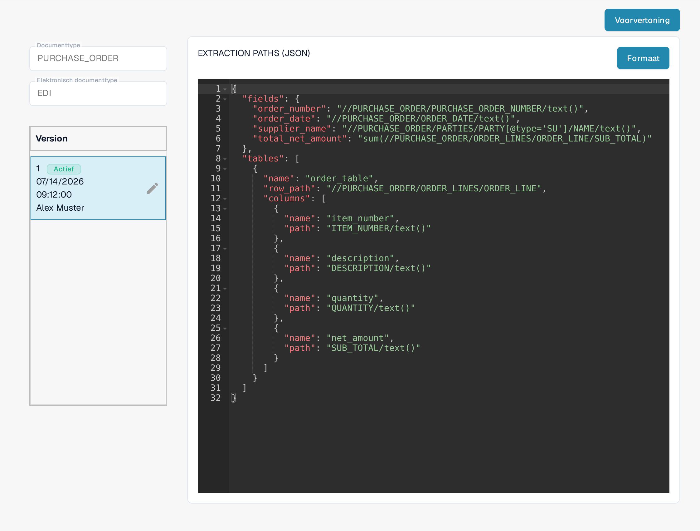
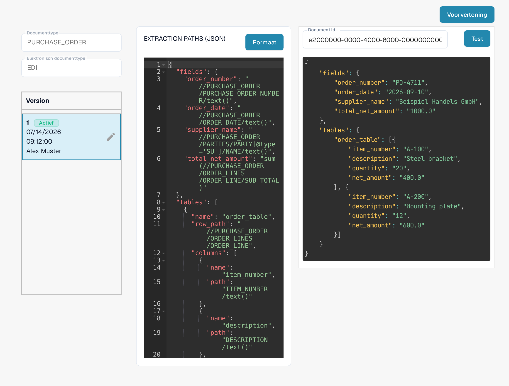

# EDI Extraction Paths Bestandsgids

De configuratie **Extraction Paths** laat DocBits zien waar de waarden van een factuur in een gestructureerd EDI/XML-document staan. Ze koppelt documentvelden en tabelkolommen aan XPath-expressies. Wijzig deze configuratie alleen als u de elektronische documentformaten van uw organisatie beheert.

## De extractiepaden openen

1. Ga naar **Instellingen → Documenttypen**.
2. Open **E-Doc** voor het documenttype dat u wilt configureren. De schermafbeeldingen hieronder gebruiken het type **PURCHASE_ORDER**.
3. Vouw **EDI** uit en selecteer **EXTRACTION PATHS**. De regel heeft het label **JSON**.

<figure><figcaption>
Het EDI-formaat heeft aparte regels voor STRUCTURE DESCRIPTOR, TRANSFORMATION, PREVIEW en EXTRACTION PATHS.
</figcaption></figure>

Met de knop **Nieuw** voegt u een nieuw EDI-onderdeel toe. Het menu met de drie puntjes aan het einde van elke regel bundelt de acties van die regel. Geen van beide wijzigt de actieve versie zolang u geen concept activeert.

Wilt u een ander EDI-onderdeel wijzigen, gebruik dan de bijbehorende gids: [EDI Transformatiebestand Gids](edi-transformation-file-guide.md) of [EDI Voorbeeldbestand Gids](edi-preview-file-guide.md).

## De mapping lezen

De detailpagina toont links het gekozen documenttype en het EDI-formaat, daaronder de versies, en rechts de JSON-mapping. Het label **Actief** markeert de versie die nu in gebruik is. De kop boven de versielijst staat in deze versie van de interface nog in het Engels (**Version**). De knop **Formaat** herschikt de JSON zodat u hem kunt lezen; hij activeert geen versie.

<figure><figcaption>
De actieve EDI-mapping van het type PURCHASE_ORDER, met versie 1 gemarkeerd als Actief en voorbeeldinhoud in de JSON-editor.
</figcaption></figure>

De JSON heeft twee hoofdonderdelen:

* `fields` koppelt een DocBits-veld, bijvoorbeeld `order_number`, aan de XPath van de waarde in de XML.
* `tables` benoemt een herhalende regel met `row_path` en koppelt elke tabelkolom via `name` en `path`.

In het getoonde voorbeeld bevat de mapping van het type PURCHASE_ORDER `"order_number": "//PURCHASE_ORDER/PURCHASE_ORDER_NUMBER/text()"`. De tabel gebruikt `"row_path": "//PURCHASE_ORDER/ORDER_LINES/ORDER_LINE"`. Uw XML-structuur en DocBits-veldnamen kunnen afwijken: kopieer paden uit uw eigen voorbeelddocument in plaats van uit deze opname.

## Een wijziging maken en controleren

Het potlood naast de actieve versie maakt een **concept**. Breng uw JSON-wijzigingen in dat concept aan. Controleer veldnamen en paden op uw XML voordat u activeert. Het vinkje bij het concept activeert die versie; een nieuwe versie activeren vervangt de versie die daarvoor actief was. Gebruik het prullenbakpictogram alleen om een ongewenst concept te verwijderen.

Klik op **Voorvertoning** om het testpaneel te openen. Vul de DocBits **Document Id...** in van een geüpload EDI-document en klik op **Test**. Vergelijk de teruggegeven waarden met het brondocument. In de opname hieronder zijn de ingevulde ID en de getoonde resultaatwaarden verzonnen voorbeeldgegevens; ze komen niet uit een document van uw organisatie. Het label van het invoerveld staat in deze versie van de interface nog in het Engels (**Document Id...**).

<figure><figcaption>
Test de gekozen mapping met een EDI-document-ID voordat u een concept activeert; de ID e2000000-0000-4000-8000-000000000003 en de getoonde waarden zijn verzonnen voorbeeldgegevens.
</figcaption></figure>

Hebt u de document-ID nodig? Open het geüploade document in DocBits en kopieer de ID. Voor achtergrond bij deze bestanden zie [EDI-instellingen](README.md) en de [EDI-video’s](edi-videos.md).

## Geldende regels en activering

Als een elektronische creditnota als factuur verschijnt, volg dan de [handleiding voor het oplossen van classificatieproblemen](../credit-note-recognized-as-invoice.md). Die behandelt de effectieve aangepaste of standaardbron, typecodes, Extraction Paths en veilig activeren.

De weergaven tonen een bestaande configuratie en versie. De instellingen verschillen per documenttype en formaat. Valideer wijzigingen in een concept voordat u ze activeert.
