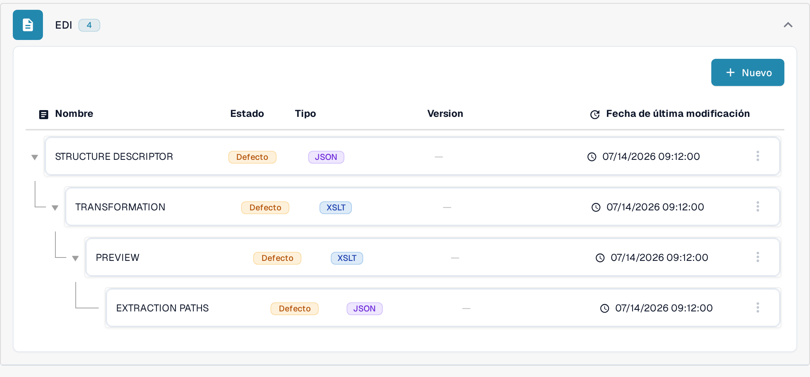
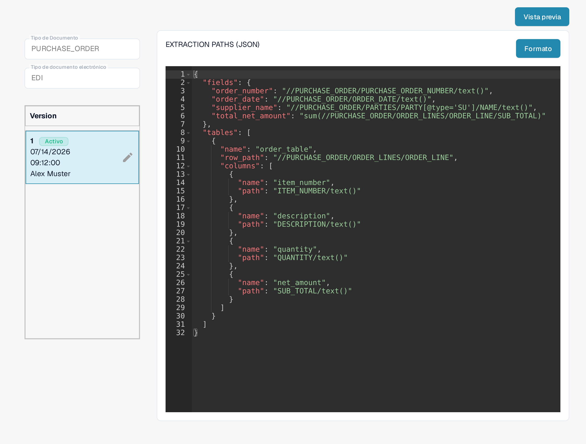

# Guía de Archivos de Rutas de Extracción EDI

La configuración de **Rutas de Extracción** indica a DocBits dónde encontrar los valores de la factura en un documento EDI/XML estructurado. Relaciona campos del documento y columnas de tabla con expresiones XPath. Cambie esta configuración únicamente si gestiona formatos de documentos electrónicos para su organización.

## Abrir las rutas de extracción

1. Vaya a **Ajustes → Tipos De Documento**.
2. Abra **E-Doc** del tipo de documento que desea configurar. Las capturas de abajo usan **PURCHASE_ORDER**.
3. Expanda **EDI** y seleccione **EXTRACTION PATHS**. La fila está marcada como **JSON**.

<figure><figcaption>
EXTRACTION PATHS es la cuarta fila del grupo EDI y está marcada como JSON.
</figcaption></figure>

Si necesita cambiar otro componente EDI, use la guía correspondiente de [Transformación](edi-transformation-file-guide.md) o [Vista previa](edi-preview-file-guide.md).

## Leer el mapeo

La página de detalles muestra a la izquierda el tipo de documento y el formato electrónico seleccionados, debajo sus versiones y a la derecha el mapeo JSON. La insignia **Activo** identifica la versión que se está usando. **Formato** ordena el JSON para poder leerlo; no activa ninguna versión.

<figure><figcaption>
El mapeo EDI de la versión activa, con el editor JSON a la derecha de la lista de versiones.
</figcaption></figure>

El JSON tiene dos partes principales:

* `fields` relaciona un campo de DocBits, por ejemplo `order_number`, con la ruta XPath del valor en el XML.
* `tables` identifica una fila repetida con `row_path` y relaciona cada columna de la tabla con su `name` y `path`.

Por ejemplo, el mapeo visible incluye `"order_number": "//PURCHASE_ORDER/PURCHASE_ORDER_NUMBER/text()"`. La tabla `order_table` usa `"row_path": "//PURCHASE_ORDER/ORDER_LINES/ORDER_LINE"`. La estructura de su XML y los nombres de campo de DocBits pueden ser distintos; copie las rutas de su propio documento de ejemplo en lugar de las de este ejemplo.

## Crear y comprobar un cambio

El lápiz junto a la versión activa crea un **borrador**. Haga sus cambios de JSON en ese borrador. Compruebe los nombres de campo y las rutas con su XML antes de activarlo. La marca de verificación del borrador activa esa versión; al activar una nueva versión se sustituye la que estaba activa. Use el icono de papelera solo para eliminar un borrador que ya no necesita.

Haga clic en **Vista previa** para abrir el panel de prueba. Introduzca en el campo **Document Id...** el ID de un documento EDI ya cargado y haga clic en **Prueba**. Compare los valores devueltos con el documento original. La captura muestra un identificador de ejemplo inventado y la respuesta de ejemplo del sistema; los valores no proceden de un documento real.

<figure><figcaption>
Panel de prueba con un ID de ejemplo inventado (visible solo al final) y una respuesta de ejemplo; no se afirma ningún resultado real.
</figcaption></figure>

¿Necesita el ID del documento? Abra el documento cargado en DocBits y copie su ID. Para conocer el contexto de estos archivos, consulte [Configuración EDI](README.md) y la [guía en vídeo del EDI](edi-videos.md).

## Reglas efectivas y activación

Si una nota de crédito electrónica aparece como Invoice, siga la [guía de resolución de problemas de clasificación](../credit-note-recognized-as-invoice.md). Explica el origen personalizado o predeterminado que se aplica, los códigos de tipo, las Rutas de Extracción y la activación segura.

Las vistas muestran una configuración y una versión existentes. Los ajustes varían según el tipo de documento y el formato. Valide los cambios en un borrador antes de activarlos.

Algunas etiquetas de la interfaz, como **Version**, siguen apareciendo en inglés en la versión actual del producto. Los identificadores técnicos de los atributos y el código de configuración se mantienen sin cambios.
