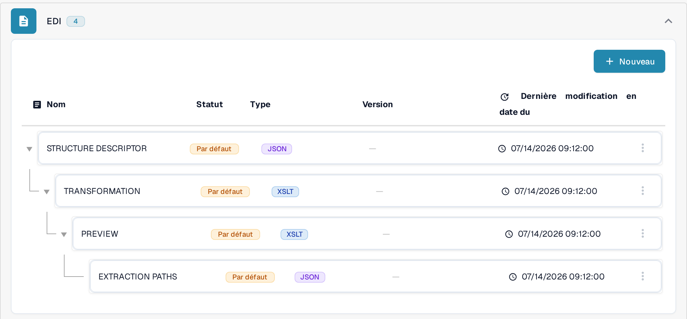

# Guide du fichier des chemins d'extraction EDI

La configuration des **chemins d'extraction** (Extraction Paths) indique à DocBits où trouver les valeurs d'une facture dans un document EDI/XML structuré. Elle associe les champs du document et les colonnes de table à des expressions XPath. Ne modifiez cette configuration que si vous gérez les formats de documents électroniques de votre organisation.

## Ouvrir les chemins d'extraction

1. Allez dans **Paramètres → Types de Documents**.
2. Ouvrez **E-Doc** pour le type de document à configurer. Les captures ci-dessous utilisent le type **PURCHASE_ORDER**.
3. Dépliez **EDI** et sélectionnez **EXTRACTION PATHS**. La ligne porte la mention **JSON**.

<figure><figcaption>
Le format EDI comporte des entrées distinctes pour TRANSFORMATION, PREVIEW et EXTRACTION PATHS.
</figcaption></figure>

Si vous devez modifier un autre composant EDI, utilisez le guide correspondant : [Transformation](edi-transformation-file-guide.md) ou [Aperçu](edi-preview-file-guide.md).

## Lire le mappage

La page de détail affiche à gauche le type de document sélectionné et le format EDI, ses versions en dessous, et le mappage JSON à droite. Le badge **Actif** identifie la version actuellement utilisée. Le bouton **Format** réorganise le JSON pour la lecture ; il n'active aucune version.

<figure><figcaption>
Le mappage EDI actif du type PURCHASE_ORDER, avec sa version 1 marquée Actif et le contenu d'exemple dans l'éditeur JSON.
</figcaption></figure>

Le JSON comporte deux parties principales :

* `fields` associe un champ DocBits, par exemple `order_number`, à l'XPath de sa valeur dans le XML.
* `tables` identifie une ligne répétitive avec `row_path` et associe chaque colonne de la table par son `name` et son `path`.

Dans l'exemple affiché, le mappage du type PURCHASE_ORDER contient `"order_number": "//PURCHASE_ORDER/PURCHASE_ORDER_NUMBER/text()"`. Sa table utilise `"row_path": "//PURCHASE_ORDER/ORDER_LINES/ORDER_LINE"`. La structure de votre XML et les noms de champs DocBits peuvent différer : copiez les chemins depuis votre propre document exemple plutôt que depuis cette capture.

## Créer et vérifier une modification

Le crayon situé à côté de la version active crée un **brouillon**. Effectuez vos modifications JSON dans ce brouillon. Vérifiez les noms de champs et les chemins sur votre XML avant de l'activer. La coche du brouillon active cette version ; activer une nouvelle version remplace celle qui était active auparavant. Utilisez l'icône corbeille uniquement pour supprimer un brouillon indésirable.

Le bouton **Nouveau** de la liste crée un nouvel attribut EDI et le menu à trois points de chaque ligne regroupe les actions de cette ligne. Aucune de ces deux commandes ne modifie la version active tant que vous n'activez pas un brouillon.

Cliquez sur **Aperçu** pour afficher le panneau de test. Saisissez l'**identifiant de document** DocBits d'un document EDI téléversé, puis cliquez sur **Test**. Comparez les valeurs renvoyées avec le document source. Dans la capture ci-dessous, l'identifiant saisi et les valeurs du résultat sont des données d'exemple inventées ; ils ne proviennent pas d'un document de votre organisation. Le libellé du champ de saisie reste affiché en anglais (**Document Id...**) dans cette version de l'interface.

<figure><figcaption>
Testez le mappage sélectionné avec un identifiant de document EDI avant d'activer un brouillon ; l'identifiant e2000000-0000-4000-8000-000000000003 et les valeurs affichées sont des données d'exemple inventées.
</figcaption></figure>

Besoin de l'identifiant du document ? Ouvrez le document téléversé dans DocBits et copiez son identifiant. Pour le contexte de ces fichiers, consultez [Paramètres EDI](README.md) et les [Vidéos EDI](edi-videos.md).

## Règles effectives et activation

Si un avoir électronique apparaît comme une facture, suivez le [guide de diagnostic de la classification](../credit-note-recognized-as-invoice.md). Il couvre la source personnalisée ou par défaut effectivement utilisée, les codes de type, les chemins d'extraction et une activation sûre.

Les vues montrent une configuration et une version existantes. Les paramètres varient selon le type de document et le format. Validez les modifications dans un brouillon avant de les activer.
