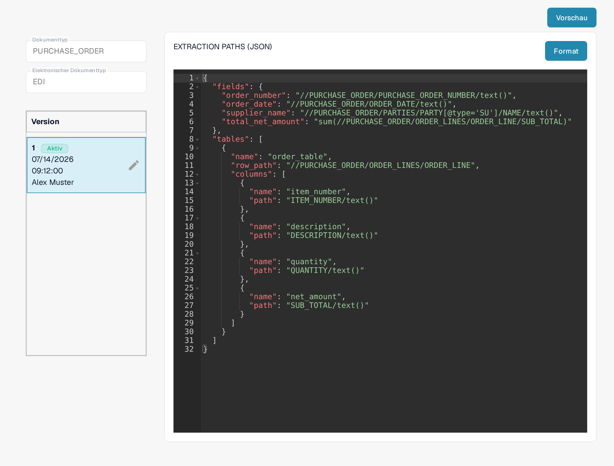

# EDI Extraktionspfad-Datei-Leitfaden

Die Konfiguration der **Extraktionspfade** legt fest, wo DocBits Werte in einem strukturierten EDI-/XML-Dokument findet. Sie ordnet Dokumentfelder und Tabellenspalten XPath-Ausdrücken zu. Ändern Sie diese Konfiguration nur, wenn Sie elektronische Dokumentformate für Ihre Organisation pflegen.

## Extraktionspfade öffnen

1. Gehen Sie zu **Einstellungen → Dokumenttypen**.
2. Öffnen Sie **E-Doc** für den Dokumenttyp, den Sie einrichten möchten. Die Abbildungen verwenden den Dokumenttyp **PURCHASE_ORDER**.
3. Klappen Sie **EDI** auf und wählen Sie **EXTRACTION PATHS**. Die Zeile trägt den Typ **JSON**.

<figure><figcaption>
In der EDI-Liste hat jede Komponente einen eigenen Eintrag; EXTRACTION PATHS ist mit dem Typ JSON gekennzeichnet.
</figcaption></figure>

Mit **Neu** legen Sie ein neues EDI-Attribut für diesen Dokumenttyp und dieses Format an. Das Symbol mit den drei Punkten rechts in jeder Zeile öffnet das Menü **Aktionen**: Dort können Sie ein Attribut löschen (als Administrator), ein eigenes Attribut bearbeiten oder auf den Standard zurücksetzen und ein Standard-Attribut anpassen.

Wenn Sie eine andere EDI-Komponente ändern möchten, verwenden Sie die passende Anleitung zur [Transformation](edi-transformation-file-guide.md) oder zur [Vorschau](edi-preview-file-guide.md).

## Die Zuordnung lesen

Die Detailseite zeigt links den **Dokumenttyp** und den **Elektronischen Dokumenttyp**, darunter die Versionen, und rechts die JSON-Zuordnung. Das Abzeichen **Aktiv** kennzeichnet die derzeit verwendete Version. **Format** ordnet das JSON zum Lesen; es aktiviert keine Version.

<figure><figcaption>
Aktive EDI-Zuordnung für Bestellungen: links Dokumenttyp, elektronisches Format und Versionen, rechts die JSON-Zuordnung mit ihren XPath-Ausdrücken.
</figcaption></figure>

Das JSON hat zwei Hauptteile:

* `fields` ordnet ein DocBits-Feld wie `order_number` dem XPath des Werts im XML zu.
* `tables` beschreibt eine wiederkehrende Zeile mit `row_path` und ordnet jede Tabellenspalte über `name` und `path` zu.

Die gezeigte Bestellzuordnung enthält zum Beispiel `"order_number": "//PURCHASE_ORDER/PURCHASE_ORDER_NUMBER/text()"`. Ihre Tabelle verwendet `"row_path": "//PURCHASE_ORDER/ORDER_LINES/ORDER_LINE"`. Ihre XML-Struktur und die DocBits-Feldnamen können abweichen; übernehmen Sie die Pfade aus Ihrem eigenen Beispieldokument statt aus diesem Beispiel.

## Eine Änderung anlegen und prüfen

Der Stift neben der aktiven Version erstellt einen **Entwurf**. Nehmen Sie Ihre JSON-Änderungen in diesem Entwurf vor. Prüfen Sie die Feldnamen und Pfade gegen Ihr XML, bevor Sie ihn aktivieren. Das Häkchen des Entwurfs aktiviert diese Version; eine neu aktivierte Version ersetzt die bisher aktive. Das Papierkorb-Symbol erscheint, sobald mehr als eine Version vorhanden ist; löschen Sie damit nur einen unerwünschten Entwurf.

Klicken Sie auf **Vorschau**, um den Testbereich zu öffnen. Geben Sie im Feld **Document Id...** die DocBits-Dokument-ID eines hochgeladenen EDI-Dokuments ein und klicken Sie auf **Test**. Vergleichen Sie die zurückgegebenen Werte mit dem Quelldokument. Die Abbildung zeigt den Testbereich mit einer erfundenen Beispiel-ID und einem Beispielergebnis; alle gezeigten Werte sind erfundene Beispieldaten.

<figure><figcaption>
Testen Sie die Zuordnung mit der Dokument-ID eines hochgeladenen EDI-Dokuments; die eingegebene ID und die gezeigten Ergebnisswerte sind erfundene Beispieldaten.
</figcaption></figure>

Benötigen Sie die Dokument-ID? Öffnen Sie das hochgeladene Dokument in DocBits und kopieren Sie seine ID. Hintergrund zu diesen Dateien finden Sie unter [EDI-Einstellungen](README.md) und in der [EDI-Videoanleitung](edi-videos.md).

## Verwendete Regeln und Aktivierung

Wenn eine elektronische Gutschrift als Invoice erscheint, folgen Sie der [Anleitung zur Fehlerbehebung bei der Klassifizierung](../credit-note-recognized-as-invoice.md). Sie erläutert die verwendete angepasste oder standardmäßige Quelle, die Typcodes, Extraction Paths und die sichere Aktivierung.

Die Ansichten zeigen eine vorhandene Konfiguration und Version. Die Einstellungen unterscheiden sich je nach Dokumenttyp und Format. Prüfen Sie Änderungen in einem Entwurf vor der Aktivierung.
