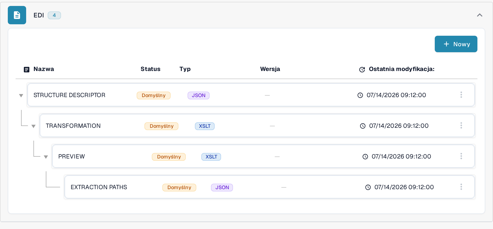
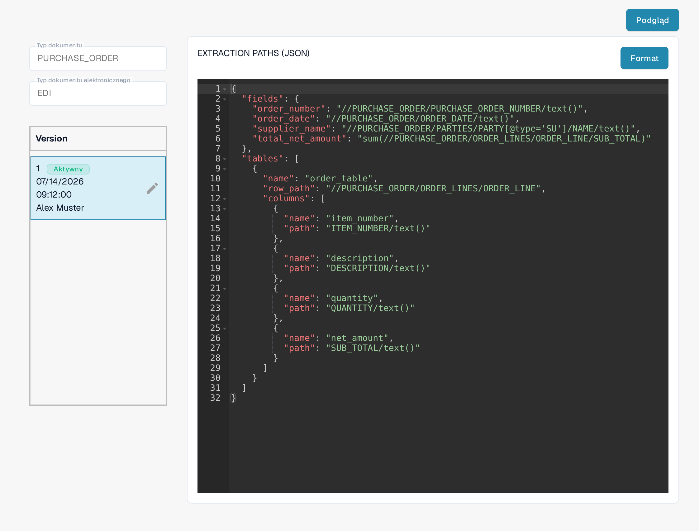
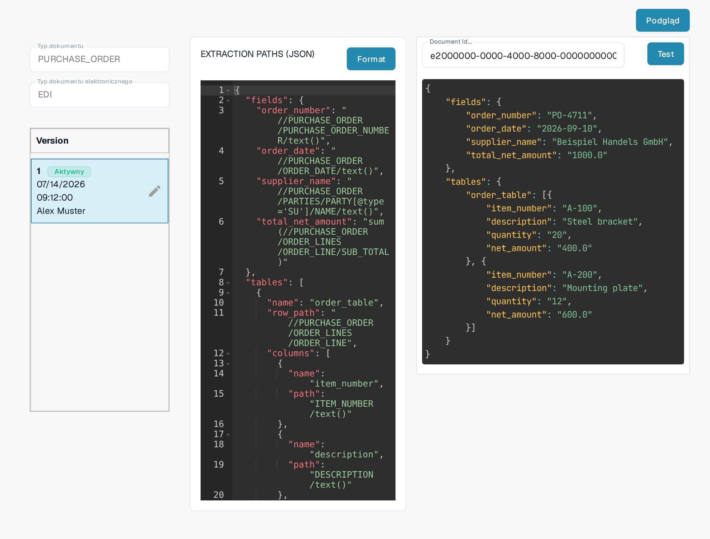

# Przewodnik po pliku ścieżek ekstrakcji EDI

Konfiguracja **Ścieżki ekstrakcji** wskazuje DocBits, gdzie w strukturyzowanym dokumencie EDI/XML znajdują się wartości pól dokumentu. Przypisuje pola dokumentu i kolumny tabel do wyrażeń XPath. Zmieniaj tę konfigurację tylko wtedy, gdy zarządzasz formatami dokumentów elektronicznych w swojej organizacji.

## Otwieranie ścieżek ekstrakcji

1. Przejdź do **Ustawienia → Typy Dokumentów**.
2. Otwórz **E-Doc** dla typu dokumentu, który chcesz skonfigurować. Zrzuty ekranu poniżej pokazują typ **PURCHASE_ORDER**.
3. Rozwiń **EDI** i wybierz **EXTRACTION PATHS**. Wiersz jest oznaczony jako **JSON**.

<figure><figcaption>
Grupa EDI zawiera osobne pozycje STRUCTURE DESCRIPTOR, TRANSFORMATION, PREVIEW i EXTRACTION PATHS; ostatnia z nich jest oznaczona jako JSON.
</figcaption></figure>

Jeśli musisz zmienić inny składnik EDI, skorzystaj z odpowiedniego przewodnika: [Transformacja](edi-transformation-file-guide.md) lub [Podgląd](edi-preview-file-guide.md).

## Odczytywanie mapowania

Strona szczegółów pokazuje po lewej wybrany typ dokumentu i format elektroniczny, pod nim jego wersje, a po prawej mapowanie JSON. Znacznik **Aktywny** wskazuje wersję używaną obecnie. **Format** porządkuje JSON do czytania; nie aktywuje żadnej wersji.

<figure><figcaption>
Mapowanie EDI aktywnej wersji, z edytorem JSON po prawej stronie listy wersji.
</figcaption></figure>

JSON ma dwie główne części:

* `fields` przypisuje pole DocBits, na przykład `order_number`, do ścieżki XPath wartości w XML.
* `tables` identyfikuje powtarzający się wiersz przez `row_path` i przypisuje każdą kolumnę tabeli przez `name` oraz `path`.

Na przykład widoczne mapowanie zawiera `"order_number": "//PURCHASE_ORDER/PURCHASE_ORDER_NUMBER/text()"`. Tabela `order_table` używa `"row_path": "//PURCHASE_ORDER/ORDER_LINES/ORDER_LINE"`. Struktura Twojego XML i nazwy pól DocBits mogą się różnić; kopiuj ścieżki z własnego dokumentu przykładowego, a nie z tego przykładu.

## Tworzenie i sprawdzanie zmiany

Ołówek obok aktywnej wersji tworzy **wersję roboczą**. Wprowadź zmiany JSON w tej wersji roboczej. Przed aktywacją sprawdź nazwy pól i ścieżki na własnym pliku XML. Znacznik wyboru wersji roboczej aktywuje tę wersję; aktywowanie nowej wersji zastępuje poprzednio aktywną. Ikony kosza używaj tylko do usunięcia niepotrzebnej wersji roboczej.

Kliknij **Podgląd**, aby otworzyć panel testowy. W polu **Document Id...** wpisz **ID dokumentu** DocBits przesłanego dokumentu EDI i kliknij **Test**. Porównaj zwrócone wartości z dokumentem źródłowym. Zrzut ekranu pokazuje wymyślony przykładowy identyfikator oraz przykładową odpowiedź systemu; te wartości nie pochodzą z rzeczywistego dokumentu.

<figure><figcaption>
Panel testowy z wymyślonym przykładowym ID i przykładową odpowiedzią; nie twierdzimy, że to wynik rzeczywistego dokumentu.
</figcaption></figure>

Potrzebujesz ID dokumentu? Otwórz przesłany dokument w DocBits i skopiuj jego ID. Informacje o tych plikach znajdziesz w [Ustawienia EDI](README.md) i [przewodniku wideo EDI](edi-videos.md).

Ten przewodnik opisuje zmianę istniejącej pozycji; przycisk **Nowy** na górze listy oraz menu z trzema kropkami przy wierszu nie są do tego potrzebne.

## Obowiązujące reguły i aktywacja

Jeśli elektroniczna nota kredytowa jest wyświetlana jako Invoice, skorzystaj z [przewodnika rozwiązywania problemów z klasyfikacją](../credit-note-recognized-as-invoice.md). Opisuje on faktycznie używane źródło niestandardowe lub domyślne, kody typów, ścieżki ekstrakcji i bezpieczną aktywację.

Widoki przedstawiają istniejącą konfigurację i wersję. Ustawienia różnią się w zależności od typu dokumentu i formatu. Zmiany sprawdź w wersji roboczej przed aktywacją.

W pokazanej wersji interfejsu niektóre etykiety, takie jak **Version** i **Document Id...**, pozostają w języku angielskim. Techniczne identyfikatory atrybutów i kod konfiguracji pozostają niezmienione.
